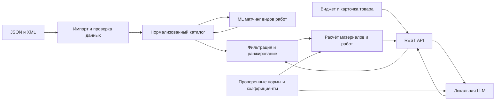

# План решения хакатона RepairCalc

План составлен 20 октября 2026 года по семи исходным файлам в этой папке. Это план будущей реализации: приложения, моделей и измеренных метрик пока нет. Предлагаемая последовательность рассчитана на MVP; упомянутые в DOCX 24–48 часов — ориентир документа, а не подтверждённый дедлайн команды.

## 1. Результат, который нужно показать

Работающий локально микросервис с REST/JSON API и демонстрационным виджетом:

1. Общий расчёт: дом/квартира/студия + косметический/капитальный/дизайнерский ремонт + параметры помещений → материалы для пола, стен, обоев, электрики, стоимость материалов и отдельно ориентировочная стоимость работ.
2. Подбор под помещение: санузел/кухня/детская/балкон, влажность и нагрузки → подходящие материалы и объяснение ограничений.
3. Карточка товара: размеры и условия → потребность, запас, целое число упаковок, сумма покупки и остаток.
4. Новый товар: автоматическое назначение нескольких видов работ без ручного проставления всех соответствий.
5. Воспроизводимая оценка: micro-F1 ≥ 0,8 на согласованном тестовом наборе, дополнительно macro-F1 и качество по каждому виду работ.
6. Работа в закрытом контуре с локальной LLM; запуск, модельные файлы и данные должны быть подготовлены до отключения внешней сети.

Источники: `tech_description_of_task.md`, `answers_and_links.md`, DOCX кейса. Ответы конкретизируют метрики. В DOCX есть предложения по стеку и расширениям; их не следует автоматически считать обязательными условиями.

## 2. Состояние на момент осмотра

- Исходников приложения, зависимостей, тестов и конфигурации запуска нет. Git-репозиторий не инициализирован; присутствующий служебный каталог `.git` не распознаётся как репозиторий.
- JSON: 88 790 карточек, 2 421 ID категорий; 199 нулевых цен, 7 525 пропущенных единиц продажи, 44 повторных вхождения `cod_good`.
- XML: 61 406 предложений, 3 326 категорий с иерархией, ссылки на изображения и явные единицы части характеристик; дата снимка 2026-10-20 06:48 без часового пояса.
- 56 207 общих кодов между выгрузками. XML `offer/@id` и JSON `id` — разные пространства идентификаторов. 36 общих кодов неоднозначны из-за дублей JSON.
- Нет готовых меток «товар → вид работ», эталонных смет, справочника норм и коэффициентов, тарифов ремонтных работ.
- Цена, наличие и характеристики относятся к снимкам. Свежесть JSON и доступность живого API не подтверждены.
- Видео исследовано по кадрам; устные ответы пока не расшифрованы. Вопросы из чата не превращаем в требования.

Подробные аудиты находятся в `reports/`.

## 3. Рабочее архитектурное решение

Предлагаю один backend с разделёнными модулями и отдельный локальный модельный процесс. Это позволит показать весь цикл без необходимости обслуживать множество сервисов.

Предлагаемый стек: Python/FastAPI для API и импорта, PostgreSQL с JSONB для каталога и происхождения характеристик, локальная модель через Ollama, простой виджет Vue 3, Docker Compose. Конкретную модель и размер выбираем после проверки доступного оборудования и короткого измерения качества/скорости. Поиск по эмбеддингам добавляем в существующее хранилище или локальный индекс по результату baseline; отдельная векторная БД не является стартовой зависимостью.

В исходной PNG предлагается MongoDB, в DOCX — PostgreSQL. Это варианты архитектуры. Для MVP предлагаю одну основную БД. Условия комнаты первоначально передаются структурированными полями; отдельный классификатор комнаты не нужен для выбора из четырёх известных типов.

LLM участвует в автоматическом сопоставлении/извлечении признаков с проверяемым JSON-ответом и в объяснениях по утверждённым данным. Арифметику, округление, ограничения применимости и итоговую цену выполняет код. Полезно заранее рассчитывать метки каталога, чтобы не вызывать LLM заново для каждого товара в каждой смете.

## 4. Этапы и критерии готовности

### Этап 0. Зафиксировать рамки и доступные ресурсы

Что я сделаю:

- Составлю матрицу «требование → источник → компонент → демонстрация → проверка».
- Уточню внутри команды фактический срок и ресурсы. RTX 3090 24 ГБ и 32 ГБ RAM описаны в DOCX/видеочате; наличие доступа к этому серверу, модели, Docker и файловой системе не подтверждено. Письменные ответы говорят о собственных ресурсах команды.
- Выделю открытые интеграционные вопросы: адрес/авторизация API, лимиты, доступ на защите, регион цен, смысл `result_price`, контракт передачи корзины.
- Проверю установленное локальное окружение и доступные модели без изменения системы. Если потребуется установка или скачивание, это будет отдельное конкретное действие.
- При доступном локальном ASR расшифрую запись, сопоставлю устные ответы с письменными. Пока это не блокирует работу с уже полученными данными.

Готово, когда: обязательный объём, источники данных, доступный режим локального запуска и список неизвестного записаны; проект может продолжать работу на снимках каталога независимо от внешнего API.

### Этап 1. Подготовить каталог и правила данных

Что я сделаю:

- Опишу каноническую модель товара: внутренний ключ, `source`, исходные ID, `cod_good`, категория, название, цена, валюта, единица продажи, фасовка, площадь упаковки, характеристики, дата снимка.
- Напишу потоковый импорт обоих файлов. Сырые значения останутся доступными для аудита, исходные файлы — неизменными.
- Соединю данные по проверенному `cod_good` из JSON и хвосту XML URL; неоднозначные пары отправлю в отчёт, без произвольного выбора первой карточки.
- Сохраню категории обоих источников отдельно. Связь их деревьев буду устанавливать явно: одинаковые названия/числовые ID сами по себе не подтверждают эквивалентность.
- Очищу HTML, нормализую числа с запятой/точкой, диапазоны и единицы, сохраню повторные характеристики и их происхождение.
- Разделю геометрические размеры товара, транспортный вес и массу содержимого. Литры и килограммы не конвертируются без плотности.
- Задам политику цен: источник и единица продажи обязательны, нулевая цена означает необходимость проверки. При появлении живого API его `result_price` применяется только в рамках подтверждённого контракта.
- Измерю покрытие нужными полями отдельно для краски, грунтовки, обоев/клея, плитки/клея/затирки, напольных покрытий и электрики.

Готово, когда: повторный импорт воспроизводит результат; есть отчёт количества/дублей/пропусков, явные единицы и источники; неполные карточки не получают выдуманные параметры.

### Этап 2. Зафиксировать таксономию и независимый эталон

Что я сделаю:

- Задам многометочные виды работ: покраска стен/потолков, оклейка обоев, укладка плитки, укладка напольных покрытий, подготовка оснований, монтаж гипсокартона, электромонтаж. Это стартовое предложение; проверю практическое покрытие кейса и доступных данных.
- Отделю тип материала от вида работ. Например, грунтовка может подходить сразу для нескольких работ; категория магазина не равна целевой метке.
- Добавлю признаки применимости: основание, влажность, внутренние/наружные работы, нагрузка, назначение. Разделю материалы, инструменты и дополнительные товары.
- Подготовлю стартовый эталон порядка 400–600 карточек с ручной проверкой: частые и редкие классы, несколько меток, неоднозначные товары, пропуски и товары вне выбранной области.
- Разделю development/validation/test по семействам и дублям товара, а не случайно по почти одинаковым SKU. Тест зафиксирую до подбора порогов.
- Независимо проверю метки, предложенные моделью. Не буду измерять качество на её же неподтверждённых ответах.
- Зафиксирую способ расчёта micro/macro-F1, состав классов и правила оценки отказа от ответа. Итоговую независимую приёмку нужно согласовать с организаторами.

Готово, когда: есть справочник меток, инструкция разметки и замороженный проверяемый тест. Размер 400–600 — предложение для старта, а не норматив приёмки.

### Этап 3. Сделать движок расчёта и первые эталонные сметы

Что я сделаю:

- Опишу помещение: длина/ширина или площадь с периметром, высота, проёмы, поверхности, влажность, нагрузки и выбранные работы. Площадь пола сама по себе не определяет площадь стен.
- Сделаю независимые расчётные стратегии для покрытий по площади, рулонных обоев, жидких материалов и смесей.
- Для покрытия: потребность = площадь × коэффициент запаса; упаковки = округление вверх от потребности / покрытия упаковки. Покажу фактическую купленную площадь и остаток.
- Для краски: учту норму с её размерностью и числом слоёв. Если исходный расход уже указан на несколько слоёв, не буду умножать его повторно.
- Для смесей: учту основание, толщину слоя и условия применимости нормы. Диапазон расхода не превращается в случайное среднее.
- Для обоев: учту высоту полотна, ширину/длину рулона, раппорт и подгон рисунка; проверю округление по полотнам и рулонам.
- Заведу версионируемый справочник коэффициентов с причиной, областью применения и источником. В ответе будет видно, какие коэффициенты применены.
- Добавлю стоимость работ отдельным справочником тарифов по операциям и единицам; демонстрационные тарифы будут явно помечены. Каталоги товаров этих цен не содержат.
- Для электрики запрошу число точек, состав работ и длины трасс либо покажу явно заданный предварительный сценарий. Точную ведомость кабеля из одной площади комнаты не обещаем.
- Для каждой цены отделю сумму материалов от работ; использую десятичные денежные значения.
- Подготовлю 20–30 проверенных случаев: нормальные расчёты, проёмы, запас, слои, неполная упаковка, нулевая цена, отсутствующая норма, несовместимые единицы.

Готово, когда: количество упаковок и итог совпадают с ручным эталоном, каждая формула объяснима, недостаток данных возвращается как необходимость уточнения. MAE по количеству считается по однородным единицам/типам материалов; для целых упаковок дополнительно проверяется точное совпадение.

### Этап 4. Реализовать и оценить ML матчинг

Что я сделаю:

- Подготовлю простой baseline по тексту и категориям, чтобы получить начальную измеримую точку.
- Проверю локальные эмбеддинги и многометочный классификатор либо ранжирование по описаниям работ. Пороги выберу на validation.
- Подключу локальную LLM для неоднозначных карточек/извлечения признаков в заданную схему. Назначения и числовые атрибуты сохраняются с источником и статусом проверки.
- Применю явные ограничения совместимости до ранжирования: например, неподходящее основание или подтверждённая невлагостойкость исключают материал для соответствующей операции в санузле. Неизвестный признак отличается от отрицательного.
- При недостаточной уверенности верну запрос проверки, сохранив измерение доли автоматической обработки.
- Измерю micro-F1, macro-F1, precision/recall и поддержку каждого класса; отдельно долю отказов и ошибки на новых семействах товаров. Отказы не буду скрыто исключать из общей оценки.
- Проверю релевантность рекомендаций и полноту комплекта по независимым сценариям; F1 классификации не доказывает качество всей сметы.
- Зафиксирую время импорта, классификации, ответа и потребление памяти на фактическом оборудовании.

Готово, когда: воспроизводится целевой micro-F1 ≥ 0,8 на согласованном тесте, показаны ошибки и ограничения, новый товар проходит тот же pipeline. Если цель не достигнута, сначала исправляем данные/таксономию/порог/модель по validation и не меняем тест ради результата.

### Этап 5. Собрать REST API и сквозной сценарий

Предлагаемый контракт, подлежащий реализации:

| Метод и путь | Назначение |
| --- | --- |
| `POST /admin/api/v1/catalog/import` | Импорт и статус обработки каталога |
| `POST /admin/api/v1/product/add` | Новый товар и автоматический матчинг |
| `POST /api/v1/product/{id}/calc` | Потребность и цена в карточке товара |
| `POST /api/v1/estimate` | Смета по объекту, ремонту и помещениям |
| `POST /api/v1/recommendations` | Подбор под работы и ограничения комнаты |
| `GET /health` | Готовность API, каталога и модельного компонента |

В ответ включу версию каталога/правил/модели, входные размеры, формулу, коэффициенты, упаковки, единицы, стоимость материалов и работ, ограничения и объяснение выбора. Импорт/массовый матчинг будут заданиями с состоянием, а не длительным HTTP-запросом. Новые и изменённые товары пересчитываются адресно.

Готово, когда: все три пользовательских сценария работают через API; OpenAPI описывает входы, ошибки и ответы; обновление товара не требует ручного назначения всех меток. Интеграция с реальной корзиной идёт по подтверждённому контракту, до него демонстрируется готовый JSON состава корзины.

### Этап 6. Сделать виджет и демонстрацию

- Соберу общий мастер, рекомендации для комнаты и встроенный калькулятор карточки товара на одном API.
- Покажу редактируемые размеры и коэффициенты, объяснение выбора, альтернативы и пересчёт суммы при замене товара.
- Разделю подтверждённые данные и требующие уточнения параметры. При отсутствии товара или нормы интерфейс предложит конкретное действие.
- Локальная LLM формирует краткое объяснение по правилам и фактам выбранных SKU. Если используем RAG, источники должны быть подготовлены и проверены, а не только названы в архитектуре.
- Измерю время и число действий до состава корзины.

Готово, когда: пользователь проходит три сценария, видит причину выбора и может воспроизвести расчёт.

### Этап 7. Проверить автономный запуск и подготовить защиту

- Подготовлю Docker Compose, пример конфигурации без секретов, инструкции загрузки данных/моделей, лицензионные сведения и запуск одной командой.
- Проверю сквозные сценарии на локальных снимках при отключённой внешней сети и запишу ограничения оборудования.
- Подготовлю отчёт метрик с составом теста и версиями, эталонные расчёты, измеренные задержки и память.
- Отрепетирую показ: влажный санузел; расчёт в карточке; добавление нового товара; метрики и пример ошибки с корректным отказом.
- Покажу бизнес-прокси: долю автоматически обработанных SKU, время подготовки каталога и число действий до корзины. Рост конверсии останется гипотезой без A/B-теста.

Готово, когда: другой участник команды воспроизводит запуск и демонстрацию по README, а показатели подтверждаются сохранёнными результатами.

## 5. Порядок при ограниченном времени

Сначала заморозить правила оценки и подготовить данные. Затем довести одну вертикаль до полного цикла — например, плитка с клеем после проверки фасовки и нормы. После этого расширить расчёты на краску, обои, пол и предварительную электрику, сохранив все обязательные входы общего калькулятора. ML-разметку и UI можно вести параллельно после фиксации схемы данных и API.

Первый контрольный результат: импорт → проверенный товар → расчёт упаковок → JSON сметы с источниками. Второй: многометочный матчинг с независимым тестом и локальной моделью. Третий: все сценарии в виджете и автономная демонстрация.

До работающего полного цикла не расширять проект на CV планов, обучение коэффициентов без исторических данных, сложную персонализацию или дополнительные хранилища. RAG и админку развивать после расчётов и оценки матчинга.

## 6. Ближайший конкретный шаг

Создать каркас проекта и повторяемый импорт каталогов; подготовить матрицу требований, схему канонического товара, стартовую таксономию и отчёт покрытия расчётными атрибутами. Затем выбрать SKU для первого эталонного калькулятора. Это будущая работа: в рамках текущего запроса выполнены осмотр, аудиты и планирование.
