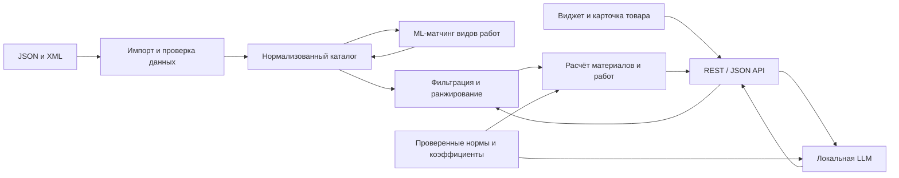

# HotProd_SPB_TECH_RUN

Релизы на стенд, GitHub Environments и список секретов: [docs/RELEASE.md](docs/RELEASE.md).

**RepairCalc — микросервис умных калькуляторов ремонта и стоимости работ для кейса Максидома на хакатоне SPB TECH RUN 2026.**

Цель — по параметрам объекта и помещения подобрать товары из каталога, рассчитать количество материалов, упаковки, стоимость покупки и ориентировочную стоимость работ. ML должен автоматизировать сопоставление товаров с видами работ, а локальная LLM — участвовать в обработке данных и объяснении рекомендаций. Сервис должен работать в закрытом контуре и предоставлять REST/JSON API для встраивания в сайт.

**Текущее состояние:** реализованы frontend на Vue 3 + TypeScript + Sass и Java 21 backend на Spring Boot с PostgreSQL, Flyway, версионированными каталогом/правилами и точными расчётами материалов (BE-02–14). Через API работают витрина `GET /api/v1/products` и калькулятор `POST /api/v1/product/{id}/calc`: подготовлены **12 учебных карточек, 11 рассчитываются, одна явно заблокирована из-за неполных данных**.

Рабочий frontend использует backend API; production-сборка не подменяет ответы локальными фикстурами. Интерфейс включает общий мастер сметы, подбор для комнаты, калькулятор товара, локальное сохранение смет и JSON корзины. Для общего мастера, рекомендаций и распознавания интерьера необходимы соответствующие серверные endpoints; они пока не реализованы. Изолированные фикстуры сохранены для разработки и автоматических тестов. Реальные цены/остатки и интеграция с магазином требуют подключения рабочих данных. Исследование данных и первоначальный план ниже сохранены как контекст дальнейшей разработки.

В карточках комнат на страницах «Подбор для комнаты» и «Общий расчёт» есть лента интерьеров с крупным просмотром и выбором
материалов по изображению для текущих параметров комнаты (включая применённые размеры плана).
В demo это явно помеченные иллюстрации и фикстуры; API-контракт ленты/распознавания
описан в [OpenAPI](docs/openapi.yaml), его backend пока не реализован.

## Быстрый запуск backend

Пошаговый запуск на Windows, Linux и macOS: **[инструкция для команды](backend/docs/TEAM_SETUP.md)**. Подробности реализации, переменные окружения, CLI-импорт и проверки: [backend/README.md](backend/README.md). Используются JDK 21 и отдельная PostgreSQL; глобальный Maven не нужен — версия зафиксирована Maven Wrapper.

Отдельный тест локальной модели: **[Gemma 4 12B через Ollama](backend/docs/OLLAMA_SMOKE.md)**. Python-скрипт работает независимо от Java backend; подключение LLM к серверным расчётам пока не реализовано.

## Быстрый запуск frontend

Требования frontend: **GNU Make**, Node.js **22.12+ LTS** (либо 24 LTS) и npm. Для контейнера — Docker Engine и Compose v2. Локальные frontend-команды одинаковые на Windows, macOS и Linux; Python, Bash и PowerShell-скрипты для них не нужны. Деплой через Ansible требует Linux/macOS/WSL и Python; см. [инструкцию релиза](docs/RELEASE.md).

```bash
make init
make dev
# http://127.0.0.1:5173
```

Полный стек через Docker (frontend, Java, PostgreSQL и Python estimator):

```bash
make init-config
# Задайте DB_PASSWORD в env/secret.env
make up
# http://127.0.0.1:8080
```

Точка управления frontend — корневой `Makefile`; backend использует свой Maven Wrapper. Проверки frontend: `make check`; браузерные тесты: `make e2e`; production-сборка с проверками: `make release`; Docker-образ: `make release-image` (тег задаётся через `IMAGE_TAG` в `env/.env`, без коммитов и публикации).

**Документация реализации:** [пошаговый запуск Docker](docs/deploy.md), [команды, настройки и структура](docs/FRONTEND.md), [OpenAPI](docs/openapi.yaml), [пояснения к контракту API](docs/API_CONTRACT.md), [разбор всех материалов и границы frontend](docs/FRONTEND_SCOPE.md).

`make init-config` создаёт недостающие `env/.env`, `env/secret.env` и локальный Compose override, не заменяя существующие настройки. Общие параметры находятся в `.env`, пароль БД и admin-хеш — в `secret.env`; оба файла исключены из Git. Общие шаблоны заменяют прежний `backend/.env.example`. Правила загрузки, новые переменные и перенос старых секретов: [CONFIG.md](docs/CONFIG.md). `make dependencies` запускает только локальную PostgreSQL; `make backend` и `make estimator` передают оба файла локальным сервисам. Ollama включается отдельно профилем `llm`, классификатор — `batch`; см. [Compose](docs/deploy.md) и [инструкцию Java](backend/docs/TEAM_SETUP.md).

## Навигация

- [Экономное чтение проекта AI-агентами](docs/AI_CONTEXT.md)
- [Сценарии и требования](#сценарии-и-требования)
- [Ресурсы и подготовка локальной папки](#ресурсы-и-подготовка-локальной-папки)
- [Состав репозитория](#состав-репозитория)
- [Что известно о данных](#что-известно-о-данных)
- [Правила расчётов и обработки данных](#правила-расчётов-и-обработки-данных)
- [Предлагаемая архитектура](#предлагаемая-архитектура)
- [API и интеграция](#api-и-интеграция)
- [Оценка качества](#оценка-качества)
- [План реализации](#план-реализации)
- [Открытые вопросы и ограничения](#открытые-вопросы-и-ограничения)

## Сценарии и требования

Основная постановка находится в [tech_description_of_task.md](tech_description_of_task.md), письменные уточнения — в [answers_and_links.md](answers_and_links.md). Развёрнутый драфт кейса содержит варианты реализации и дополнительные идеи; их следует читать вместе с письменными уточнениями.

| Сценарий | Вход | Ожидаемый результат |
| --- | --- | --- |
| Общий калькулятор | Дом / квартира / студия; косметический / капитальный / дизайнерский ремонт; параметры помещений | Смета материалов для пола, стен, обоев и электрики; отдельно ориентировочная стоимость работ |
| Подбор под помещение | Санузел / кухня / детская / балкон; влажность, назначение и нагрузки | Подходящие материалы с учётом ограничений и объяснением выбора |
| Калькулятор в карточке товара | Товар, размеры поверхности и условия работ | Потребность, запас, целое число упаковок, сумма покупки и остаток |
| Автоматический ML-матчинг | Название, описание, категория и характеристики нового товара | Один или несколько видов работ без ручного назначения всех соответствий |

Письменные ответы уточняют условия прототипа:

- Матчинг — **многометочная классификация**: один товар может подходить для нескольких работ. Например, грунтовка используется и при покраске, и при укладке плитки.
- Основная метрика — **micro-F1 ≥ 0,8** на согласованном тестовом наборе; дополнительно нужен macro-F1. Собственная таксономия допустима при обосновании, инструкции разметки и проверяемом эталоне.
- Поправочные коэффициенты можно задавать формулами, правилами и справочниками. Обучать ML для всех коэффициентов не требуется. Пользователь должен видеть значение коэффициента и причину его применения.
- Допустим ограниченный реалистичный тестовый каталог с разными категориями, неоднозначными товарами и товарами для нескольких видов работ. Нужно показать обработку новых товаров.
- Справочники, эталонные данные, модели и вычислительные ресурсы команда готовит самостоятельно.
- Фиксированные нормативы задержки и объёма обработки в письменных ответах не заданы; необходимо измерить время обработки каталога, время матчинга и используемые ресурсы.
- Работа в закрытом контуре на локальной LLM и REST/JSON API входят в постановку задачи.

Критерии оценки: точность расхода и смет, качество матчинга и рекомендаций, работоспособность и масштабируемость API, удобство пути до корзины, снижение ручной работы с каталогом и потенциал развития продукта.

## Ресурсы и подготовка локальной папки

- [Исходные ресурсы на Яндекс Диске](https://disk.yandex.ru/d/in42g0lX86OiYA).
- [Материалы по каталогу на GitVerse](https://gitverse.ru/technohub/hackathon-info-2026/wiki/WIKIHCKTHNNF20-1) — ссылка из письменных ответов.
- [Инвентаризация исходных материалов](INVENTORY.md).

Крупные ресурсы исключены из Git и перечислены в [.gitignore](.gitignore). Для работы с данными скачайте их из ресурсов и разместите в корне клонированного репозитория с исходными именами:

| Локальный файл | Размер | Назначение |
| --- | ---: | --- |
| `products_final.json` | 261,54 MiB | Расширенные карточки товаров и строковые характеристики |
| `export_yandex_spb.xml` | 89,85 MiB | YML-каталог: дерево категорий, предложения, ссылки на изображения и единицы характеристик |
| `2026-10-15 18-16-47.mp4` | 126,42 MiB | Запись встречи по кейсу, около 34 минут |

```bash
git clone https://github.com/artparve/HotProd_SPB_TECH_RUN.git
cd HotProd_SPB_TECH_RUN

# После скачивания ресурсов в эту папку:
ls -lh products_final.json export_yandex_spb.xml '2026-10-15 18-16-47.mp4'
git check-ignore products_final.json export_yandex_spb.xml '2026-10-15 18-16-47.mp4'
```

`git check-ignore` должен вывести все три имени. Для frontend и текущего Java backend крупные исходные ресурсы не нужны. Java backend использует подготовленные учебные данные из `backend/data/`, frontend в деморежиме — собственные фикстуры. Полный потоковый импорт этих выгрузок и загрузка моделей остаются будущими задачами. Работоспособность внешних ссылок и внешнего API в рамках имеющихся аудитов не проверялась.

## Состав репозитория

| Файл | Содержание |
| --- | --- |
| [README.md](README.md) | Сводка проекта, требований, данных, архитектуры и следующих шагов |
| [Запуск backend для команды](backend/docs/TEAM_SETUP.md) | Настройка JDK/PostgreSQL, импорт учебных данных, запуск и проверки на Windows, Linux и macOS |
| [backend/README.md](backend/README.md) | Реализованные Java-компоненты, конфигурация, команды и результаты проверок |
| [INVENTORY.md](INVENTORY.md) | Обзор семи исходных файлов, их назначения и ограничений |
| [PLAN.md](PLAN.md) | Подробный план MVP, зависимости этапов и критерии готовности |
| [tech_description_of_task.md](tech_description_of_task.md) | Краткая постановка кейса Максидома и критерии оценки |
| [answers_and_links.md](answers_and_links.md) | Письменные ответы о коэффициентах, ресурсах, тестовом каталоге, ML и приёмке |
| [Кейс №1: микросервис умных калькуляторов ремонта и стоимости работ](Кейс_№1_микросервис_умных_калькуляторов_ремонта_и_стоимости_работ.docx) | Развёрнутый DOCX-драфт: сценарии, архитектура, описание API каталога, MVP, метрики, демо и оборудование |
| [Драфт решения.png](Драфт%20решения.png) | Исходный эскиз архитектуры: frontend, backend, admin, классификаторы, MongoDB, калькулятор и RAG |
| [reports/json_audit.md](reports/json_audit.md) | Полный аудит JSON: структура, полнота, дубли, категории и примеры проблем |
| [reports/xml_audit.md](reports/xml_audit.md) | Полный аудит XML: категории, единицы, расход, конфликты и сопоставление с JSON |
| [reports/video_audit.md](reports/video_audit.md) | Метод просмотра видео, наблюдения с таймкодами и границы выводов |
| [.gitignore](.gitignore) | Исключения для двух крупных каталогов и видеозаписи |

Аудиты описывают полный потоковый разбор каталогов. Упомянутые в отчётах скрипты и машинные сводки в `/tmp` — вспомогательные результаты исходного осмотра; они не включены в репозиторий и не являются готовым воспроизводимым импортёром.

## Что известно о данных

### Каталоги

| Показатель | JSON | XML / YML |
| --- | --- | --- |
| Товары | 88 790 карточек | 61 406 предложений |
| Категории | 2 421 ID; у товара одна категория, дерева нет | 3 326 категорий с родителями; товары используют 2 268 |
| Характеристики | 782 337 записей, значения строковые, отдельной единицы нет | 547 598 `param`, из них 168 993 с явной `unit` |
| Цены | RUB; 199 нулевых, отрицательных нет | RUB; все положительные |
| Единица продажи | Отсутствует у 7 525 карточек | Единого поля единицы продажи нет |
| Изображения | Полей изображений и абсолютных URL нет | Есть ссылки `picture` |
| Дата и наличие | Дата снимка и остатки отсутствуют | `2026-10-20 06:48` без timezone; все `available=true` относятся к снимку |

Корень JSON — `{"products": [...]}`. Карточки содержат `id`, `cod_good`, `name`, `marketing_description`, `url_key`, `price`, `currency`, `brand`, `collection`, `country`, `categories`, `unit`, `description`, `weight`, `characteristics`. Верхнее поле `weight` пусто у всех товаров; сведения о весе могут встречаться в характеристиках. У 9 439 карточек список характеристик пуст; описания часто содержат HTML.

В JSON `Расход материала` встречается в характеристиках 1 442 товаров. В XML `Расход материала` или `Расход` есть у 1 295 товаров; вместе со `Средний расход` — у 1 309. Эти количества **не означают готовность норм к расчёту**: нужны единицы, условия применения, толщина слоя и число слоёв. Поиск любого слова «расход» захватывает также воду, газ, топливо и другие величины.

Каталоги включают сад, посуду, мебель и другие товары за пределами ремонта. Для MVP предстоит выделить нужные вертикали: плитка и клей, краски и грунтовки, обои, напольные покрытия, электрика.

### Сопоставление источников

- Подтверждённый ключ связи — `cod_good` JSON и числовой хвост URL товара в XML.
- Совпадают **56 207 уникальных кодов**: 91,53% XML и 63,33% уникальных кодов JSON.
- Только XML: **5 199** кодов. Только JSON: **32 539** уникальных кодов / 32 547 карточек.
- В JSON 44 повторяющихся `cod_good`, каждый встречается дважды; 36 таких кодов присутствуют в XML. Без разрешения дублей соединение даёт 56 243 строки вместо 56 207 товаров.
- `offer/@id` XML и `id` JSON принадлежат разным пространствам идентификаторов. Артикул XML также не уникален.
- Совпадение кода не гарантирует согласованность цены, характеристик или даты данных. Нужна явная политика выбора источников и разрешения конфликтов.

### Проблемы качества и недостающие данные

В JSON у 13 497 карточек повторяются названия характеристик; у 8 472 значения одного названия различаются как строки. В XML повторные имена свойств встречаются у 5 114 товаров, а разные сочетания значения и единицы — у 3 983. Часть различий можно устранить нормализацией, часть требует проверки: например, `.8` и `0.8` эквивалентны, а разные нормы расхода могут противоречить друг другу.

В XML найден пример лака с расходом 80–120 г/м² в описании и 50–70 г/м² в `param`, при фасовке в литрах. Такой товар нельзя рассчитывать без разрешения конфликта и данных о плотности.

В предоставленных каталогах нет готовых меток «товар → вид работ», эталонных смет, полного справочника расхода, правил совместимости и тарифов ремонтных работ. Эти данные предстоит подготовить отдельно. Упомянутые в DOCX рейтинги и маржинальность также не подтверждены как доступные поля локальных выгрузок.

### Видеозапись

Запись встречи Zoom «Хакатон 2026 Sber/Maxidom» длится 33:59,957, разрешение 1920×1080, есть аудио. Проверена выборка обзорных и полноразмерных кадров, **аудио не расшифровано**. На просмотренных кадрах видны участники и чат; демонстрации приложения не обнаружено.

На 20:00 видно сообщение о RTX 3090 с 24 ГБ VRAM и 32 ГБ RAM. На 24:00 в чате есть вопросы о сервере, API, авторизации и региональных ценах; сами вопросы не подтверждают наличие доступа или условия интеграции. Подробности — в [обзоре видео](reports/video_audit.md).

## Правила расчётов и обработки данных

Предлагаемые принципы из [плана](PLAN.md), которые предстоит реализовать:

1. Хранить исходные значения, нормализованные значения, единицы и происхождение каждого поля. Повторные характеристики сохранять списком до проверки.
2. Отделять тип товара от вида работ; один материал может иметь несколько рабочих назначений. Неизвестный признак совместимости должен отличаться от отрицательного.
3. Вычислять геометрию, расход, округление упаковок и деньги детерминированным кодом. Использовать LLM для матчинга, извлечения признаков и объяснений по проверенным данным.
4. Для покрытий считать `потребность = площадь × коэффициент запаса`, затем `упаковки = ceil(потребность / покрытие упаковки)`. Показывать купленное количество и остаток.
5. Для краски учитывать размерность нормы и число слоёв, для смесей — толщину и основание, для обоев — полотна, раппорт и подгон. Не умножать на слои повторно, если они уже учтены в норме.
6. Хранить коэффициенты с источником, версией и областью применения. Пример из письменных ответов: 20 м² плитки с запасом 10% → 22 м² до округления по упаковкам; коэффициент зависит от сценария.
7. Не смешивать цену упаковки и цену м², транспортный вес и массу содержимого. Не переводить литры в килограммы без плотности; не выбирать произвольное среднее диапазона расхода.
8. Считать стоимость материалов и работ отдельно; для денег использовать десятичное представление. Нулевая цена и отсутствующая норма требуют проверки или уточнения.
9. Для стен запрашивать геометрию, высоту и проёмы; для электрики — точки и трассы либо явно заданный предварительный сценарий. Одной площади пола недостаточно для точной ведомости.

## Предлагаемая архитектура

Java backend и PostgreSQL уже реализованы для каталога и расчёта одного товара. Следующая схема сохраняет первоначальный план расширения MVP: модуль подбора, ML-матчинг и отдельный локальный модельный процесс пока отсутствуют.



| Компонент | Предложение для MVP |
| --- | --- |
| Backend и импорт | Java 21 / Spring Boot MVC; подготовленный импорт реализован, полный JSON/XML-импорт запланирован |
| Основное хранилище | PostgreSQL с JSONB, исходными и нормализованными атрибутами |
| ML | Текстовый baseline, затем локальные эмбеддинги и многометочный классификатор / ранжирование |
| Локальная LLM | Ollama; выбор модели после проверки оборудования, качества и скорости |
| Интерфейс | Виджет Vue 3 с тремя пользовательскими сценариями |
| Развёртывание | Docker Compose, заранее подготовленные данные и модели для автономной работы |

Стек текущего backend зафиксирован: Java 21, Spring Boot и PostgreSQL. ML/LLM-часть схемы — предложение для дальнейшего развития. В PNG используется MongoDB, в DOCX предлагаются PostgreSQL, отдельное векторное хранилище и варианты ML-инструментов. Необходимость векторного индекса и выбор модели предстоит определить после baseline.

RAG-пояснения, мини-админка и извлечение параметров из свободного текста — дополнительные возможности. CV по планам помещений, обучение коэффициентов без исторических данных и продакшн-нагрузка не входят в начальный MVP.

## API и интеграция

### API RepairCalc: реализованное и следующие этапы

Текущий Java API работает на подготовленных учебных данных. По `/admin` доступны вход администратора, создание и редактирование черновиков, список и история версий. Настройка и границы поставки описаны в [документе реализации](docs/admin-catalog-implementation.md); свидетельства проверок — в [отчёте](reports/admin-catalog/2026-10-30/README.md). Очередь классификации, проверка меток и атомарная публикация реализованы в [продолжении](docs/admin-workflow.md); общая смета и рекомендации остаются планом:

| Метод и путь | Назначение | Состояние |
| --- | --- | --- |
| `GET /api/v1/products` | Опубликованная витрина (исходно 12 учебных карточек, пополняется админкой) | Реализовано |
| `POST /api/v1/product/{id}/calc` | Потребность, упаковки и стоимость одного товара без работ | Реализовано: 11 карточек; неполная карточка возвращает 422 |
| `GET /actuator/health/liveness` | Работа Java-процесса | Реализовано |
| `GET /actuator/health/readiness` | Доступность БД и совместимых каталога/правил | Реализовано |
| `POST /api/v1/estimate` | Смета по объекту, виду ремонта и помещениям | Запланировано |
| `POST /api/v1/recommendations` | Подбор с учётом работ и ограничений комнаты | Запланировано |
| `POST /admin/api/v1/catalog/import` | Полный импорт и статус обработки каталога | Запланировано; подготовленные данные импортируются локальной CLI-командой |
| `GET/POST /api/v1/admin/products`, `GET/PUT /api/v1/admin/products/{id}` | Список, создание и редактирование черновиков | Реализовано: сессия, CSRF, If-Match, история и аудит |
| `GET /api/v1/admin/products/{id}/history` | Неизменяемые версии карточки | Реализовано |
| `POST /api/v1/admin/products/{id}/classifications`, `/reviews`, `/publish` | Очередь модели, решения человека и публикация с совместимыми правилами | Реализовано для проверенной учебной вертикали; [границы](docs/admin-workflow.md) |

Ответ калькулятора содержит одну строку, версии каталога/правил, `model=not-used`, формулу, единицы, упаковки, остаток и стоимость материалов; стоимость работ равна нулю. Для будущей общей сметы нужны отдельные работы, комплектование и подбор. Массовый импорт и матчинг предполагаются фоновыми заданиями со статусом. До подтверждения интеграции с корзиной демонстрируется JSON её состава.

### Внешний API каталога из DOCX

В документе описаны следующие маршруты; это сведения из предоставленного файла, а не результаты проверки стенда:

| Метод и путь | Описанное назначение |
| --- | --- |
| `GET /api/catalog/categories/tree` | Дерево категорий |
| `GET /api/catalog/categories` | Список категорий |
| `GET /api/catalog/products` | Пагинированный список товаров |
| `GET /api/catalog/products/{id}` | Полная карточка по ID Bagisto |
| `GET /api/regions` | Справочник регионов |

Список товаров нужно читать по страницам до `meta.last_page`; полные `description`, `weight` и `characteristics` запрашиваются через карточку. `id`, `sku` и `cod_good` имеют разный смысл. `properties` списка описывает фильтры, а `characteristics` карточки — свойства конкретного товара.

В документе есть поля `result_price`, `quantity_in_package`, `package_area`, `stocks` и другие, которых может не быть в локальном JSON. Иллюстративные ответы DOCX не доказывают их фактическое заполнение. Итоговую цену стенда, региональный контекст, авторизацию, лимиты и доступ на защите нужно подтвердить; нельзя самостоятельно выбирать минимальную цену из разных ценовых полей или предполагать поддержку query-параметра региона.

## Оценка качества

| Область | Что требуется / предлагается измерять |
| --- | --- |
| ML-матчинг | micro-F1 ≥ 0,8 на согласованном эталоне; macro-F1, precision/recall и поддержка каждого класса |
| Новые и неоднозначные товары | Качество на новых семействах, доля отказов / запросов проверки, доля автоматической обработки |
| Расчёты | Сравнение с ручными эталонами, MAE по однородным единицам и точное совпадение числа упаковок |
| Рекомендации | Совместимость материалов с помещением, релевантность и полнота комплекта по независимым сценариям |
| Производительность | Время импорта, классификации и ответа; память и фактическое оборудование |
| UX и бизнес-прокси | Время и число действий до корзины, доля автоматически обработанных SKU, трудозатраты на каталог |

План предлагает начать с 400–600 вручную проверенных карточек и 20–30 эталонных расчётов. Это рабочие ориентиры, а не установленные организаторами размеры приёмки. Разделение development / validation / test должно учитывать дубли и семейства товаров; тест фиксируется до настройки порогов. Непроверенные ответы модели не могут служить собственным эталоном.

Методика независимой приёмки ещё требует согласования. Высокий F1 на искусственно упрощённой таксономии не доказывает практическое качество. Рост конверсии и среднего чека — гипотезы продукта, пока без A/B-проверки.

## План реализации

Первоначальный общий план MVP и критерии его этапов находятся в [PLAN.md](PLAN.md). Он включает ещё не реализованные ML, подбор, общую смету и полный импорт. Текущее состояние Java backend BE-02–14 и результаты проверок описаны в [backend/README.md](backend/README.md).

| Этап | Результат |
| --- | --- |
| 0. Рамки и ресурсы | Матрица требований, проверенные условия локального запуска и список неизвестного по интеграциям |
| 1. Каталог | Повторяемый потоковый импорт, каноническая карточка, нормализация и политика конфликтов / дублей |
| 2. Таксономия и эталон | Справочник видов работ, инструкция разметки и независимый зафиксированный тест |
| 3. Движок расчёта | Формулы, справочники коэффициентов и тарифов, первые проверенные сметы |
| 4. ML-матчинг | Baseline, локальные модели, измеренные метрики и обработка неопределённости |
| 5. API | Сквозные сценарии, OpenAPI, фоновые задания и обработка новых товаров |
| 6. Виджет | Общий мастер, подбор под помещение, калькулятор карточки, объяснения и альтернативы |
| 7. Автономная демонстрация | Воспроизводимый запуск, работа без внешней сети, отчёт метрик и сценарий защиты |

**Следующие шаги:** серверные рекомендации и общая смета с комплектованием материалов, затем полный потоковый импорт JSON/XML и расширение проверенных данных. Готовые каркас, подготовленный импорт, таксономия и калькулятор товара не заменяют будущую проверку реальных SKU, норм и ML-матчинга.

При ограниченном времени план предлагает сначала довести одну вертикаль до полного цикла — например, плитку с клеем после проверки фасовки и норм. Контрольная цепочка: импорт → проверенный товар → упаковки → JSON сметы с источниками. Затем добавить измеримый многометочный матчинг, расширить расчёты на остальные обязательные направления и собрать интерфейс.

Предложенный показ на защите: квартира с капитальным ремонтом и влажный санузел 6 м² → подбор и смета; расчёт конкретного товара в карточке; добавление нового товара с автоматическим матчингом; метрики и пример корректного запроса уточнения. Для расчёта стен и отдельных работ сценарий должен включать дополнительные размеры и условия.

## Открытые вопросы и ограничения

- **Инфраструктура.** DOCX упоминает Ollama и сервер Intel Core i7-14700K, RTX 3090 24 ГБ, 32 ГБ RAM, NVMe 1 ТБ; видеочат подтверждает упоминание GPU/RAM. Письменные ответы требуют собственные ресурсы команды. Фактический доступ к серверу, Docker, своим моделям и файловой системе не подтверждён.
- **Данные и API.** Нужно подтвердить адрес стенда, авторизацию, лимиты, доступность на защите, региональные цены, смысл `result_price` и контракт корзины. Локальных снимков достаточно для начала прототипа, но они не подтверждают текущие цены и наличие.
- **Эталоны и нормы.** Нужно создать разметку видов работ, сметы, правила совместимости, проверенные нормы с единицами и отдельный справочник тарифов работ.
- **Видео.** Устные ответы остаются неисследованными до расшифровки аудио; вопросы из чата не являются ответами организаторов.
- **Сроки.** Указанные в DOCX 24–48 часов — ориентир драфта MVP; фактический дедлайн команды в материалах не подтверждён.
- **Исторические формулировки.** В разделе состояния `PLAN.md` сохранено наблюдение до инициализации Git. Сейчас репозиторий инициализирован, а крупные исходники хранятся отдельно и игнорируются Git.
