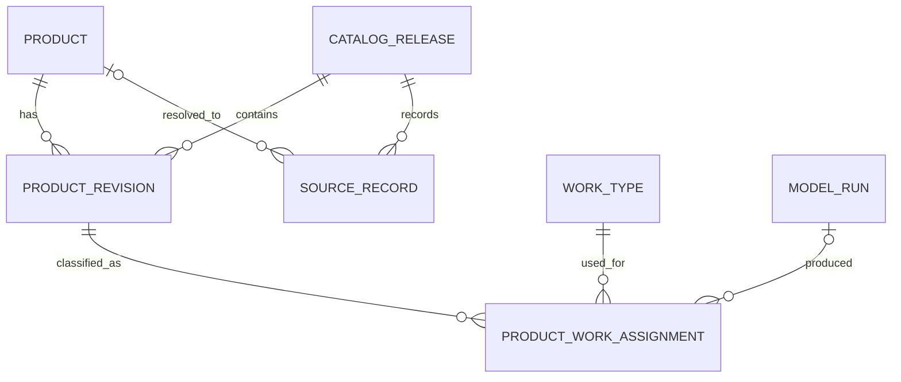
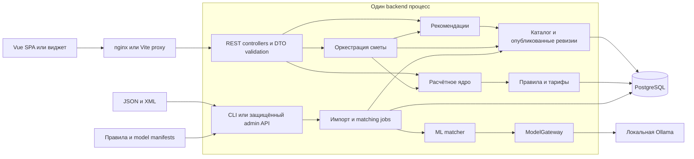

# RepairCalc — исследование проекта и проектирование серверной части

Дата: 24 октября 2026 года. Проверенный commit: `45d9a4ca4a30dcf62d018e548a7d65de80aad1b1`.

**Основной вывод.** В репозитории есть самостоятельный Vue-прототип трёх калькуляторов, локальные сметы и экспорт состава корзины. Есть подготовленный API-адаптер и предложенный OpenAPI, но нет backend, БД, импорта, ML или LLM-интеграции. Рациональная основа развития — один backend с функциональными модулями, PostgreSQL и локальным модельным процессом. Java/Spring Boot подходит для API и расчётов; ранее предложенный Python/FastAPI остаётся разумной альтернативой, зависящей от компетенций команды. До реализации важнее согласовать расчётные данные и поведение неполной сметы, чем выбирать дополнительные инфраструктурные компоненты.

Отчёт — результат исследования и набор проектных предложений. Он не утверждает окончательный контракт. Код приложения, существующая документация и конфигурации не изменялись; добавлен только этот файл.

## Как читать выводы

Используются две независимые оценки:

- **Подтверждённость требования:** `Т` — явно задано постановкой или письменными ответами; `И` — следует из существующего интерфейса/кода, но не обязательно является окончательным бизнес-правилом; `Г` — гипотеза; `П` — новое проектное предложение; `?` — требуется решение владельца.
- **Состояние реализации:** реализовано во frontend; частично реализовано; только визуально; предполагается по интерфейсу; требует уточнения; отсутствует во frontend, но требуется постановкой.

Например, локальное сохранение реализовано, но облачное хранение не является подтверждённым требованием. ML-матчинг, наоборот, отсутствует в UI, но прямо обязателен по постановке.

Исследованы исходники всех пяти страниц, все компоненты, composables, типы, демоданные и формулы, API-клиент, тесты, OpenAPI, Makefile, Docker/nginx/Vite-конфигурации, README и остальные Markdown-материалы. Текст DOCX прочитан из OOXML; архитектурный PNG просмотрен. Ссылки на код ниже ведут на реальные файлы и проверенные строки.

**Границы проверки:** исходные `products_final.json`, `export_yandex_spb.xml` и MP4 в текущем checkout отсутствуют. Сведения о них взяты из существующих аудитов, без повторного подсчёта и расшифровки видео. Примеры внешнего API в DOCX иллюстративные; сам стенд не проверялся. Runtime-проверки приложения не проводились: отсутствуют `frontend/node_modules`, npm, GNU Make и Docker в доступном PATH; обнаружен Node.js `v24.22.1`. Зависимости не устанавливались. Наличие теста ниже означает прочитанный тестовый сценарий, а не его успешное выполнение в этом исследовании. Применимых AGENTS.md не найдено. Изначально Git показывал только пользовательский каталог `.idea/` как untracked; он не затрагивался.

Основные источники требований, помимо ссылок на код:

- [Краткая постановка кейса][task] и [письменные ответы][answers] — обязательные сценарии, multi-label, метрики, коэффициенты и условия прототипа.
- [Развёрнутый DOCX кейса][case-docx] — сценарии, предложения архитектуры и иллюстративный внешний API; [исходный PNG][draft-image] — ранний эскиз, не окончательные решения.
- [README][readme], [PLAN][plan-state] и [границы frontend][frontend-scope] — текущее описание и исторические предложения, сверенные с реализацией.
- [Аудит JSON][json-audit], [аудит XML][xml-quality] и [обзор видео][video-audit] — вторичные источники об отсутствующих исходных файлах; их ограничения сохранены.

## A. Project Overview

### Назначение и аудитория

RepairCalc — сервис для кейса Максидома на SPB TECH RUN 2026. Пользователь задаёт объект, помещения и работы, получает подходящие товары, потребность, число упаковок, остаток, стоимость материалов и отдельно ориентир стоимости работ. Три обязательные точки входа: общий расчёт, подбор под условия комнаты и расчёт конкретного товара. Отдельная задача — автоматически сопоставлять новые SKU с несколькими видами работ и работать в закрытом контуре с локальной LLM. Основание: [постановка][task], [письменные ответы][answers].

Основная аудитория — посетитель сайта магазина, планирующий закупку материалов (`Т`, DOCX, разделы 1–2). Контент-менеджер/оператор каталога предусмотрен DOCX и ранним эскизом, но готового административного интерфейса нет. B2B, рост конверсии и среднего чека описаны как развитие и продуктовые гипотезы; пользователи, продажи и A/B-измерения в репозитории отсутствуют.

Термин «микросервис» в кейсе означает отдельный сервис для встраивания в сайт. Он не требует разделения самого RepairCalc на несколько бизнес-сервисов.

### Что уже решено, что открыто

| Область | Факт | Следствие |
|---|---|---|
| UI | Vue 3, TypeScript, Vue Router, Vite, Sass | Сохранять существующие страницы и адаптер при интеграции |
| Вычисления демо | Decimal.js, собственные формулы, 12 синтетических товаров | Есть примеры UX и тестовые фикстуры, нет производственных норм |
| Данные браузера | Reactive singleton + localStorage | Аккаунты, серверные проекты и CRUD смет сейчас не нужны |
| API | Четыре операции в OpenAPI и ручном клиенте | Есть исходная точка согласования, сервер ещё предстоит написать |
| Каталог/ML | Требования и прежние аудиты | Сначала политика идентичности, нормализация и независимый эталон |
| Backend-язык | PLAN/README предлагают FastAPI; backend-кода нет | Java не требует миграции существующего сервера, но выбор команды открыт |
| Хранилище | PNG предлагает MongoDB, PLAN — PostgreSQL | Ни одно решение не закреплено реализацией; рекомендуется одна БД |
| Авторизация | Нет страниц входа, пользователей, guard или токенов | Не добавлять регистрацию только из-за названий «Мой проект»/«Мои сметы» |
| Развёртывание | Один контейнер frontend/nginx | Наличие Docker-файлов не означает готовую серверную инфраструктуру |

Старое описание «исходников приложения нет» в [PLAN:18][plan-state] относится к осмотру 20 октября. Текущее наличие frontend подтверждено кодом и README; историческая запись не описывает этот checkout.

## B. Existing Frontend

### Карта проекта

| Каталог/файл | Реальное содержание |
|---|---|
| `frontend/src/main.ts`, `App.vue` | Инициализация SPA, history-маршруты, навигация, помощь, toast, счётчик локальной корзины |
| `frontend/src/views/` | `EstimateView`, `RoomView`, `ProductView`, `SavedView`, `CartView` |
| `frontend/src/components/` | Редактор условий комнаты, схематичный SVG-план, CSS-образцы материалов, результат расчёта, иконки |
| `frontend/src/domain/` | Zod-схемы/TS-типы, геометрия, совместимость, форматирование и JSON-download |
| `frontend/src/services/` | Единый fetch-клиент и динамически подключаемый демодвижок |
| `frontend/src/composables/` | Глобальное состояние браузера и обёртка busy/error/run |
| `frontend/src/data/catalog.ts` | 12 синтетических карточек, включая неполную карточку с неизвестными свойствами |
| `frontend/src/**/*.test.ts`, `frontend/tests/` | Unit/component/API/contract-тесты и Playwright-сценарии |
| `docs/` | OpenAPI и пояснения к frontend, границам реализации и запуску |
| `reports/` | Исторические аудиты JSON/XML/видеозаписи |
| `env/`, `docker/`, `frontend/nginx/`, `Makefile` | Конфигурация demo/api, build, proxy, SPA routing и команды запуска |

Версии frontend-зависимостей зафиксированы в [package.json][package] и npm lockfile. Это факт репозитория, а не оценка их актуальности или безопасности. Новые версии backend-зависимостей в этом отчёте не назначаются.

### Маршруты и состояние

| Маршрут | Страница | Что действительно работает по коду | Статус |
|---|---|---|---|
| `/` | `EstimateView` | Мастер из 3 шагов, комнаты, параметры, подбор, альтернативы, повторный расчёт | Реализовано на демоданных; серверная часть отсутствует |
| `/room` | `RoomView` | Условия комнаты → рекомендации; перенос параметров комнаты в общий проект | Реализовано на демоправилах |
| `/product?id=…` | `ProductView` | Выбор товара, условные поля по kind, расчёт и результат | Реализовано на демоформулах |
| `/saved` | `SavedView` | Последние 30 смет, раскрытие, подтверждение удаления, экспорт через результат | Реализовано локально |
| `/cart` | `CartView` | Последняя подготовленная смета, стоимость материалов, JSON, подтверждение очистки | Реализовано как локальный список |
| Любой неизвестный путь | Router | Redirect на `/` | Реализовано; отдельной 404-страницы нет |

Маршруты заданы явно в [main.ts:11][routes]. Lazy-loading страниц, role guards и серверной сессии нет. Мобильное меню и modal помощи — локальные UI-действия; помощь не обращается к LLM ([App.vue:125][help]).

Состояние — Vue `reactive` singleton без Pinia/Vuex ([useWorkspace.ts:6][workspace]). Сохраняются `project`, массив `saved` и один `cart`; схема ограничивает число смет 30, новые добавляются впереди. Повторное сохранение того же `estimate.id` подавляется. Невалидный ввод не заменяет последний валидный draft. Повреждение/недоступность storage и ошибка записи имеют сообщения. Глубокий watch сохраняет всё состояние; синхронизации между вкладками и сервером нет.

`step`, `selections`, активный результат мастера, форма `/room` и форма товара живут в конкретной странице. Сохранённая смета содержит результат и карточки товаров, но не полный исходный запрос и `selections`. Открыть её как snapshot можно; восстановить редактируемый расчёт по ней нельзя.

### Данные, запросы и интеграции

[api.ts:10][api-request] содержит единственное обращение `fetch`. Режим задаётся на сборке через `VITE_DATA_MODE`, base URL — `VITE_API_BASE_URL`, стандартно `/api/v1`. Используются `credentials: same-origin`, JSON, AbortController и таймаут 15 секунд. Успешные ответы проверяются Zod. HTTP, сеть, timeout, JSON и schema errors различаются сообщениями. Тело `ApiError` не читается. Автоматического fallback на demo в API-режиме нет.

Реальные вызовы клиента: `GET /products`, `POST /estimate`, `POST /recommendations`, `POST /product/{id}/calc` ([api.ts:45][api-service]). Демо импортируется динамически только для demo-ветки. API-клиента Bagisto, ML SDK, Ollama, аналитики, платежей и внешней корзины в исходниках нет. Внешние URL документации не являются runtime-интеграциями приложения. Изображения материалов сделаны CSS/SVG, а не загружаются из каталога.

Vite читает `env/` и проксирует `/api` на `API_UPSTREAM`. nginx сохраняет путь `/api/...`, не выдаёт SPA HTML для API и имеет собственный `/healthz` ([vite.config.ts][vite], [nginx:10][nginx]). `VITE_*` публичны и встроены в сборку; смена env требует перезапуска dev или пересборки. Порты backend в примерах — конфигурация, а не контракт языка реализации.

### Демологика и пределы её переноса

[demo.ts:53][demo-calc] считает геометрию/потребность и округляет упаковки через Decimal. Реализованы покрытия, краска, грунтовка, плиточный клей, рулонные обои, розетки и кабель. Версии названы `demo-catalog-v1`, `demo-rules-v1`, модель — `none (rules only)`.

В общем расчёте выбирается первый совместимый товар подходящего kind. Клей добавляется только при ID `demo-tile`; грунтовка — для paint/wallpaper. Ранжирование по цене, рейтингу, марже или ML отсутствует. Класс ремонта и тип объекта передаются как контекст и не меняют демотарифы ([demo.ts:132][demo-estimate]). Это не доказательство отсутствия будущих бизнес-различий.

## C. User Scenarios

Ниже перечислены все обнаруженные бизнес-действия. «Сохранить» означает состояние браузера, если явно не предложено иное. Серверные обязанности описывают будущую реализацию.

### C1. Создать проект и отредактировать комнаты

- **Кто/зачем/вход:** посетитель, `/`, шаг 1; задать объект и объём работ. Ввод: apartment/house/studio, cosmetic/capital/designer, 1–20 комнат; имя, тип, длина, ширина, высота, площадь проёмов, условия, works, запас, слои, точки и кабельные трассы.
- **Проверки:** положительные размеры, заданные пределы из схемы; высота 1–10; проёмы меньше полной площади стен; минимум одна работа; paint и wallpaper не выбираются одновременно для всех стен одной комнаты. Выбор типа комнаты меняет редактируемые defaults влажности/отопления/нагрузки, а не фиксирует их навсегда.
- **Сервер/хранение/результат:** до запроса сервер не нужен; draft сохраняется локально. При расчёте сервер повторяет все ограничения и проверяет уникальность room ID. UI показывает геометрию, выбранную комнату и суммарную площадь. Удаление последней комнаты и добавление 21-й заблокированы.
- **Ошибки/неизвестное:** пустой промежуточный ввод, неверные проёмы, storage error; форма только прямоугольная. Не определены сложная геометрия, зоны смешанной отделки и влияние класса ремонта. Пределы UI — текущие технические ограничения, не подтверждённые отраслевые нормы. Основание: [EstimateView:39][estimate-rooms], [RoomEditor:22][room-editor], [types:18][room-schema].

### C2. Подобрать комплект и получить общую смету

- **Кто/зачем/вход:** посетитель, «Подобрать материалы» → шаг 2 → «Рассчитать смету»; передаются Project и selections. На первом переходе последовательно вызываются каталог и смета, на втором смета считается повторно.
- **Проверки/сервер:** проверить проект, доступность и идентичность товаров, область применимости норм, упаковку, цену и состав комплекта; выбрать материалы, вычислить потребность, стоимость работ и материалов. Зафиксировать использованные версии. Денежные итоги и пригодность определяет сервер.
- **Хранение/результат:** результат в памяти страницы; draft в localStorage; постоянное серверное хранение не требуется текущим UX. Ответ содержит строки, формулы, need/purchased/remainder, суммы, warnings, версии. Действия результата: раскрыть расчёт и источники, сохранить, скачать JSON, подготовить корзину.
- **Ошибки/неизвестное:** no match, отсутствующая цена/норма, несовместимость, HTTP/timeout, изменение формы во время запроса. Код сравнивает fingerprint запроса с текущей формой. Demo допускает частичные строки и всё равно начисляет работы; политику partial/full estimate и технологическую полноту нужно согласовать. Основание: [EstimateView:53][estimate-next], [demo:152][demo-add], [EstimateResult:30][result].

### C3. Заменить материал и пересчитать

- **Кто/зачем/вход:** посетитель, select альтернативы на шаге 2; ключ `roomId:kind` → productId. UI фильтрует локально загруженный каталог по kind и compatible, не запрашивает отдельный endpoint альтернатив.
- **Проверки/сервер:** заново проверить room, work, kind, совместимость, цену и зависимые материалы; пересчитать всю смету. Доверять клиентской фильтрации нельзя. Выбор плитки может менять не только цену, но и состав работ/комплекта.
- **Хранение/результат:** selections в памяти страницы, обновлённый результат. При неудаче предыдущий selection восстанавливается; автоматического сохранения новой сметы нет.
- **Ошибки/неизвестное:** выбранный SKU исчез/изменился/несовместим → конфликт; проект изменился → повтор. Неясны несколько материалов одного kind, разделение по поверхностям и политика остатков между комнатами. Основание: [EstimateView:49][estimate-choices], [EstimateView:83][estimate-replace].

### C4. Подобрать товары по условиям комнаты

- **Кто/зачем/вход:** посетитель, `/room`, исходно санузел 3×2 с повышенной влажностью; RoomEditor → «Найти материалы». Вводится та же Room-модель, включая геометрию и выбранные работы.
- **Проверки/сервер:** валидировать Room, взять рабочие назначения, применить ограничения, ранжировать и сформировать объяснение по подтверждённым фактам. Тип комнаты не заменяет явные conditions.
- **Хранение/результат:** список `{product, reason}` и warnings в памяти; пустой список имеет отдельное состояние. Карточка ведёт в `/product?id=…`. «Добавить комнату в проект» копирует только параметры комнаты с новым UUID; выбранные рекомендации не переносятся. Проверяется лимит 20 комнат.
- **Ошибки/неизвестное:** no confirmed options, данные изменились во время запроса, сеть; критерии ранжирования и свойства для детской не формализованы. Demo объяснение о типе комнаты не доказывает проверку всех свойств её назначения. Основание: [RoomView:14][room-view], [demo:27][demo-recommend].

### C5. Рассчитать конкретный товар

- **Кто/зачем/вход:** посетитель, `/product?id=…` или переход из рекомендаций. Каталог загружается целиком как витрина; выбирается товар, затем площадь либо периметр/высота, запас, слои, quantity точек/кабеля.
- **Проверки/сервер:** загрузить канонический товар по ID, проверить данные и branch-specific inputs. Для розетки quantity должно быть целым; для кабеля допустима длина. Проверить единицы, фасовку, расход и раппорт; вернуть одну строку Estimate с labor `0.00`.
- **Хранение/результат:** результат в памяти, затем доступны обычные локальные действия EstimateResult. Для покрытия показываются потребность, упаковки и остаток; отсутствующую норму демодвижок не придумывает.
- **Ошибки/неизвестное:** пустой/недоступный каталог с retry, неизвестный query ID с предупреждением и выбором первого товара, 404 сервера, отсутствующая фасовка/цена/норма, полотно длиннее рулона. Текущий запрос не содержит условий комнаты, основания и толщины слоя: обещать проверку пригодности здесь нельзя. Динамическое изменение query ID без remount полностью не синхронизировано с выбором. Основание: [ProductView:30][product-load], [ProductView:54][product-calc], [demo:67][demo-wallpaper].

### C6. Сохранить, открыть, экспортировать и удалить смету

- **Кто/зачем/вход:** посетитель, EstimateResult → «Сохранить», затем `/saved`. Вход — готовый Estimate; раскрывается snapshot, а не форма исходного проекта.
- **Проверки/сервер:** estimateSchema перед записью, дедупликация по id, максимум 30. Серверная операция не предусмотрена. JSON создаётся через Blob, без upload.
- **Хранение/результат:** локальный массив результатов, новые впереди; можно снова скачать JSON и подготовить локальную корзину. Удаление требует inline-подтверждения и меняет только этот браузер.
- **Ошибки/неизвестное:** пустой список, повреждённая/устаревшая схема storage, quota/unavailable; цены snapshot устаревают. «Новый расчёт» лишь ведёт на `/` и не сбрасывает существующий draft. Синхронизация устройств, импорт JSON и повторный расчёт snapshot не реализованы и не подтверждены. Основание: [useWorkspace:53][save], [SavedView:9][saved-view], [format:10][download].

### C7. Подготовить и экспортировать состав корзины

- **Кто/зачем/вход:** посетитель, непустой результат → «Подготовить корзину» → `/cart`. Вход — весь Estimate; новая операция заменяет предыдущую корзину, не добавляет строки к ней.
- **Проверки/сервер:** валидируется структура Estimate; сейчас нет серверного запроса. В будущем магазин обязан сам подтвердить SKU, единицу продажи, цену и наличие перед реальной покупкой.
- **Хранение/результат:** один локальный snapshot. JSON `schemaVersion=1.0`, mode, estimateId, RUB, versions, materials, items с productId/roomId/name/quantity/saleUnit/unitPrice/total; labor не передаётся. Очистка имеет подтверждение.
- **Ошибки/неизвестное:** пустая корзина; один SKU в разных комнатах остаётся несколькими строками; сведения устаревают. Не определены API магазина, агрегация количества, упаковочный шаг, резервирование и checkout. Нельзя считать этот JSON действительным заказом. Основание: [CartView:8][cart], [useWorkspace:62][set-cart].

### C8. Загрузить каталог и обработать новый товар

- **Кто/зачем/вход:** оператор/разработчик — роль из DOCX, экран отсутствует. Источник: JSON/XML или новый source record; цель — расширять каталог без ручного назначения всех меток.
- **Проверки/сервер:** формат и источник, source ID/cod_good, дубли, единицы, качество данных, разрешённые виды работ; затем multi-label inference, проверка результатов и публикация пригодной ревизии.
- **Хранение/результат:** исходные записи и provenance, нормализованные версии, назначения работ, статус задания, отчёт ошибок и версия модели. Для больших файлов обработка фоновая или CLI, не внутри 15-секундного UI-запроса.
- **Ошибки/неизвестное:** битый файл, коллизии, неоднозначные характеристики, модель недоступна, низкая уверенность, неизвестные категории. Протокол импорта и права оператора — предложения; сама обработка новых товаров обязательна. Основание: [answers:104][acceptance], [PLAN:133][plan-api], DOCX, раздел 2.

### C9. Навигация, помощь и сообщения

Посетитель открывает sidebar/mobile menu, help dialog, раскрывает формулы/источники и отменяет подтверждение удаления/очистки. Эти действия реализованы локально и не создают backend-требований. Dialog закрывается кнопкой, кликом по фону и событием close; E2E-сценарий предусматривает Escape. Toast и общий storage warning доступны в App. Основание: [App.vue][app], [scenarios.spec.ts:81][e2e-help].

## D. Functional Requirements

### Предварительная спецификация

В колонке «Правила/границы» `И` обозначает существующий договор frontend, который ещё можно пересмотреть. Все серверные компоненты ниже — будущие.

| ID / блок | Подтверждённость и источник | Роли, операции, вход → результат | Правила/границы | Зависимости и сервер |
|---|---|---|---|---|
| FR-01 Проект и помещения | Т: постановка; И: Room/Project | Посетитель: контекст и rooms → валидный запрос | Прямоугольники, 1–20 rooms, пределы и взаимоисключение отделки — И | UI draft локально; сервер повторяет validation |
| FR-02 Нормализованный каталог | Т: реальные/реалистичные товары; П: схема | Оператор: источники → канонические карточки; посетитель: витрина | Нельзя смешивать source IDs, цену упаковки/м², неизвестное/false | Catalog/import; обязательно сервер или подготовительный pipeline |
| FR-03 Калькулятор товара | Т: постановка; И: ProductInput | Посетитель: productId + размеры → need/packages/remainder/price | Размерности и округление; labor=0 для этого сценария | Catalog + проверенные rules; сервер обязателен |
| FR-04 Общая смета | Т: постановка; И: мастер | Посетитель: Project + selections → материалы и работы отдельно | Объект/класс ремонта должны передаваться; их влияние ?; полнота комплекта ? | FR-01/02/03/05/06; сервер обязателен |
| FR-05 Совместимость и рекомендации | Т: постановка; И: compatible | Посетитель: Room → подходящие продукты/причины/ограничения | Неизвестные признаки не подтверждают пригодность; применимость проверяется по операции | Catalog + mapping + rules; сервер обязателен |
| FR-06 Нормы, коэффициенты, тарифы | Т: ответы; И: демо | Подготовленные справочники → прозрачный расчёт и объяснение коэффициента | Источник, условия и версия; нормы нельзя выдумывать; тарифы отдельны от цен товаров | Rules + Catalog; вычисления на сервере |
| FR-07 Замена материалов | И: шаг 2 | Посетитель: room/kind/product → новая смета | Полная повторная validation, состав зависимых материалов пересчитывается | FR-04/05; тот же endpoint сметы |
| FR-08 Локальные сметы | И: код | Посетитель: save/open/delete/export → snapshot | 30, dedup по id, только браузер; облачная синхронизация ? | Backend не требуется |
| FR-09 Состав корзины | И: код; Т: UX до корзины | Посетитель: Estimate → локальный JSON материалов | Замена последней корзины, без работ и оформления заказа | Backend не требуется до договора с магазином |
| FR-10 ML-матчинг новых SKU | Т: ответы | Оператор: source record → несколько work labels | Не hardcode SKU; новые/неоднозначные товары; независимая оценка | Catalog + taxonomy + local model; сервер/pipeline |
| FR-11 Оценка ML и расчётов | Т: ответы | Команда: фиксированный test → воспроизводимый отчёт | micro-F1 ≥0,8; macro-F1 дополнительно; скорость/ресурсы измерить, норматив задержки не задан | Evaluation tooling; пользовательский endpoint не нужен |
| FR-12 Закрытый контур и локальная LLM | Т: постановка | Команда: подготовленные артефакты → работа без внешней сети | LLM участвует в pipeline; веса/данные локальны; арифметика в коде | Model adapter + доставка артефактов |
| FR-13 Ошибки и наблюдаемость | И: useAsync/API; П: сервер | Посетитель/оператор: ошибка → понятное действие; команда: trace/status | Не подменять API demo; HTTP JSON; отсутствие данных не 500 | Общая инфраструктура, все модули |
| FR-14 Доступ к изменению каталога | Г: роль DOCX; П: механизм | Оператор: import/add → защищённая операция | Способ identity ?; публичная запись каталога не нужна | Только при включении admin API; альтернативно локальный CLI |

Технические предложения не расширяют бизнес-объём автоматически. Регистрация, личный кабинет на сервере, платёж, заказы, скидочный движок и роли покупателя/подрядчика не подтверждены.

### Логика, за которую отвечает сервер

Сервер выбирает опубликованную версию каталога, цену/единицу продажи и проверенные расчётные параметры; применяет ограничения к каждой работе; проверяет selections; определяет зависимые материалы; считает деньги и упаковки; возвращает provenance и ограничения. Браузер может показывать геометрию и предварительно валидировать ввод, но не является источником истины. ML-метка «подходит для floor» сама по себе не подтверждает влагостойкость, норму расхода или комплектность.

## E. Domain Model

### Сущности, значения и представления

| Понятие | Предварительное содержание | Что это означает для хранения |
|---|---|---|
| Product | Стабильная внутренняя идентичность товара | Не равна JSON id, XML offer id или cod_good |
| ProductRevision | Данные конкретного товара в версии каталога: название, тип, цена, фасовка, атрибуты, provenance | Нужна связь с release для согласованного расчёта |
| SourceRecord | Исходный source ID и запись, внешние коды, массив характеристик | Сохранять дубли и исходные значения до разрешения конфликтов |
| CatalogRelease | Публикуемый снимок нормализованных карточек и состояния обработки | Импортировать отдельно от используемой пользователями версии |
| WorkType | Вид ремонтной операции | Категория магазина и product kind не заменяют WorkType |
| ProductWorkAssignment | Связь revision ↔ один или несколько WorkType, метод/модель/статус/основание | Многометочная связь, а не одно поле category |
| RuleSet | Версионированные формулы, нормы, коэффициенты, совместимость, состав комплектов и тарифы | Для MVP допустим валидируемый bundle, без универсального rule engine |
| ModelRun | Версия model/prompt/preprocessing/taxonomy и ссылки на evaluation | Model string в UI — краткая проекция manifest |
| Import/MatchingJob | Техническая задача со статусом, progress и ошибками | Только для длительных операций; не бизнес-сущность покупателя |
| Project, Room, CalculationInput | Входные value objects с пользовательской геометрией | Не требуют серверных таблиц при локальном draft |
| Estimate, EstimateLine | Snapshot результата вычисления, выбранных продуктов и версий | Сейчас DTO/модель представления, хранится браузером |
| Recommendations | Временная выдача products+reasons | Не отдельная таблица рекомендаций |
| CartExport | Производный документ передачи материалов | Не корзина/заказ магазина и не отдельный агрегат |

Текущий [Product Zod][product-schema] — плоская UI-проекция. На сервере нужно разделить цену продажи, размер упаковки, физическую единицу, норму с размерностью и условиями применения. Например, `consumption=4` недостаточно без `кг/м²`, толщины слоя и основания. `wet/highLoad/unheated` nullable выражают три состояния, но не заменяют полноценные правила по конкретной операции.

### Концептуальные связи



RuleSet и технические jobs описаны отдельно в I. Project/Room не показаны как таблицы: их серверная персистентность не требуется текущим сценариям. Глубокий DDD, отдельные bounded contexts и event sourcing сейчас не обоснованы. Достаточно понятных границ модулей и небольших транзакционных операций; весь каталог не должен загружаться как один ORM-агрегат.

### Состояния и инварианты

Предлагаемый жизненный цикл release: `STAGING → VALIDATING → READY → PUBLISHED → RETIRED`; ошибки проверки → `REJECTED`. Активная пользовательская версия одна. Опубликованные ревизии неизменны; обновление создаёт новую. Для назначения: `PROPOSED → ACCEPTED` либо `NEEDS_REVIEW/REJECTED`; критерий ACCEPTED определяется проверенной политикой качества, а не фразой модели «уверен». Для job: `QUEUED → RUNNING → SUCCEEDED/FAILED`, при перезапуске — контролируемое восстановление или повтор. Это предложения `П`, а не уже существующие статусы.

Обязательные технические инварианты для достоверного расчёта:

1. Один расчёт использует согласованные catalog/rules/model revisions; источник каждого числа доступен.
2. `packages = ceil(need / packageAmount)` для подходящей упаковочной стратегии; `purchased ≥ need`, `remainder = purchased − need`, `lineTotal = packages × salePrice`, `materials = Σ lineTotal`, `total = materials + labor`.
3. Все величины сравниваются в согласованных единицах; деньги — десятичные. Литры и килограммы не взаимозаменяемы без подтверждённой плотности.
4. Неизвестная цена, фасовка, применимость или норма не становятся нулём либо произвольным средним. Нулевая цена в исходнике — непроверенные данные, если иной смысл не подтверждён.
5. Room ID уникальны в запросе; selections ссылаются на существующие комнаты и допустимые виды материалов/работ; неизвестные ключи не игнорируются молча.
6. Указание одного товара в нескольких комнатах требует решения об объединении закупки. Demo округляет каждую строку отдельно; это может завышать закупку при переносе остатков.

Исключение, требующее исправления контракта: обои. Сейчас `unit=полотен`, `packageSize=1`, но число полотен из рулона вычисляется по высоте и раппорту ([catalog:105][catalog-wallpaper], [demo:67][demo-wallpaper]). Фраза OpenAPI «packageSize — количество unit в saleUnit» для такого товара не является постоянной величиной. Предложение: хранить длину/ширину рулона и тип калькулятора, а производное число полотен возвращать в расчёте; не обещать `purchased = quantity × product.packageSize` для обоев.

Для покраски следует отличать норму на один слой от нормы на полный цикл. Для обоев ещё нужно подтвердить правила подгона, вычета проёмов и подрезки: демо добавляет 0,1 м, округляет по раппорту и не вычитает проёмы, что не делает эти правила универсальными. Для смесей текущей формы недостаточно для всех технологий; расширять её следует после выбора первой подтверждённой нормы.

## F. Proposed Backend Architecture

### Выбор подхода

| Вариант | Сложность и стоимость | Гибкость/тестируемость | Оценка для RepairCalc |
|---|---|---|---|
| Один классический слоистый сервис | Низкая стартовая; растёт риск общего service/repository слоя | Хорошая при независимом расчётном ядре; границы областей легко размыть | Допустим для малого прототипа |
| Модульный монолит с простыми слоями внутри модулей | Небольшая дополнительная дисциплина, один deploy | Изолируются расчёты, каталог и inference; удобно тестировать по сценариям | **Рекомендуется** |
| Полная Clean/Hexagonal Architecture для каждого CRUD | Больше интерфейсов, мапперов и файлов | Полезна при многих заменяемых адаптерах | Применить только порты Catalog/Rules/Model там, где есть реальные внешние границы |
| Несколько микросервисов | Сетевые ошибки, отдельные deploy, observability, согласование данных | Независимое масштабирование, но дороже integration testing | Потребность не доказана; отдельный model runtime достаточно обоснован |
| Богатая DDD-модель, CQRS/event sourcing | Высокая цена моделирования и сопровождения | Нужны для сложных жизненных циклов и нескольких независимых доменов | Сейчас оснований нет |

### Предлагаемая схема



Прямой запрос пользователя не должен классифицировать заново весь каталог. Назначения работ рассчитываются при импорте/обновлении и сохраняются; online-подбор работает по опубликованным данным. LLM может помогать с неоднозначными карточками и объяснениями, но не вычисляет деньги и упаковки. Необязательное пояснение не должно блокировать достоверный расчёт: допустим проверяемый шаблон с явным предупреждением о недоступности пояснения. Это не заменяет обязательную демонстрацию локальной LLM в pipeline. Отдельный классификатор типа комнаты из раннего эскиза сейчас не нужен: пользователь явно выбирает тип и условия структурированными полями.

### Модули и ответственность

| Модуль | Ответственность | Зависимости/публичный интерфейс | Где бизнес-логика |
|---|---|---|---|
| `catalog` | Нормализованная карточка, идентичность, происхождение, активный release, витрина | ProductQuery/CatalogSnapshot; наружу без JPA entity | Политика разрешения данных и готовности карточки |
| `ingestion` | Потоковый import, source adapters, нормализация, ошибки, staging и публикация | Catalog write interface, matching, jobs | Source-specific mappings и проверка качества |
| `rules` | Версии формул, норм, коэффициентов, условий и тарифов | RuleSetQuery | Применимость нормы/коэффициента, фиксированный типизированный формат |
| `calculation` | Геометрия, стратегии расхода и упаковки, денежная арифметика | Принимает значения ProductRevision+RuleSet; без HTTP/JPA/LLM | Чистые функции и предметные стратегии |
| `recommendation` | Фильтрация по работам/условиям, ранжирование, основания выбора | CatalogQuery + Rules; чтение сохранённых work assignments | Пригодность к операции до ранжирования |
| `estimate` | Комплект для rooms/works, selections, последовательность расчёта и итоги | Recommendation + Calculation + snapshot versions | Состав комплекта, полнота, согласованность итогов |
| `matching` | Multi-label pipeline, неизвестные случаи, модельные версии | ModelGateway; получает source/revision, отдаёт назначения | Пороги/allowlist/статусы и проверка результатов |
| `operations` | Job lifecycle, health, служебные команды, защищённый доступ | Вызовы ingestion/matching | Техническая orchestration; без покупательских сущностей |

Правила взаимодействия: controller → application service → domain logic; инфраструктура реализует небольшие интерфейсы доступа к БД и модели. `calculation` не зависит от Spring и конкретной схемы хранения. Другой модуль использует публичный интерфейс владельца данных, не его repository. Циклические вызовы `catalog ↔ recommendation ↔ estimate` не допускаются: estimate оркестрирует их сверху. Shared содержит только технические значения Money/Unit/Error, а не общий слой всех бизнес-сервисов.

### Данные, задания, ошибки и конфигурация

Для CRUD и чтения небольших карточек достаточно JPA. Массовый импорт — streaming parser и пакетная запись JDBC либо явно ограниченные batch-операции; не загружать десятки тысяч managed entities в одну транзакцию. Каталог, правила и назначения берутся по зафиксированным версиям. Внешний inference не вызывается внутри открытой DB-транзакции.

Для MVP достаточно одного ограниченного executor и таблицы job. При обработке job сохраняются progress, phase и ошибки; повторный запуск не дублирует источник и назначения. После аварии незавершённая задача должна становиться повторяемой либо FAILED с понятной причиной. Если появится несколько экземпляров worker, нужны atomic claim/lease и восстановление просроченного lease. Брокер сообщений и распределённый scheduler до этого не нужны. На первом этапе CLI с отчётом может заменить admin HTTP API.

Validation и domain errors переводятся одним exception handler в `ApiError`; классы ошибок и HTTP описаны в H. В логах — trace/request ID, операция, версии и длительность; stack trace остаётся серверу. UI не получает JDBC exception, внутренние пути и исходный prompt. Readiness каталога/правил и доступность inference показываются отдельно: готовность nginx не доказывает готовность сервиса.

Конфигурация: типизированные Spring properties; общие безопасные defaults в конфиге, секреты backend через окружение/секреты окружения запуска. Параметры БД, local model URL, model artifact/prompt version, разрешённые import roots и executor limits отделены от публичных `VITE_*`. Профили local/test/deploy различают инфраструктуру, но не скрыто меняют формулы. Rules и модели поставляются как версионированные артефакты; URL модели не задаёт пользователь расчёта.

Отложить: Kubernetes, Kafka/RabbitMQ, Redis, отдельную векторную БД, Spring Cloud Gateway, WebFlux, distributed tracing platform, workflow engine, универсальный DSL формул. Пересмотр нужен при измеренном дефиците latency/throughput, нескольких worker, независимом выпуске ML либо нескольких магазинах с отдельными SLA.

## G. Technology Stack

**Предварительная рекомендация:** Java + Spring Boot/MVC для API и детерминированного ядра, PostgreSQL, Flyway, Maven, локальная Ollama. Это выбор для команды, способной поддерживать Java. Если фактический исполнитель ориентирован на Python и сроки очень короткие, ранее предложенный FastAPI даст меньше затрат на совмещение с Python ML. Компетенции и дедлайн репозиторий не подтверждает. Два параллельных CRUD-backend на Java и Python не нужны.

| Технология | Задача и почему подходит | Альтернатива/ограничение | MVP |
|---|---|---|---|
| Java, поддерживаемая LTS JDK | Типизированный API, BigDecimal, стабильный расчётный код | Python Decimal; Java не обязательна по кейсу | Да при выборе Java |
| Spring Boot | Конфигурация, HTTP, DI, lifecycle и готовый test ecosystem в одном процессе | FastAPI; меньше setup в Python-команде | Да для Java API |
| Spring Web / MVC | Синхронный JSON REST, validation и exception handling | WebFlux имеет смысл только при доказанном профиле неблокирующих нагрузок | MVC достаточно |
| Spring Security | Доступ к служебным операциям и интеграция identity | Local CLI без admin HTTP на первом этапе; существующий gateway при согласовании | При включении защищённого API; не означает регистрацию |
| Spring Data JPA | Небольшие repository/query для catalog revisions, jobs и model manifests | Spring JDBC/jOOQ; для bulk импортов JDBC проще контролировать | Допустима, без generic repository поверх неё |
| Hibernate | JPA provider, управление ORM mapping | Не отдельное бизнес-решение сверх JPA; не инструмент для поточного parsing | Вместе с JPA |
| PostgreSQL | Связи, транзакции, numeric, JSONB для неоднородных атрибутов | MongoDB соответствует эскизу, но не даёт явной выгоды при связях и публикации версий; H2 не заменяет PG integration tests | Да |
| Flyway | Версионирование SQL-схемы и повторяемый setup | Liquibase при требованиях к декларативным changelog; оба одновременно не нужны | Да |
| Maven + Wrapper | Одна backend-сборка, BOM и воспроизводимый запуск | Gradle при существующей компетенции; основания для multi-module build пока нет | Да |
| Jakarta Bean Validation | Проверка формата и границ DTO | Межполевые/товарные правила всё равно проверяет domain service | Да |
| OpenAPI | Согласование с ручным клиентом/Zod, ошибки, acceptance fixtures | Сначала существующий YAML как основа; генерацию клиента можно отложить | Да, без двух расходящихся спецификаций |
| JUnit | Эталонные расчёты, boundary cases, обработка ошибок | Другой test runner не даёт подтверждённой выгоды | Да |
| Mockito | Изолировать ModelGateway и редкие внешние ошибки | Простые fakes удобнее для чистого calculation; не мокировать всё подряд | По необходимости |
| Testcontainers | Проверить реальные PG constraints, миграции, публикацию и повторный import | Выделенная тестовая PostgreSQL, если Docker недоступен; H2 не подтверждает PG/JSONB | До проверки persistence; pure calculation раньше работает без Docker |
| Docker/Compose | Подготовленная среда API+PG+frontend, автономная демонстрация | Локальные процессы для ранней разработки; Ollama может работать на хосте | Для воспроизводимого демо |
| Jackson streaming / XML StAX | Импорт крупных исходников с ограниченной памятью | Python streaming parser при FastAPI; XML external entities отключить | Да для full import, не отдельный сервис |
| BigDecimal | Деньги и точные десятичные расчёты до округления упаковок | Python Decimal; binary floating point не подходит для денежных итогов | Да |
| Ollama + выбранная локальная модель | Участие LLM без облачного API; structured extraction/classification | Другой локальный inference runtime; выбрать по оборудованию и качеству | Да по постановке; конкретная модель после проверки |
| Python ML/evaluation tooling | Быстрый baseline, разметка/evaluation и обучение при выбранном подходе | Java inference через Ollama может обойтись без Python serving | По потребности pipeline; отдельный FastAPI inference — только если нужен |

Проверены официальные материалы: [совместимость Spring Boot с JDK и build tools](https://docs.spring.io/spring-boot/system-requirements.html), [JSON/JSONB PostgreSQL](https://www.postgresql.org/docs/17/datatype-json.html), [structured outputs Ollama](https://docs.ollama.com/capabilities/structured-outputs). Они подтверждают технические возможности; рекомендация для RepairCalc — вывод из исследованных сценариев. Конкретные версии JDK/Boot/PostgreSQL/драйвера/Flyway и OpenAPI tooling следует выбрать одной совместимой поддерживаемой матрицей при инициализации и зафиксировать в ADR/BOM/Wrapper/образах. Здесь версии зависимостей не объявлены окончательными.

Ollama умеет ограничивать форму ответа JSON Schema, но это не подтверждает истинность норм и характеристик. Требуется последующая semantic validation и provenance. Библиотеки RAG/LangChain/LlamaIndex, FAISS/Qdrant и обучаемые коэффициенты пока не нужны: источники, датасет и польза соответствующих механизмов не доказаны.

## H. API Design

### Статус контракта и общие правила

Существующий [openapi.yaml:1][openapi] прямо называет себя предложением будущего backend. Четыре его операции соответствуют клиенту. Ни одной серверной операции сейчас нет. Ниже `P0` — сохранить эту исходную форму для первой интеграции; `P1` — дополнительное проектное предложение для согласования. Внешний Bagisto API — отдельный источник, его ответы нельзя отдавать UI напрямую.

Базовый пользовательский prefix `/api/v1`, JSON, денежные суммы — десятичные строки RUB, `createdAt` — UTC ISO 8601 с Z, ID — opaque strings. Успешный backend-ответ содержит `mode=api`. Не доверять цене, норме и пригодности из браузера; на calc передаётся productId, а не полная карточка товара. Endpoint `/product/{id}/calc` сохраняется в существующем единственном числе, чтобы без причины не ломать ручной клиент.

### DTO для существующих четырёх операций

| DTO | Поля текущего предложения | Серверная проверка и недостаток информации |
|---|---|---|
| Room | id, name, type, length/width/height/openings, humidity/load/heated, works, reserve/layers/sockets/cableLength | Ограничения [types:18][room-schema]; уникальность IDs, отсутствие дублей works; предметные условия дополнительно |
| Project | object, renovation, rooms | 1–20; пределы frontend, а не утверждённые бизнес-нормы |
| EstimateRequest | `{project: Project, selections: Record<string,string>}` | Ключи roomId:kind и productId валидируются; неопределены несколько позиций одного kind и version precondition |
| ProductInput | area, perimeter, height, reserve, layers, quantity | Сейчас все обязательны даже когда не используются. Проверки по kind строже общей схемы; нет толщины/основания/conditions |
| Product | id/name/category/kind; price; packageSize/unit/saleUnit; works; nullable wet/highLoad/unheated; description/source; optional consumption/rollWidth/rollLength/rapport | Нормализованная UI-витрина; description plain text. Не копия таблицы и не raw карточка магазина. Противоречие обоев — E |
| EstimateLine | id, roomId, roomName, product, quantity, need, purchased, remainder, total, formula, reason | quantity — целые единицы продажи; единицы результатов явны; арифметические инварианты — E |
| Estimate | id, createdAt, mode, lines, materials, labor, total, warnings, versions | versions={catalog,rules,model}; id обозначает вычисленный snapshot и не обещает GET по нему; полнота пока не описана |
| Recommendations | `products:[{product,reason}], warnings:string[]` | Пустая выдача допустима; нет версий и машинных причин отказа |
| ApiError | code, message, optional fields:string[] | В текущем клиенте читается только HTTP status; нужна доработка обработки |

Пределы ProductInput: area `(0,10000]`, perimeter `(0,1000]`, height `[1,10]`, reserve `[0,30]`, layers integer `[1,4]`, quantity `(0,5000]`. Ограничения Room: длина/ширина `(0,100]`, openings `[0,2000]`, sockets integer `[0,200]`, cableLength `[0,5000]`, name 1–60. Это восстановлено из кода, а не предложено как норматив предметной области.

### Операции P0

| Сценарий / метод и endpoint | Вход и request | Response / сущности | HTTP и возможные ошибки | Валидация / авторизация |
|---|---|---|---|---|
| C2/C3/C5: `GET /api/v1/products` | Параметров сейчас нет; body отсутствует | `Product[]`; ProductRevision и CatalogRelease | 200, включая `[]`; 503 catalog_not_ready; общий 500 только для неожиданной ошибки | Только опубликованная ограниченная витрина; предварительно анонимное чтение |
| C2/C3: `POST /api/v1/estimate` | EstimateRequest | Estimate; input values + ProductRevision/RuleSet/assignments | 200; 400 invalid_json; 409 selection_conflict; 422 invalid_input/needs_clarification; 503 not_ready | Геометрия, работы, selections, нормы, комплект, тарифы; предварительно посетитель без login |
| C4: `POST /api/v1/recommendations` | `{room:Room}` | Recommendations; assignments+compatibility+ProductRevision | 200, включая пустую выдачу с reasons/warnings; 400 malformed; 422 validation; 503 catalog_not_ready | Валидировать Room; фильтровать до ranking; предварительно анонимно |
| C5: `POST /api/v1/product/{id}/calc` | id path + ProductInput | Estimate с ровно одной строкой, labor=`0.00`; ProductRevision+RuleSet | 200; 400 malformed; 404 product_not_found; 409 unusable/changed selection при известном precondition; 422 missing_norm/units/parameters; 503 not_ready | Условия по kind; неизвестный id не заменять первым товаром на сервере; предварительно анонимно |

Для всех операций: ограничение размера тела/стоимости вычисления; 429 при введённом rate limit, не бесконечные retry; 500 без внутренних подробностей. Ошибка upstream каталога не должна превращаться в успешную нулевую смету. 401/403 нужны только при согласованной защите соответствующего маршрута; сейчас OpenAPI не задаёт login.

### Дополнительные операции P1

Эти маршруты не входят в текущий OpenAPI и не вызываются frontend. Первые два имени сохраняют предложения из PLAN/эскиза; окончательную REST-форму можно согласовать до реализации без миграции готовых клиентов. На раннем этапе возможен CLI с теми же application services.

| Сценарий / метод и endpoint | Request / параметры | Response DTO | Статусы, валидация, ошибки и доступ | Сущности |
|---|---|---|---|---|
| C8: `POST /admin/api/v1/catalog/import` | multipart `file`, `sourceType` (json или xml), `requestKey`; режим обработки определяется сервером | 202 JobReceipt `{jobId,status,statusUrl}` + Location; результат ещё не опубликован | 400 format; 401/403 operator; 409 request_key_conflict; 413 size; 415 media type; 422 invalid source; 503 resources unavailable. Проверить содержимое, checksum и разрешённый source; не принимать произвольный URL/путь | Job, SourceRecord, CatalogRelease |
| C8: `POST /admin/api/v1/product/add` | SourceProductDraft: source/externalId, optional codGood, name, categoryRefs, optional description/price, attributes[] `{name,value,unit?}` | 202 JobReceipt, после job — normalizedProductId и mapping status | 400/401/403/409/422/503. Идентичность и provenance обязательны; неизвестные расчётные поля допускаются как неизвестные, не как нули. Ручные work labels не заменяют автоматический pipeline | Product, SourceRecord, ProductRevision, assignments |
| C8: `GET /admin/api/v1/jobs/{id}` | jobId path | JobStatus `{id,kind,status,phase,processed,total?,errors[],result?}` | 200; 401/403; 404; 503. Доступ оператору, ошибки без сырых секретов/полных файлов | Job; ссылки на release/product/model run |
| Эксплуатация: `GET /health` | Нет body | Readiness `{status,components:{db,catalog,rules,model}}`, минимум публичных деталей | 200 либо 503 для обязательных компонентов; operator/internal network для подробностей. Liveness процесса отдельно от readiness | Состояние зависимостей, не новые бизнес-таблицы |

`requestKey` предлагается только для административных мутаций: повтор того же ключа/файла даёт существующий job, другой payload с тем же ключом — 409. Ошибки отдельных строк могут завершать import с quality report; условия публикации и возможность частичного принятия — N. Для синхронных расчётов Idempotency-Key сейчас не нужен: повтор не создаёт заказа и не списывает деньги, хотя id/createdAt результата могут отличаться.

Для больших файлов нельзя использовать текущие настройки frontend nginx без изменения: `client_max_body_size=2m` меньше описанных снимков 89,85/261,54 MiB. Рекомендация MVP — локальный CLI/монтированный входной файл; при admin upload — отдельный защищённый route/лимит и streaming. Размер допустимого upload нужно определить по ресурсам, не выбрать произвольным числом.

### Ошибки, согласованность и эволюция

Пример **предлагаемого** ответа в пределах существующей схемы:

```json
{
  "code": "needs_clarification",
  "message": "Для выбранного клея не подтверждена норма при заданной толщине слоя",
  "fields": ["project.rooms[0].substrate", "project.rooms[0].layerThickness"]
}
```

Эти два поля ещё отсутствуют в Room: пример показывает недостаток контракта, а не готовую форму для отправки. Для текущего UI ошибка должна вести к понятному действию; нельзя предлагать заполнить несуществующее поле без соответствующей доработки. `requestId` удобно передавать заголовком; машинные issue details и coverage — отдельное согласованное расширение.

Предлагаемая политика MVP: если обязательная операция не может быть посчитана, 422 с причиной. Частичный 200 допустим только после явного определения `status/coverage/missingItems`, чтобы UI не называл неполный комплект готовым. Неблокирующие предупреждения остаются в warnings. При отсутствии тарифа нельзя выдавать неизвестную стоимость работ как `0.00`; варианты — согласованный демонстрационный тариф с пометкой либо явное расширение nullable/unknown labor. Выбор требуется до утверждения H.

Сегодня запрос не содержит ожидаемую версию каталога/цены. Поэтому backend может проверить пригодность selection, но **не может доказать изменение цены относительно показанной клиенту**. Для такой проверки нужно добавить `expectedVersions`/quote precondition и передачу версии витрины. До этого сервер возвращает текущий snapshot, а UI явно показывает факт обновления; нельзя обещать контроль отсутствующего precondition.

`GET /products` оставлять небольшим массивом нормализованной витрины; не возвращать все десятки тысяч source SKU. Текущие экраны требуют этот массив для select. Пагинация/поиск/filter/sort в UI отсутствуют. При расширении нужны согласованный `{items,page/...}` либо cursor envelope, endpoint карточки по ID и запрос альтернатив с room/work context; это изменит `api.ts`, `ProductView` и `EstimateView`. Не добавлять параметры, которые UI не использует. Порядок рекомендаций должен быть стабильным и определённым, включая tie-break по id.

Изменения обязательности, envelope, enums kind/work, единиц обоев и semantics полноты требуют общей правки YAML/Zod/клиента/fixtures. Дополнительные поля не означают автоматическую совместимость: Zod object по умолчанию удаляет неизвестные поля, поэтому новые metadata могут потеряться при сохранении. Contract tests сравнивают свойства и required, но не весь смысл и арифметические инварианты. [contract.test.ts:30][contract-test].

### Прослеживаемость экранов и операций

| Экран / действие | Функциональное требование | Backend-операция | Endpoint | Сущности | Статус |
|---|---|---|---|---|---|
| `/`: тип объекта, rooms, параметры | FR-01 | Проверка входа при расчёте | В составе POST estimate | Project/Room values | UI готов; правила backend предстоит реализовать |
| `/`: «Подобрать материалы» | FR-02/04/05/06 | Витрина + полная смета | GET products + POST estimate | Revision/RuleSet/assignments | P0; server отсутствует |
| `/`: альтернатива | FR-07 | Пересчитать выбор и комплект | POST estimate | Те же + selections | P0; несколько позиций kind ? |
| `/`: «Рассчитать смету» | FR-04/06 | Расчёт и totals | POST estimate | Estimate result | P0; полнота и labor ? |
| `/room`: «Найти материалы» | FR-05 | Контекстный подбор | POST recommendations | Room + revisions/assignments | P0; ranking/conditions ? |
| `/room`: «Добавить комнату» | FR-01 | Нет | — | Локальный Project | Реализовано локально |
| `/product`: загрузка/выбор | FR-02 | Витрина | GET products | Product DTO | P0; большой каталог потребует другого UX |
| `/product`: упаковки | FR-03/06 | Calculate by product id | POST product/{id}/calc | Revision/RuleSet | P0; условия смесей ? |
| Result: формула/ограничения | FR-06/13 | Сформировать explanation/versions | В ответах расчётов | Provenance | Частично; structured factors нет |
| Save/open/delete/JSON | FR-08 | Нет | — | Estimate snapshot | Реализовано локально |
| Подготовить/очистить/export cart | FR-09 | Нет до интеграции магазина | — | CartExport | Реализовано локально; магазин ? |
| Импорт/новый товар, UI отсутствует | FR-02/10/14 | Ingest и auto matching | Admin import/add + jobs | Source/release/assignments/job | P1, требования Т; transport/auth ? |
| Приёмка ML, UI отсутствует | FR-11/12 | Batch evaluation | CLI, endpoint не требуется | ModelRun/test artifacts | Т; данные и метрики ещё не получены |

## I. Database Design

### Минимальная предлагаемая схема

Это проект PostgreSQL-хранения `П`, основанный на обязательной работе с каталогом/ML и требовании объяснимого расчёта. Поля ниже концептуальные; DDL и миграции не созданы. UUID допустимы для внутренних ключей, внешние коды хранятся строками.

| Таблица | Ключи, основные данные | Связи и ограничения |
|---|---|---|
| `catalog_release` | PK id; state; created_at/published_at; source_manifest JSONB; pipeline_version; fingerprint | Только одна PUBLISHED, immutability опубликованных данных; fingerprint описывает также настройки pipeline, не только файл |
| `product` | PK id; created_at; optional business_code | Не ставить UNIQUE(cod_good), пока не решены найденные дубли; не использовать auto-cast внешнего id как внутренний |
| `source_record` | PK id; release_id FK; source; external_id; cod_good?; product_id nullable FK; raw_payload JSONB; raw_ref/checksum; issues JSONB | UNIQUE(release_id,source,external_id); unresolved записи не обязаны иметь product. Raw characteristics остаются массивом |
| `product_revision` | PK id; product_id/release_id FK; name; kind; category_refs JSONB; sale_price numeric?; currency?; sale_unit?; package_amount numeric?; measure_unit?; normalized attributes/provenance JSONB; quality_state | UNIQUE(release_id,product_id); положительность известных упаковок/расходов; null для неизвестного. Нулевая/ошибочная цена raw сохраняется в source, расчётная неизвестна |
| `work_type` | PK id; taxonomy_version; code; name; definition | UNIQUE(taxonomy_version,code); смысл опубликованной версии не меняется |
| `product_work_assignment` | revision_id/work_type_id FK; model_run_id nullable FK; status; score?; method; evidence JSONB | PK(revision_id,work_type_id) для выбранного результата; не несколько конфликтующих активных назначений. Score не считается автоматически вероятностью |
| `rule_set` | PK id; version UNIQUE; state; content JSONB; checksum; created_at | Только валидированная неизменяемая версия используется расчётом; нормы/коэффициенты/тарифы имеют source, conditions и единицы внутри typed bundle |
| `model_run` | PK id; version UNIQUE; model/artifact/prompt/preprocessing hashes; taxonomy_version; config JSONB; metrics_ref | Воспроизводимость inference/evaluation; full test dataset хранится артефактом, не таблицей пользовательских данных |
| `job` | PK id; kind/state; release_id/model_run_id optional FK; request_key UNIQUE?; payload_hash; phase/counts; timestamps; errors/result JSONB; lease optional | Повторная отправка проверяет hash; внутренние результаты bounded, большой отчёт — файл с checksum |

В первой вертикали source_record может одновременно играть роль staging: отдельная универсальная EAV-система не нужна. Для норм/коэффициентов и tariffs допустим один строго валидируемый RuleSet bundle. Если появится редактор отдельных норм, независимые workflow или сложный поиск по условиям, их можно выделить в таблицы; текущий UI этого не требует.

Иерархия категорий есть в исходном XML по аудиту, но UI показывает только строковый label. Пока достаточно versioned category refs/сырого дерева артефактом; таблицы `source_category(parent_id)` и `product_category` добавлять при реальном сценарии дерева/фильтрации. Их ID обязательно scoped источником. Отсутствуют основания создавать users, sessions покупателя, project, room, cart, order и payment tables.

Для прямого добавления товара рекомендован новый release на базе активного с обновлённой записью; реализация копирования/структурного sharing — деталь после измерения объёма. Нельзя незаметно изменять опубликованную product_revision, иначе `versions.catalog` перестанет объяснять результат. Для учебного набора копирование просто; для большого снимка оценить стоимость и delta-представление, не вводить его заранее.

### Целостность, индексы и транзакции

Money хранится как numeric, поступает/выдаётся decimal string; точность и scale подобрать по диапазону исходников и округлению, затем зафиксировать. Geometry/consumption — numeric со scale по подтверждённым единицам; бесконечность/NaN и отрицательные значения отклоняются. JSONB не заменяет typed validation и CHECK для частых числовых полей.

Стартовые индексы: unique keys выше; `source_record(source,cod_good)` для сверки; `source_record(product_id)`; `product_revision(release_id,kind,quality_state)` для витрины; `product_work_assignment(work_type_id,status,revision_id)` для подбора; `job(state,created_at)` для очереди. FK PostgreSQL не следует считать автоматически индексированными: индексы на FK выбираются по join/delete/query. Partial unique index на опубликованный state обеспечивает единственный активный release. GIN по всему raw JSONB и поиск по embeddings добавлять только под измеренный запрос.

Не превращать повторные характеристики в JSON-объект с ключом по имени: JSONB оставляет последнее значение повторного object key. Сохранять их массивом объектов с исходным порядком/позицией, а исходный файл — неизменяемым артефактом. Это соответствует и найденным дублям, и [семантике PostgreSQL JSONB](https://www.postgresql.org/docs/17/datatype-json.html).

Транзакционные границы:

1. Создание job и её idempotency record — одна короткая транзакция.
2. Import — ограниченные пакеты в непубличный release; ошибки строки сохраняются без порчи активной версии. Не удерживать транзакцию на весь файл/inference.
3. Результат matching привязывается к точным source revision/model run. Долгий inference выполняется вне транзакции; перед записью проверяется актуальность входного hash.
4. Публикация READY release и смена прежнего PUBLISHED на RETIRED — атомарно, под общей блокировкой публикации/constraint. Не допускается состояние, где часть новых цен видна вместе со старыми упаковками.
5. Расчёт захватывает IDs опубликованного catalog и RuleSet и читает только их неизменяемые данные. Это избавляет от длинной блокировки каталога; модельные назначения тоже должны входить в эту ревизию/manifest, а не изменяться под тем же version string.

Flyway migrations лежат в backend resources и запускаются в контролируемом порядке. Hibernate `ddl-auto` для deploy — validate, не update/create. Integration tests поднимают чистую PostgreSQL и применяют реальные миграции. Изменения схемы и добавление новой версии расчётных данных — разные процессы.

Для аудита MVP достаточно immutable raw/provenance, hashes/versions и journal job/publication с actor/time. Полный журнал каждого пользовательского ввода не подтверждён и по умолчанию не нужен. Если появится редактор правил, фиксировать автора и прежнюю/новую версии; если серверные сметы — хранить request, selected revisions и response snapshot. Сроки хранения каталогов, jobs, backups и модельных артефактов нужно согласовать.

## J. Authentication & Security

### Подтверждённый объём доступа

В интерфейсе нет регистрации, login/logout, паролей, JWT, OAuth, профиля или разграничения ролей. «Мои сметы» означает localStorage, а не личный кабинет. Предварительно пользовательские калькуляторы могут быть анонимными. Изменение каталога — отдельная доверенная операция; административную роль нельзя назначить из JavaScript.

| Подход | Применимость | Предварительное решение |
|---|---|---|
| Browser session cookie | Небольшой admin UI либо авторизованная интеграция на одном origin | Предпочтительнее собственного токен-сервиса, если admin UI понадобится |
| Непрозрачный service token | Машинный импорт/backend-to-backend | Возможен согласованный защищённый канал; секрет только на сервере/у оператора, не VITE/localStorage |
| JWT | Несколько независимых resource servers или внешняя identity platform | Сейчас оснований нет; не выдавать JWT только ради REST |
| OAuth 2.0/OIDC | Существующий корпоративный IdP/SSO | Использовать при подтверждении такой интеграции; свой OAuth server не строить |
| RBAC | Доступ к import/add/status и, позже, редактору норм | Для MVP достаточно одной operator permission; отдельные reviewer/admin только при реальном workflow |
| Локальный CLI | Import/evaluation без admin UI | Минимальный способ на первой вертикали; ограничить доступ к машине/данным |

При cookie auth: Secure/HttpOnly/SameSite для session cookie, CSRF-token для state-changing запросов, отсутствие mutating GET. `credentials: same-origin` уже позволяет отправлять same-origin cookie, но клиент ещё не получает и не отправляет CSRF token; простое включение Spring Security может дать 403 на POST. Требуется согласовать SPA flow. Основание: [официальная документация Spring Security CSRF](https://docs.spring.io/spring-security/reference/servlet/exploits/csrf.html). Отключать CSRF для всего приложения автоматически из-за JSON нельзя.

Если всё же вводятся локальные пароли, нужен адаптивный односторонний PasswordEncoder, параметры по измерению на выбранном сервере, секреты вне Git, ограничение попыток и корректное управление сессией. Не нужны reversible encryption/plain SHA для пароля. Это условное предложение, а не требование создать users. Основание: [Spring Security Password Storage](https://docs.spring.io/spring-security/reference/features/authentication/password-storage.html).

### Защита, вытекающая из реальных операций

- На сервере проверять числовые пределы, размеры коллекций, уникальность room IDs, допустимые selections, units и источники. Браузерные проверки обходятся прямым запросом.
- Считать цены и totals сервером. Экспортируемый JSON и localStorage редактируемы пользователем; магазин должен самостоятельно проверить заказ.
- При импорте ограничить размер/время/память, отключить DTD и external entity resolution XML, не выполнять HTML/скрипты из description; raw хранить отдельно от plain-text выдачи.
- Не разрешать пользователю arbitrary fetch URL, путь на сервере или URL модели. Каталожные URL/изображения сами по себе не разрешение для backend выполнять сетевой запрос. Это особенно важно при подключении импортёра.
- Текст карточки и ответ LLM — недоверенные данные. Model output проверяется по allowed work codes, source evidence и единицам; инструкции внутри описания товара не должны управлять pipeline. LLM не получает полномочий публикации, изменения цены или вызова произвольных инструментов.
- БД и inference доступны backend во внутренней сети; публичный порт Ollama не требуется. Секреты API/БД не попадают в `VITE_*`, ответы и полные логи запросов.
- Для closed-contour заранее подготовить модели/образы/пакеты, отключить облачные функции inference и проверить работу с запрещённым egress. В Ollama предусмотрен local-only режим, включая `OLLAMA_NO_CLOUD=1`; поддержку проверить у выбранного установленного релиза. [Ollama FAQ](https://docs.ollama.com/faq).
- По умолчанию same-origin proxy; CORS не включать `*` с credentials. HTTPS и доверенные origins определить для целевого размещения. Текущий `frame-ancestors 'self'` не позволит произвольное cross-origin iframe-встраивание; embedding contract требуется согласовать.

Юридические условия, персональные данные пользователей и их retention не определены. Текущий MVP может обходиться без аккаунтов и истории серверных пользовательских запросов, что уменьшает объём ненужных данных. Это архитектурное ограничение объёма, не утверждение о выполнении юридических требований.

## K. Frontend Integration

### Готовность и необходимые изменения

Основные страницы можно подключать по завершённым сценариям через существующий `service`. Переписывать UI, вводить Pinia или заменять Vue Router для этого не требуется. Однако простая замена всех демоданных сырым каталогом не даст правильной интеграции: UI-модель уже содержит нормализацию и ряд ограничений.

| Приоритет | Конкретное изменение | Основание и затрагиваемые файлы | Критерий готовности |
|---|---|---|---|
| Обязательно до расчётов | Согласовать нормализованный Product и серверный mapping raw → DTO | [types:61][product-schema], [api:45][api-service]; Bagisto имеет другую форму | Реальные проверенные карточки принимаются Zod, единица цены однозначна |
| Обязательно до calc обоев | Устранить постоянный `packageSize` в единице «полотна» либо явно отделить roll geometry/calculation output | [catalog:105][catalog-wallpaper], [OpenAPI:361][openapi-package], [ProductView:96][product-display] | Отображение упаковки и purchased/remainder не противоречат формуле |
| Обязательно до смесей | Согласовать покрываемые нормы и запрос недостающих условий | [ProductInput:114][product-input], [demo:82][demo-consumption] | Нет расчёта по произвольной толщине/среднему диапазона; UI умеет запросить нужное поле либо явно не поддерживает сценарий |
| Обязательно | Парсить структурированные `ApiError`, показывать field issues и действие для 409/422/503 | [api:24][api-error], [useAsync:3][async] | «Нет нормы» отличается от «backend недоступен»; нет подмены demo |
| Обязательно | Определить полную/частичную смету и отображение отсутствующей стоимости работ | [demo:152][demo-add], [result:64][result-totals] | Неполный комплект не выдаётся за завершённую коммерческую смету; 0 не означает unknown |
| Обязательно на backend | Заменить демозависимости по SKU на проверенные material roles/kit rules | [demo:165][demo-kit] | Новый реальный SKU плитки меняет комплект без ID-specific if |
| Обязательно | Согласовать mapping UI works/kinds к ML-taxonomy | [types:3][work-schema], [catalog:97][catalog-multilabel] | Один SKU может иметь несколько работ; floor не смешивает все разные технологии в одну норму |
| Обязательно | Проверять ответы не только по shape в contract/integration tests | [contract.test:30][contract-test], [types:97][estimate-schema] | Проверены totals, purchased≥need, одна строка и нулевой labor для product calc, mode/api и версии |
| Обязательно при ценовом precondition | Передавать version/quote context между витриной, заменой и расчётом | [EstimateView:64][estimate-request], [api:50][api-estimate] | Изменение цены/версии имеет определённое UX и 409 только при сравнимом ожидании |
| Обязательно в API-режиме | Исправить статические демо/локальные утверждения | [EstimateView:231][estimate-privacy], [ProductView:116][product-demo-copy] | UI точно описывает передачу параметров серверу и происхождение данных |
| Обязательно при admin cookie auth | CSRF bootstrap/header и согласованные 401/403 | [api:14][api-fetch] | Авторизованный POST работает, поддельный запрос отклоняется |
| Обязательно при встраивании | Согласовать origin, CSP, маршруты, внешний product ID и host integration | [nginx:8][nginx-csp], [main.ts][routes] | Работает выбранный формат виджета/iframe; ID магазина преобразуется явно |
| При расширении каталога | Endpoint карточки, поиск/пагинация и серверные alternatives по контексту | [ProductView:30][product-load], [EstimateView:49][estimate-choices] | UI не скачивает весь raw каталог; выбор по прямой ссылке загружается отдельно |
| Необязательно для первой интеграции | Сохранять request snapshot, origin/schema version и selections вместе со сметой | [useWorkspace:6][workspace], [types:97][estimate-schema] | При появлении «повторить расчёт» восстанавливаются входы, старые данные мигрируются |
| Необязательно | Генерация TS-клиента/типов из OpenAPI, единые fixtures, отмена запроса при unmount | Ручной API и Zod сейчас дублируют YAML | Уменьшение расхождения контрактов без потери runtime validation |
| Необязательно | Общий query cache, синхронизация вкладок, подтверждение вытеснения 31-й сметы | Локальная реализация работает без этого | Вводить только при измеренной проблеме UX, не ради новой библиотеки |

Backend-замена демодвижка устраняет ID-specific расчёт, но сам demo.ts можно сохранить как честный автономный режим. [ProductSwatch:12][swatch] также оформляет tile/vinyl по demo ID: это ограничение внешнего вида, а не основание менять бизнес-правила. При реальных SKU нужны presentation attributes либо нейтральная визуализация; реальные фотографии и их хранение не являются обязательным условием API.

Действующая `compatible` требует ненулевых **всех трёх** флагов даже при обычной влажности и отоплении ([room.ts:20][compatible]). Она также применяет room load к любому kind. Нельзя переносить это на все реальные карточки как универсальное правило: следует определить обязательные признаки по операции/материалу. Иначе полезный SKU с неизвестным нерелевантным флагом исчезнет из выдачи. До согласования нельзя ослаблять проверку конкретно необходимого свойства.

### Замена моков по вертикальным сценариям

1. `demoCatalog` → нормализованная витрина; сначала небольшой проверенный набор с корректными price/package/units. UI остаётся прежним. Неполные карточки могут быть видимы с объяснимым отказом в расчёте.
2. `productDemo/calculateLine` → серверный product calc одной категории. Сравнить пакеты/остаток/деньги с независимым ручным эталоном, а не считать совпадение с demo доказательством нормы.
3. `recommendDemo` → серверная фильтрация и ranking по сохранённым назначениям. Проверить влажную комнату, обычные условия, unheated, unknown и отсутствие вариантов.
4. `estimateDemo` → сборка комплектов и расчёт всех нужных направлений. Проверить замену товара с изменением dependent materials и решение partial policy.
5. Сохранение/JSON/cart остаются локальными, пока не подтверждены серверные кабинеты и контракт магазина. При изменении Estimate обновить local schema version/миграцию, иначе весь workspace может быть отклонён как устаревший.

На каждом этапе обрабатывать busy/error/empty state существующим useAsync, не отключая Zod. Сравнение fingerprint уже защищает от показа ответа для изменённой формы; backend всё равно должен проверять свой snapshot и selections. Structured issues желательно привязать к RoomEditor/ProductView, чтобы ошибка подсказывала конкретное исправление.

### Проверки и локальная среда

Сохранить существующие unit/component/API-adapter tests и Playwright demo suite. В репозитории 7 E2E-сценариев с desktop/mobile projects: общий путь и замена, рекомендации санузла, товар/неизвестный расход, неверная геометрия, помощь/viewport, отсутствие внешних запросов, повреждённый draft. Они запускаются с `VITE_DATA_MODE=demo` и не доказывают работу реального backend. [playwright.config:3][playwright], [scenarios.spec.ts][e2e].

Добавить при реализации API: contract fixtures сервера против YAML/Zod; запросы всех четырёх endpoint в api mode; 422 с field issues, 409 selection/version conflict, 503, timeout; недопустимый выбор прямым HTTP-запросом; пустую выдачу и неполную смету по выбранной политике. На backend — чистые JUnit эталоны расчётов и PostgreSQL integration tests для импорта/публикации/constraints. Mock model допустим в integration tests, но приёмка ML должна использовать реальную локальную модель и независимые метки.

Локально оставить существующий Makefile единой точкой входа. После выбора Java добавить backend Wrapper/test/run и отдельную проверку БД, а не второй несвязанный управляющий скрипт. Vite/nginx продолжают same-origin `/api/v1`, backend может слушать любой согласованный порт. Compose расширяется API+PostgreSQL; модель может работать на хосте или в контейнере после проверки GPU. `API_UPSTREAM`/`DOCKER_API_UPSTREAM` настроить по фактической сети. Не публиковать DB/model наружу для работы UI.

## L. MVP Scope

### Обязательный MVP по постановке

MVP должен включать три пользовательских сценария, материалы по полу/покраске/обоям/предварительной электрике, условия комнаты, отдельную стоимость работ и материалов, прозрачные коэффициенты и упаковки; загрузку/обработку новых товаров; multi-label ML и измерение micro-F1 ≥0,8 на согласованном эталоне с дополнительным macro-F1; работу локальной LLM и REST/JSON в закрытом контуре. Ограниченный реалистичный каталог разрешён письменными ответами, но должен содержать разные категории, многометочные и неоднозначные товары, а также демонстрацию обработки новых SKU. [answers][answers].

Первая вертикаль «плитка + подтверждённый клей» — **контрольная точка разработки**, не весь MVP кейса. Временно сузить итоговый объём до неё можно только отдельным решением владельца/условий приёмки. UI содержит также более узкий набор product kinds, чем все примеры DOCX; гипсокартон, затирка и инструменты не становятся готовыми функциями лишь потому, что названы в документе.

| MVP | Post-MVP при подтверждении | Future / пока гипотезы |
|---|---|---|
| Проверенный тестовый каталог, повторяемый import, source mapping и quality report | Операторский UI исправления неоднозначностей и редактор правил | B2B/multi-tenant и отдельные магазины |
| Четыре UI endpoint и обработка ошибок | Живой каталог/региональная цена/остатки после договора | Распределение на бизнес-микросервисы |
| Детерминированные расчёты и versioned нормы/тарифы | Реальная корзина магазина с его validation | Заказ, платёж, доставка как собственные подсистемы |
| Multi-label matching, новый товар, независимый test и отчёт метрик | RAG поверх проверенной базы источников | CV по плану помещения |
| Локальная LLM в pipeline, подготовленные offline artifacts | Свободный текст → параметры с подтверждением пользователем | Обучение коэффициентов на будущей истории заказов |
| Локальные сметы и JSON корзины как сейчас | Сложная геометрия/зоны, несколько покрытий одного kind | Персонализация, A/B-оптимизация конверсии |
| Воспроизводимый запуск и измерения времени/ресурсов | Совместное использование остатков между комнатами | Серверные кабинеты и синхронизация устройств, если появится спрос |

Порог F1 установлен ответами; фиксированные RPS/latency/SLA и размер acceptance sample не установлены. Предложенные в старом PLAN 400–600 карточек и 20–30 расчётов — рабочие ориентиры, не договор приёмки. Успех на демофикстурах из 12 карточек не подтверждает ML и не является измерением качества на новых товарах.

## M. Implementation Roadmap

### Модули и критерии готовности

Сложность относительная: низкая/средняя/высокая, без обещаний сроков до определения людей, доступных данных и оборудования. P0 — блокирует достоверный основной путь, P1 — завершает MVP; P2 — опционально после него. Названия компонентов ниже — предложения, файлов backend пока нет.

| Модуль | FR, компоненты | API / сущности | Зависимости | Сложность / приоритет | Критерий готовности |
|---|---|---|---|---|---|
| Foundation | FR-13/14; application config, DTO validation, ErrorHandler, health | ApiError/health; без user tables | Решение языка и окружения | Средняя / P0 | Запуск Wrapper/Compose; стабильные JSON errors, конфигурация без секретов, smoke test |
| Catalog/Ingestion | FR-02; source parsers, normalizer, quality checker, publication service | products; CLI/import/jobs; Product/Revision/Source/Release | Источники и политика идентичности | Высокая из-за данных / P0 | Повторяемый import; дубли не скрываются; единицы/provenance сохранены; активный release не повреждается |
| Rules/Calculation | FR-03/06; RuleSet loader, geometry, consumption и package strategies | product calc; RuleSet и value objects | Проверенные SKU/нормы/тарифы | Средняя, верификация данных высокая / P0 | Эталонные packages и суммы; units/ranges/слои/обои; корректный отказ при нехватке данных |
| Matching/Evaluation | FR-10/11/12; taxonomy, baseline, ModelGateway, validation, metric runner | CLI/add/jobs; assignments/ModelRun | Нормализованные данные, test policy, локальная модель | Высокая / P0 параллельно по данным, выпуск P1 | Новые товары без hardcode; multi-label; воспроизводимый test, целевой micro-F1, macro-F1 и ошибки |
| Recommendation | FR-05; applicability filter, ranker, explanation mapper | recommendations; read projections | Catalog, назначения и rules | Средняя / P1 | Контекстные positive/negative/unknown примеры; стабильный ranking; empty state объясним |
| Estimate | FR-04/07; kit composer, selection validator, totals | estimate; request/response snapshots | Calculation+Recommendation и согласованный комплект | Высокая / P1 | Все работы, замены и multi-room; missing/partial policy; сумма без скрытых наценок |
| Operations/Security | FR-13/14; job runner/status, protected ingress, readiness | admin и health; Job | Import/matching; identity choice | Средняя / P1 при HTTP admin | Повтор/перезапуск job, ограничения входа, запрещённая запись без доступа, модель не публична |
| Frontend integration | FR-01/03–09/13; api mode, error fields, согласованные DTO | Четыре P0 операции; local workspace | Завершённые вертикальные endpoint | Средняя / P1 | Реальный API проходит пользовательские сценарии; demo suite отдельно; local JSON сохраняет согласованные данные |

### Порядок выполнения

1. **Согласование основы.** Зафиксировать critical вопросы N/O: объём, источники, identity/цены, первые нормы, partial/kit policy, taxonomy/test и собственные ресурсы. Результат — короткие ADR и примеры вход/выход, без написания «окончательной» модели по догадкам.
2. **Технический каркас.** После выбора стека создать один backend-проект с пакетами модулей из F, Maven Wrapper/BOM, properties, PG connection, первую Flyway migration, validation, ErrorHandler, health и базовые JUnit/Testcontainers настройки. Не создавать заранее repository/service/controller для будущих users/cart/order.
3. **Каталог первой вертикали.** Версионированный небольшой проверенный набор → import → normalized Product → GET products. Подготовить fixtures, отчёт покрытия и provenance. Большие исходники использовать после получения, не восстанавливать их из сводных отчётов.
4. **Первый достоверный calc.** POST product calc для покрытия и затем проверенной связанной смеси. Ручной эталон определяет ожидаемый результат; перенос demo формул допускается только после проверки правил. Подключить ProductView через api mode.
5. **Taxonomy/evaluation и локальный matching.** Вести подготовку размеченных данных после определения схемы каталога; train/validation/test по семействам и дублям. Зафиксировать тест до настройки порогов; baseline → измерение → модель по результату. Новый SKU проходит тот же pipeline; отказ от решения тоже учитывается, не удаляется из оценки.
6. **Подбор и комплект.** Реализовать recommendations и `estimate` с выбранной политикой совместимости/полноты и явными selections. Подключить RoomView, затем общий мастер. Добавить оставшиеся обязательные направления расчёта; примеры комплектов согласовать по каждому виду работ.
7. **Обновление каталога и эксплуатация.** Повторный import, job state/recovery, публикация неизменяемого release, admin transport/доступ при необходимости. Долгие операции отделить от online budget.
8. **Приёмка.** API-mode E2E всех трёх сценариев, ошибки/empty/unknown, новая карточка, реальные ML-метрики, измерение времени и памяти, автономный запуск с заблокированной внешней сетью, резервное восстановление каталога и артефактов. Инструкцию проверяет другой участник команды.

Критерий завершения MVP — воспроизводимый сквозной результат и подтверждённые метрики, а не наличие всех технологических названий в Compose. Не заданный дедлайн «24–48 часов» из DOCX нельзя превращать в обещание реализации без подтверждения команды.

## N. Risks & Open Questions

### Нефункциональные требования

| Характеристика | Что известно | Минимальное предложение | Что уточнить / когда пересматривать |
|---|---|---|---|
| Нагрузка и аудитория | Тысячи SKU предусмотрены; числа активных пользователей/RPS неизвестны | Один API instance, PG, bounded jobs и заранее рассчитанные назначения | Одновременные пользователи, профиль запросов; масштабировать по измерению |
| Время отклика | Клиент и nginx ждут по 15 секунд; приёмочный SLA не задан | Online не импортирует/не классифицирует весь каталог; измерять warmed/cold paths | Согласовать пользовательский budget; 15 секунд — текущий timeout, не норматив качества |
| Доступность | Требуется рабочий прототип, production SLA неизвестен | Health/readiness, управляемый restart, сохранённые jobs, last good release | Целевые часы работы, допустимый простой, failover |
| Объём данных | По историческим аудитам JSON 88 790 карточек, XML 61 406; текущих файлов нет | Потоковый import, versioned releases, отчёт фактического размера БД | Частота обновления, число удерживаемых версий/моделей и full/delta import |
| Устойчивость | Ошибка API не включает demo | Последний опубликованный release, 503/422, отказ от неизвестных норм | Допустима ли деградация объяснения и какие компоненты обязательны |
| Резервирование | Реального storage ещё нет | Backup PG + исходников, RuleSet и model manifests/весов; проверка restore | RPO/RTO, расписание и владельцы восстановления |
| Логи и мониторинг | У nginx есть stdout и log rotation, backend нет | Request ID, timings, HTTP failures, job counts, missing norms, model failures | Retention, доступ к логам, production alerting; не начинать с тяжёлой платформы |
| Закрытый контур | Прямое требование | Offline images/models/packages, local model, запрет egress при проверке | Доступное железо, лицензии/размер весов, кто готовит артефакты |
| Встраивание | Есть SPA, произвольный iframe ограничен CSP | Первый запуск на одном origin через proxy | Виджет, iframe или компонент магазина; origins/base path/session |
| Сопровождение | Состав команды и владение неизвестны | Одна БД и deploy, документация контрактов/источников, воспроизводимые проверки | Ответственные за нормы, импорт, модель и обновление зависимостей |

### Основные риски и проверяемые меры

| Риск | Доказательство/вероятный эффект | Мера |
|---|---|---|
| Расчёт по недостоверной фасовке/норме | [JSON audit:31][json-audit], [XML audit:46][xml-quality]: пропуски, дубли, диапазоны и конфликты | Coverage report, provenance и 422 вместо выдуманных значений |
| Ошибочная идентичность товара | [XML audit:58][xml-join]: разные ID spaces, дубли cod_good | Внутренний ID + source mapping; неоднозначность отдельно |
| Неполный комплект выглядит готовым | demo пропускает материалы, начисляет работы; UI показывает «смета готова» | Определить обязательный комплект и partial policy до integration |
| Завышенная/заниженная закупка | Округление по room, неизвестное объединение остатков; упаковка обоев непостоянна | Согласовать границу закупки и пакетную стратегию по материалу |
| Утечка test/фиктивный F1 | Мало фикстур, исходных labels нет; общий SKU family может попасть в разные splits | Независимая разметка, frozen test, отчёт всех отказов/классов и версий |
| Слишком дорогой inference | Нет измерений GPU/model; browser timeout 15s | Precompute по SKU, bounded worker; не LLM на каждую строку сметы |
| Внешняя интеграция оказывается недоступной | API в DOCX не проверен, корзина не описана | Демо на согласованных локальных снимках; integration adapter после договора |
| Ошибочная уверенность в offline | Автономный demo не доказывает автономность будущей модели | Чистый запуск подготовленных артефактов при запрещённой внешней сети |
| Расхождение YAML/Zod/серверных правил | Тест проверяет property sets/required, не семантику | Общие fixtures, branch-specific validation и server integration tests |

### Вопросы владельцу по важности

Вопросы не повторяют уже известное: micro-F1, multi-label, допустимость правил коэффициентов, разрешение ограниченного каталога и собственные ресурсы уже установлены письменными ответами. Неизвестны конкретные решения команды и критерии приёмки.

| ID / важность | Что неизвестно | Почему важно / затронутые части | Варианты | Предварительная рекомендация |
|---|---|---|---|---|
| Q1 Критический | Каков точный комплект и минимальный охват работ для итоговой демонстрации? | Kit rules, enums UI, нормы и acceptance; demo не включает подготовку, гидроизоляцию, инструменты и ряд материалов DOCX | Ограниченный согласованный набор; более полный технологический комплект | Сохранить обязательные три сценария/направления кейса и письменно перечислить включённые/исключённые операции по каждой вертикали |
| Q2 Критический | Какие SKU/источники цены/единицы продажи считаются доверенными и как разрешать дубли? | Import, каноническая идентичность, все денежные итоги | Один согласованный снимок; merge JSON/XML; live API | Для старта проверенная подвыборка снимка с provenance; неоднозначные merge не публиковать автоматически |
| Q3 Критический | Кто подтверждает нормы, условия применения, правила коэффициентов и тарифы работ? | Calculation/RuleSet, площадь/слои/смеси/обои, labor | Производитель/эксперт; явно помеченные учебные нормы/тарифы | Проверенные нормы на выбранные материалы; отдельный согласованный источник labor. Не выбирать среднее диапазона без условий |
| Q4 Критический | Что делать при отсутствующем материале/норме/тарифе и как объединять закупку нескольких комнат? | Полнота Estimate, totals, cart и rounding | 422; partial с coverage; округление по room либо общая покупка SKU | До явного coverage блокировать обязательную неполноту; режим закупки определить до эталонных multi-room расчётов |
| Q5 Критический | Какова согласованная taxonomy/test методика, кто проверяет эталон и как учитываются unknown/refusal? | ML labels, acceptance micro-F1, правила публикации | Собственная taxonomy с согласованием; внешняя; разные способы учёта отказов | Freeze test по семействам, независимая проверка; не исключать неудобные случаи из оценки |
| Q6 Критический | Каковы реальные собственные ресурсы, сроки и Java/Python-компетенции команды? | Backend stack, local model, delivery и масштаб MVP | Java API+Ollama; FastAPI+Ollama; локальная модель на доступном CPU/GPU | Один backend, проверенная модель по короткому benchmark; язык по поддерживаемости команды, сроки подтвердить отдельно |
| Q7 Важный | Как именно различаются object/renovation и что означает «для детской»? | Требования, UI и коэффициенты/совместимость | Только контекст; разные составы/качество/условия | Пока передавать контекст без скрытых наценок; вводить различия только по утверждённым правилам |
| Q8 Важный | Нужны ли live API/цены/остатки/регион и реальная корзина на приёмке? | Catalog adapter, freshness, cart/quote API | Локальный JSON; стенд; production магазин | Сначала согласованный offline snapshot и JSON; если live обязателен, получить адрес/auth/limits/регион/contract до реализации адаптера |
| Q9 Важный | Как сервис встраивается и кто вправе менять каталог? | Session/CORS/CSRF/CSP, admin API/CLI | Same-origin proxy; iframe; компонент; CLI/operator identity/IdP | Same-origin для первого прототипа, CLI для import; admin HTTP защищать при добавлении |
| Q10 Важный | Какие поля обязаны быть известны для каждой операции и материала? | Compatibility, ProductInput, missing data UX | Все глобальные flags; operation-specific признаки | Operation-specific условия; type комнаты — editable default, не доказательство пригодности |
| Q11 Важный | Какие нагрузка, задержка, частота импорта, RPO/RTO и retention нужны? | Capacity, backups, workers, release history | Демонстрационная эксплуатация; production targets | Измерить один узел и согласовать targets; чисел без владельца не назначать |
| Q12 Второстепенный | Нужны ли повторный расчёт сохранённой сметы и синхронизация устройств? | Request snapshots, local migrations, возможные users/storage | Snapshot как сейчас; re-run; server sync | Сначала локальный snapshot; re-run добавить с request snapshot, accounts только по отдельному запросу |
| Q13 Второстепенный | Нужны ли RAG, свободный текст, отдельная vector DB и admin UI? | Дополнительные компоненты и стоимость | Шаблонные пояснения; RAG; UI; CLI | Отложить до стабильных норм/ML/основных сценариев; локальную LLM в обязательном pipeline сохранить |

## O. Recommended Next Steps

1. Принять решения Q1–Q6 и зафиксировать примеры: валидный расчёт покрытия, смесей и обоев; multi-room закупка; missing norm; несколько меток; неполный комплект. Это рабочая основа для контрактов и эталонов.
2. Выбрать одну первую вертикаль и получить реальные/реалистичные карточки с проверенными единицами цены, фасовкой, нормами и provenance. Получить исходные большие файлы, если будет нужен полный import; текущие аудиты их не заменяют.
3. Согласовать изменения существующего OpenAPI: обои, условия ProductInput, partial/labor semantics, ошибки, идентичность и version context. Не создавать конкурирующий «окончательный» контракт в другом файле.
4. Выбрать backend-язык и совместимую матрицу зависимостей; записать краткий ADR: один процесс приложения, PostgreSQL, local ModelGateway, offline artifacts. Java/Spring Boot — основной кандидат этого отчёта при доступной Java-компетенции; FastAPI остаётся исходным альтернативным предложением.
5. Подготовить taxonomy, инструкцию разметки, независимые расчётные эталоны и frozen test. Одновременно проверить фактическую машину/модель коротким локальным benchmark, без обещания качества по названию модели.
6. После этого переходить к Foundation → Catalog → product calc → matching/recommendations → estimate → api-mode интеграция → автономная приёмка по M. В рамках данного исследования реализация не начата.

### Краткий список критических вопросов до разработки

1. Какие работы и обязательные материалы составляют MVP, и что считается полной сметой?
2. Каковы доверенные SKU, идентификаторы, источник цены и единица продажи; как разрешаются дубли?
3. Кто подтверждает нормы, коэффициенты, условия применения и тарифы работ?
4. Как обрабатывать нехватку данных и объединять закупку/остатки между комнатами?
5. Кто согласует taxonomy и независимый ML-тест, включая учёт отказов и неоднозначных товаров?
6. Какие сроки, собственное оборудование, модель и Java/Python-компетенции доступны команде?

[task]: <C:/Users/sanya/IdeaProjects/HotProd_SPB_TECH_RUN/tech_description_of_task.md:1>
[answers]: <C:/Users/sanya/IdeaProjects/HotProd_SPB_TECH_RUN/answers_and_links.md:11>
[acceptance]: <C:/Users/sanya/IdeaProjects/HotProd_SPB_TECH_RUN/answers_and_links.md:104>
[plan-state]: <C:/Users/sanya/IdeaProjects/HotProd_SPB_TECH_RUN/PLAN.md:18>
[plan-api]: <C:/Users/sanya/IdeaProjects/HotProd_SPB_TECH_RUN/PLAN.md:133>
[package]: <C:/Users/sanya/IdeaProjects/HotProd_SPB_TECH_RUN/frontend/package.json:1>
[routes]: <C:/Users/sanya/IdeaProjects/HotProd_SPB_TECH_RUN/frontend/src/main.ts:11>
[app]: <C:/Users/sanya/IdeaProjects/HotProd_SPB_TECH_RUN/frontend/src/App.vue:1>
[help]: <C:/Users/sanya/IdeaProjects/HotProd_SPB_TECH_RUN/frontend/src/App.vue:125>
[workspace]: <C:/Users/sanya/IdeaProjects/HotProd_SPB_TECH_RUN/frontend/src/composables/useWorkspace.ts:6>
[save]: <C:/Users/sanya/IdeaProjects/HotProd_SPB_TECH_RUN/frontend/src/composables/useWorkspace.ts:53>
[set-cart]: <C:/Users/sanya/IdeaProjects/HotProd_SPB_TECH_RUN/frontend/src/composables/useWorkspace.ts:62>
[async]: <C:/Users/sanya/IdeaProjects/HotProd_SPB_TECH_RUN/frontend/src/composables/useAsync.ts:3>
[api-request]: <C:/Users/sanya/IdeaProjects/HotProd_SPB_TECH_RUN/frontend/src/services/api.ts:10>
[api-service]: <C:/Users/sanya/IdeaProjects/HotProd_SPB_TECH_RUN/frontend/src/services/api.ts:45>
[api-error]: <C:/Users/sanya/IdeaProjects/HotProd_SPB_TECH_RUN/frontend/src/services/api.ts:24>
[api-fetch]: <C:/Users/sanya/IdeaProjects/HotProd_SPB_TECH_RUN/frontend/src/services/api.ts:14>
[api-estimate]: <C:/Users/sanya/IdeaProjects/HotProd_SPB_TECH_RUN/frontend/src/services/api.ts:50>
[vite]: <C:/Users/sanya/IdeaProjects/HotProd_SPB_TECH_RUN/frontend/vite.config.ts:5>
[nginx]: <C:/Users/sanya/IdeaProjects/HotProd_SPB_TECH_RUN/frontend/nginx/default.conf.template:10>
[nginx-csp]: <C:/Users/sanya/IdeaProjects/HotProd_SPB_TECH_RUN/frontend/nginx/default.conf.template:8>
[demo-calc]: <C:/Users/sanya/IdeaProjects/HotProd_SPB_TECH_RUN/frontend/src/services/demo.ts:53>
[demo-recommend]: <C:/Users/sanya/IdeaProjects/HotProd_SPB_TECH_RUN/frontend/src/services/demo.ts:27>
[demo-estimate]: <C:/Users/sanya/IdeaProjects/HotProd_SPB_TECH_RUN/frontend/src/services/demo.ts:132>
[demo-add]: <C:/Users/sanya/IdeaProjects/HotProd_SPB_TECH_RUN/frontend/src/services/demo.ts:152>
[demo-kit]: <C:/Users/sanya/IdeaProjects/HotProd_SPB_TECH_RUN/frontend/src/services/demo.ts:165>
[demo-wallpaper]: <C:/Users/sanya/IdeaProjects/HotProd_SPB_TECH_RUN/frontend/src/services/demo.ts:67>
[demo-consumption]: <C:/Users/sanya/IdeaProjects/HotProd_SPB_TECH_RUN/frontend/src/services/demo.ts:82>
[estimate-rooms]: <C:/Users/sanya/IdeaProjects/HotProd_SPB_TECH_RUN/frontend/src/views/EstimateView.vue:39>
[estimate-next]: <C:/Users/sanya/IdeaProjects/HotProd_SPB_TECH_RUN/frontend/src/views/EstimateView.vue:53>
[estimate-choices]: <C:/Users/sanya/IdeaProjects/HotProd_SPB_TECH_RUN/frontend/src/views/EstimateView.vue:49>
[estimate-replace]: <C:/Users/sanya/IdeaProjects/HotProd_SPB_TECH_RUN/frontend/src/views/EstimateView.vue:83>
[estimate-request]: <C:/Users/sanya/IdeaProjects/HotProd_SPB_TECH_RUN/frontend/src/views/EstimateView.vue:64>
[estimate-privacy]: <C:/Users/sanya/IdeaProjects/HotProd_SPB_TECH_RUN/frontend/src/views/EstimateView.vue:231>
[room-editor]: <C:/Users/sanya/IdeaProjects/HotProd_SPB_TECH_RUN/frontend/src/components/RoomEditor.vue:22>
[room-schema]: <C:/Users/sanya/IdeaProjects/HotProd_SPB_TECH_RUN/frontend/src/domain/types.ts:18>
[work-schema]: <C:/Users/sanya/IdeaProjects/HotProd_SPB_TECH_RUN/frontend/src/domain/types.ts:3>
[product-schema]: <C:/Users/sanya/IdeaProjects/HotProd_SPB_TECH_RUN/frontend/src/domain/types.ts:61>
[product-input]: <C:/Users/sanya/IdeaProjects/HotProd_SPB_TECH_RUN/frontend/src/domain/types.ts:114>
[estimate-schema]: <C:/Users/sanya/IdeaProjects/HotProd_SPB_TECH_RUN/frontend/src/domain/types.ts:97>
[room-view]: <C:/Users/sanya/IdeaProjects/HotProd_SPB_TECH_RUN/frontend/src/views/RoomView.vue:14>
[product-load]: <C:/Users/sanya/IdeaProjects/HotProd_SPB_TECH_RUN/frontend/src/views/ProductView.vue:30>
[product-calc]: <C:/Users/sanya/IdeaProjects/HotProd_SPB_TECH_RUN/frontend/src/views/ProductView.vue:54>
[product-display]: <C:/Users/sanya/IdeaProjects/HotProd_SPB_TECH_RUN/frontend/src/views/ProductView.vue:96>
[product-demo-copy]: <C:/Users/sanya/IdeaProjects/HotProd_SPB_TECH_RUN/frontend/src/views/ProductView.vue:116>
[result]: <C:/Users/sanya/IdeaProjects/HotProd_SPB_TECH_RUN/frontend/src/components/EstimateResult.vue:30>
[result-totals]: <C:/Users/sanya/IdeaProjects/HotProd_SPB_TECH_RUN/frontend/src/components/EstimateResult.vue:64>
[saved-view]: <C:/Users/sanya/IdeaProjects/HotProd_SPB_TECH_RUN/frontend/src/views/SavedView.vue:9>
[download]: <C:/Users/sanya/IdeaProjects/HotProd_SPB_TECH_RUN/frontend/src/domain/format.ts:10>
[cart]: <C:/Users/sanya/IdeaProjects/HotProd_SPB_TECH_RUN/frontend/src/views/CartView.vue:8>
[catalog-wallpaper]: <C:/Users/sanya/IdeaProjects/HotProd_SPB_TECH_RUN/frontend/src/data/catalog.ts:105>
[catalog-multilabel]: <C:/Users/sanya/IdeaProjects/HotProd_SPB_TECH_RUN/frontend/src/data/catalog.ts:97>
[compatible]: <C:/Users/sanya/IdeaProjects/HotProd_SPB_TECH_RUN/frontend/src/domain/room.ts:20>
[swatch]: <C:/Users/sanya/IdeaProjects/HotProd_SPB_TECH_RUN/frontend/src/components/ProductSwatch.vue:12>
[openapi]: <C:/Users/sanya/IdeaProjects/HotProd_SPB_TECH_RUN/docs/openapi.yaml:1>
[openapi-package]: <C:/Users/sanya/IdeaProjects/HotProd_SPB_TECH_RUN/docs/openapi.yaml:361>
[contract-test]: <C:/Users/sanya/IdeaProjects/HotProd_SPB_TECH_RUN/frontend/src/domain/contract.test.ts:30>
[playwright]: <C:/Users/sanya/IdeaProjects/HotProd_SPB_TECH_RUN/frontend/playwright.config.ts:3>
[e2e]: <C:/Users/sanya/IdeaProjects/HotProd_SPB_TECH_RUN/frontend/tests/scenarios.spec.ts:9>
[e2e-help]: <C:/Users/sanya/IdeaProjects/HotProd_SPB_TECH_RUN/frontend/tests/scenarios.spec.ts:81>
[json-audit]: <C:/Users/sanya/IdeaProjects/HotProd_SPB_TECH_RUN/reports/json_audit.md:31>
[xml-quality]: <C:/Users/sanya/IdeaProjects/HotProd_SPB_TECH_RUN/reports/xml_audit.md:46>
[xml-join]: <C:/Users/sanya/IdeaProjects/HotProd_SPB_TECH_RUN/reports/xml_audit.md:58>
[case-docx]: <C:/Users/sanya/IdeaProjects/HotProd_SPB_TECH_RUN/Кейс_№1_микросервис_умных_калькуляторов_ремонта_и_стоимости_работ.docx>
[draft-image]: <C:/Users/sanya/IdeaProjects/HotProd_SPB_TECH_RUN/Драфт решения.png>
[readme]: <C:/Users/sanya/IdeaProjects/HotProd_SPB_TECH_RUN/README.md:1>
[frontend-scope]: <C:/Users/sanya/IdeaProjects/HotProd_SPB_TECH_RUN/docs/FRONTEND_SCOPE.md:1>
[video-audit]: <C:/Users/sanya/IdeaProjects/HotProd_SPB_TECH_RUN/reports/video_audit.md:11>
