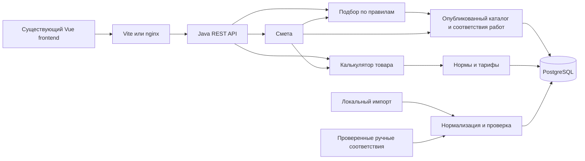

> Исторический срез до реализации Java + MongoDB + Python. Для текущих путей, решений и проверок используйте [AI_CONTEXT.md](AI_CONTEXT.md) и [IMPLEMENTATION_STATUS.md](IMPLEMENTATION_STATUS.md). Ниже сохранён исходный аудит.

# План реализации Java-бэкенда RepairCalc

Дата: 24 октября 2026 года.

**Цель:** реализовать самостоятельный backend на Java 21 или новее для существующего frontend: каталог, детерминированные расчёты материалов и работ, подбор по явным правилам и общая смета. Разработка ML на Python выполняется позднее другим участником команды и не входит в этот план. Текущий документ описывает будущие задачи; реализация приложения не начата.

Требование Java зафиксировано пользователем и заменяет прежнюю неопределённость между Java и FastAPI. [Архитектурный отчёт][review] используется как источник результатов исследования; его предложения по ML, LLM и выбору backend-языка не являются задачами этого этапа.

## 1. Границы работ

### Входит в текущую реализацию

- Java REST API, совместимый с текущими сценариями frontend.
- PostgreSQL, миграции, нормализованный каталог, происхождение и версии данных.
- Загрузка подготовленного каталога; затем потоковый импорт исходных JSON/XML.
- Проверка геометрии, условий применения, расхода, упаковки, запаса и денежных итогов.
- Калькулятор конкретного товара, подбор по правилам, смета нескольких помещений и замена материалов.
- Версионированные нормы, коэффициенты, тарифы работ и правила комплектования.
- Ручные проверенные соответствия «товар — виды работ» как входные данные этого этапа.
- Ошибки, служебная готовность, тесты, контейнеризация и интеграция с frontend.
- Небольшая граница будущей интеграции с Python: форматы данных и интерфейс применения соответствий. HTTP-адаптер реализуется после появления согласованного Python API.

### Отложено за пределы этапа

ML-матчинг, обучение, embeddings, оценка качества моделей, датасеты для ML, LLM/Ollama, RAG и развёртывание Python-компонента выполняются другим участником позднее. Для запуска Java backend они не требуются.

Также не включены аккаунты покупателей, серверное хранение пользовательских проектов/смет, настоящая корзина магазина, checkout, платёж, личный кабинет, административный UI и интеграция с неподтверждённым внешним API. Существующие локальные сохранения и JSON-экспорт продолжают обслуживаться frontend.

**Критерий завершения этого этапа:** три пользовательских сценария работают через Java API и PostgreSQL на проверенном наборе данных без Python-процесса. Это готовность backend без ML, а не выполнение всех ML-требований исходного хакатон-кейса.

## 2. Технологические решения

| Компонент | Решение | Практическое применение |
|---|---|---|
| Java | **Java 21 — базовая версия**; JDK новее допустима при совместимости | `maven.compiler.release=21`; проверка сборки и запуска на JDK 21; preview features не использовать |
| Контроль JDK | Maven Enforcer и Java toolchain/документированный JDK | Сборка на JDK ниже 21 должна завершаться понятной ошибкой; JDK CI и Docker согласованы |
| Backend | Spring Boot, Spring MVC | Один процесс, обычный REST/JSON; reactive stack не требуется |
| Сборка | Maven Wrapper, один backend Maven module | Версии библиотек согласовываются через Boot BOM; без многомодульной сборки на старте |
| Хранилище | PostgreSQL | Реляционные связи, транзакции, numeric и JSONB для атрибутов/provenance |
| Persistence | Spring Data JPA/Hibernate для обычных операций; JDBC batch для массового импорта при необходимости | Не держать весь каталог в persistence context |
| Миграции | Flyway | Версионированные SQL-миграции; Hibernate в deploy только проверяет схему |
| Валидация | Jakarta Bean Validation + предметные проверки | DTO bounds отдельно от геометрии, единиц и применимости норм |
| Арифметика | BigDecimal | Деньги и расчёт потребности без binary floating point; округление вверх по упаковкам |
| Контракт | Существующий OpenAPI 3.0.3 | Один согласованный YAML для backend/frontend; публикация спецификации без обязательной генерации новой конкурирующей схемы |
| Тестирование | JUnit, Spring test tools, Testcontainers PostgreSQL; Mockito или простые fakes по необходимости | Чистые расчёты, MVC API, реальная схема БД/миграции/import |
| Эксплуатация | Spring Boot Actuator с ограниченным health exposure, логи stdout | Liveness отдельно от готовности БД/каталога/правил; не открывать env/config endpoints |
| Развёртывание | Docker Compose: frontend + backend + PostgreSQL | Python/ML/очередь сообщений не являются зависимостями запуска |
| Доступ оператора | Сначала локальные команды импорта | Spring Security подключается при появлении защищённых HTTP-операций; публичная запись каталога не открывается |

Официальная документация на дату планирования подтверждает совместимость Spring Boot 4.1.2 с Java 21. Его можно взять как проверенную исходную точку; окончательный patch и совместимость драйвера PostgreSQL, Flyway и дополнительных инструментов фиксируются в задаче BE-02. [Spring Boot System Requirements](https://docs.spring.io/spring-boot/system-requirements.html). Версии JPA/Hibernate/validation/test tools не назначать независимо от BOM без причины.

Redis, Kafka/RabbitMQ, Kubernetes, Spring Cloud, отдельный API Gateway, универсальный rule engine и отдельные бизнес-микросервисы на этом этапе не нужны.

## 3. Структура приложения

Модульный монолит: пакеты по функциональным областям, простые слои внутри. Новое приложение предлагается разместить в `backend/` рядом с существующим `frontend/`.

```text
backend/
  pom.xml
  mvnw / mvnw.cmd / .mvn/
  Dockerfile
  src/main/java/<base-package>/
    RepairCalcApplication.java
    catalog/          карточки, идентичность, опубликованные ревизии, витрина
    ingestion/        чтение источников, нормализация, отчёты, публикация
    rules/            нормы, коэффициенты, совместимость, тарифы, комплекты
    calculation/      геометрия, расход, упаковки, денежная арифметика
    recommendation/   подбор по работам и условиям без ML
    estimate/         сборка сметы, selections, итоги, полнота
    integration/      граница получения внешних соответствий в будущем
    operations/       локальные import-команды, готовность, import status
    common/           ограниченный набор Money/Unit/Error и общая конфигурация
  src/main/resources/
    application.yml
    application-local.yml
    db/migration/
  src/test/java/<base-package>/
  src/test/resources/
    catalog/
    rules/
    contracts/
    calculations/
```

`<base-package>` выбрать при инициализации по соглашению команды. Перечень — структура будущих файлов, а не уже созданный backend.

Направление вызовов: controller → application service → domain logic. Calculation принимает проверенные значения и не зависит от HTTP/JPA/Python. Estimate оркестрирует recommendation, catalog и calculation. Другой модуль обращается к публичному сервису владельца данных, а не к его repository. DTO, JPA entity и расчётные value objects разделены.



## 4. Рабочие решения для первой версии

Эти решения позволяют планировать реализацию без ожидания ML. Предметные правила, требующие подтверждения, выделены отдельно в разделе 13.

| Вопрос | Предлагаемое решение первой версии |
|---|---|
| Как подбирать без ML | Только по проверенным `product ↔ work` соответствиям и явным условиям; стабильный порядок по приоритету набора и ID. Не заявлять интеллектуальное ранжирование |
| Источник соответствий | Отдельный versioned import-файл; один товар может иметь несколько work codes. Примеры/фикстуры не объявлять подтверждёнными производственными данными |
| Неизвестная пригодность | Проверять признаки, необходимые для конкретной операции/материала; неизвестный обязательный признак не означает разрешение |
| Неполная смета | Если обязательную часть нельзя посчитать — 422 с конкретной причиной. Partial estimate с coverage отложить до согласованного UI/контракта |
| Тариф работ не известен | Не подставлять ноль; использовать согласованный тариф с источником либо вернуть 422. Для product calc нулевой labor корректен по назначению операции |
| Объект и класс ремонта | Передавать и сохранять в контексте запроса; без скрытых наценок до появления утверждённых правил различий |
| Упаковки нескольких комнат | Первоначально округлять по строке/комнате, как текущий UI, с явной пометкой отсутствия оптимизации общих остатков. Это решение подтвердить до multi-room эталонов |
| Несколько материалов одного kind в комнате | Первая версия поддерживает текущий ключ `roomId:kind`; сценарий нескольких поверхностей/ролей одного kind не расширять скрыто |
| Пользовательские данные | Draft/сметы/cart остаются в localStorage; backend рассчитывает результат без создания аккаунта |
| Маркер режима | `mode=api` означает серверный расчёт, не наличие ML. `versions.model="not-used"`; ручные соответствия входят в fingerprint версии каталога |
| Долгий импорт | Локальная команда с записью статуса и отчёта; не держать пользовательский HTTP-запрос открытым |

Расчётный механизм зависит от данных и rules, а не от ID вроде `demo-tile`. Прикладные правила «плитка требует клей» или «работе нужна грунтовка» описываются проверенной конфигурацией комплекта и типом материала/профилем расчёта.

## 5. План данных и миграций

### Основная схема

| Таблица | Назначение | Ключевые ограничения |
|---|---|---|
| `catalog_release` | Публикуемый снимок, source/pipeline/mapping manifests, hashes и состояния | Одна активная опубликованная версия; опубликованные данные неизменны |
| `product` | Внутренняя стабильная идентичность | UUID/opaque ID; `cod_good` не объявлять уникальным до разрешения дублей |
| `source_record` | Исходная запись, source/external ID, raw attributes, provenance и ошибки | UNIQUE(release, source, external_id); characteristics сохраняются массивом, без потери повторов |
| `product_revision` | Название, тип и calculation profile, цена продажи, упаковка, единицы, применимость, атрибуты в конкретном release | UNIQUE(release, product); неизвестные значения nullable, известные проверяются |
| `work_type` | Версионированный справочник операций | UNIQUE(taxonomy_version, code); meanings опубликованной версии не меняются |
| `product_work` | Несколько рабочих назначений товара | Связь revision/work, source manual/external, version/evidence; явная политика принятия |
| `rule_set` | Версионированный typed bundle: нормы, coefficients, комплекты и labor tariffs | Version UNIQUE, hash, источники и условия; неизменяемость используемых версий |
| `import_run` | Технический статус импорта, фаза, количества, ошибки и итоговый release | Повтор по fingerprint не создаёт скрытые дубли; отчёт об аварийном завершении |

Таблицы пользователей, проектов, комнат, сохранённых смет, заказов и моделей не создавать. Входы Project/Room и ответы Estimate — DTO/value objects, а не автоматические кандидаты в таблицы.

Обязательные правила persistence:

1. Деньги — PostgreSQL numeric и Java BigDecimal; масштаб хранения выбирается по данным, выдача денежных сумм — decimal string RUB. Не округлять промежуточную потребность до округления числа упаковок.
2. Объём/масса содержимого, единица продажи, площадь упаковки и физическая единица потребности — разные понятия.
3. Сырые ошибочные/нулевые цены сохраняются в source record; расчётная карточка не становится бесплатной автоматически.
4. Категории разных источников и ID JSON/XML не объединяются по совпадению числа или названия. Cod_good — кандидат связи, а не универсальный PK.
5. Один расчёт фиксирует версии catalog/rules и читает только их неизменяемые данные. Mapping входит в manifest каталога.
6. Import пишет в staging ограниченными пакетами. Публикация готового release и замена предыдущего активного — одна короткая атомарная транзакция.
7. JDBC/JPA вызовы не удерживают транзакцию на весь большой файл. Повторный import и сбой не повреждают последнюю опубликованную версию.
8. Индексы сначала на unique/FK и фактические запросы витрины/подбора; GIN по всем raw attributes не добавлять заранее.

Миграции выпускать по готовым частям: catalog foundation → rules/work mappings → import/publication metadata и нужные индексы. Flyway применяется на чистой БД в integration tests; `ddl-auto=validate` в deploy.

## 6. Пользовательский API

За основу взять [существующий OpenAPI][openapi] и [ручной frontend-клиент][api]. Все пути ниже уже предусмотрены клиентом, но сервер ещё не реализован.

| Метод и путь | Что реализовать | Проверки и ошибки |
|---|---|---|
| `GET /api/v1/products` | Небольшая нормализованная витрина `Product[]`, не весь raw каталог | 200 включая пустой массив; 503 если каталог не опубликован |
| `POST /api/v1/product/{id}/calc` | Расчёт по ID и ProductInput; одна строка Estimate; labor=`0.00` | 404 неизвестный ID; 422 неподдержанный ввод/норма/единица/упаковка; 503 неготовность |
| `POST /api/v1/recommendations` | Проверенные кандидаты по работам и условиям, шаблонные причины и ограничения | 200 с пустым списком при отсутствии вариантов; 422 невалидная Room; 503 неготовность |
| `POST /api/v1/estimate` | Комплект по rooms/works, validation selections, строки, материалы и labor отдельно | 409 недопустимый/недоступный selection; 422 недостаток обязательных данных; 503 неготовность |

Общие ответы: 400 для некорректного JSON; 422 для понятной validation/domain error; 500 только для неожиданной серверной ошибки. `ApiError={code,message,fields?}` с безопасным текстом. Не возвращать клиенту stack traces и SQL. Request ID передавать заголовком и добавлять в серверные логи.

Значения `quantity` в строке сметы — целое число единиц продажи; price относится к saleUnit. Ввод розеток требует целого quantity, длина кабеля может быть дробной. Сервер не принимает итоговую цену из браузера и повторно проверяет selections.

### Что согласовать перед написанием DTO

- **Обои:** текущий `packageSize` описан как постоянное количество unit в saleUnit, но число полотен из рулона зависит от высоты/раппорта. Хранить roll geometry отдельно; в UI показывать геометрию рулона, в результате — вычисленные полотна/рулоны. Синхронно уточнить описание YAML и отображение frontend.
- **Смеси:** для выбранной нормы могут понадобиться основание/толщина. Сначала поддержать строго определённый проверенный профиль; остальные случаи — 422, пока необходимые поля не согласованы.
- **Version precondition:** текущий запрос не содержит ожидаемую версию цены. Не обещать выявление изменения показанной цены без `expectedVersions`/quote context. Для первой версии достаточно возвращать актуальный snapshot и явно информировать об обновлении; строгий price conflict — отдельное расширение.
- **Полнота:** правило 422 при отсутствии обязательной части закрепить в YAML/fixtures; warnings оставить для неблокирующих ограничений.
- **ID и selections:** room IDs уникальны; неизвестные room/kind/product keys отклоняются; work-коды и profile/kit rules согласованы.

Пагинацию и endpoint полной карточки добавлять при расширении витрины: нынешние экраны ожидают массив. Не менять envelope только на сервере. CRUD сохранённых смет и корзины не включать.

## 7. Этапы и задачи реализации

Все пункты — будущий backlog. Зависимости обозначены кодами задач; готовность оценивается результатом, а не числом созданных классов.

### Этап 0. Зафиксировать первые правила и контракты

| ID | Задача | Зависит от | Готово, когда |
|---|---|---|---|
| BE-01 | Согласовать первую подвыборку, нормы/тарифы, обязательный комплект, unknown/partial и multi-room policy; выписать примеры | Владелец/предметные данные | Есть проверяемые входы/выходы и источники; неизвестное обозначено; Java 21 зафиксирована |
| BE-02 | Выбрать совместимые версии Boot/JDK/PG/Flyway, инструменты и package name; записать короткий ADR | — | Maven/JDK/Docker/CI матрица определена; зависимости не ниже Java 21; версия BOM фиксирована |
| BE-03 | Уточнить существующий OpenAPI, поля ошибок, обои и правила ProductInput; подготовить contract fixtures | BE-01 | Один согласованный YAML; изменения frontend перечислены; нет конкурирующей схемы API |

### Этап 1. Создать техническую основу

| ID | Задача | Зависит от | Готово, когда |
|---|---|---|---|
| BE-04 | Инициализировать backend Maven module и пакеты из раздела 3; Wrapper, release=21, Enforcer | BE-02 | Чистый checkout собирается на JDK 21; JDK ниже 21 отклоняется |
| BE-05 | Добавить local/test/deploy config, DB properties, profiles, ограниченные health/liveness | BE-04 | Backend запускается; readiness показывает неготовность БД/данных корректно; секретов в Git/VITE нет |
| BE-06 | Реализовать общую обработку ошибок, request ID и DTO validation | BE-03, BE-04 | 400/422/500 проверены MVC-тестами; внутренние детали не раскрываются |
| BE-07 | Подключить Flyway и тестовую PostgreSQL; JUnit/Testcontainers pipeline | BE-04, BE-05 | Миграции применяются к чистой БД; тесты воспроизводимы на реальном PostgreSQL |

### Этап 2. Каталог и проверенные данные

| ID | Задача | Зависит от | Готово, когда |
|---|---|---|---|
| BE-08 | Создать миграции и repositories/query для release/product/source/revision | BE-07 | Unique/FK/check constraints и чтение ревизии подтверждены integration tests |
| BE-09 | Загрузить небольшой нормализованный каталог и ручные multi-work соответствия через локальную команду | BE-01, BE-08 | Данные и источники видны; повтор не размножает карточки; Python не требуется |
| BE-10 | Реализовать `GET /products` и DTO mapping | BE-03, BE-09 | Витрина принимается frontend Zod; price/unit/packaging непротиворечивы; empty/503 проверены |

### Этап 3. Нормы и расчётное ядро

| ID | Задача | Зависит от | Готово, когда |
|---|---|---|---|
| BE-11 | Создать typed RuleSet, версии, источники, норму/коэффициенты/тарифы и validation loader | BE-01, BE-07 | Неполный либо противоречивый bundle не публикуется; версия/источник доступны |
| BE-12 | Реализовать geometry, Money/Unit, запас и общую упаковочную арифметику | BE-01, BE-04 | Ручные эталоны и границы BigDecimal совпадают; нет лишней упаковки из-за double |
| BE-13 | Реализовать стратегии покрытий, краски/грунтовки, проверенной смеси, обоев, розеток и кабеля | BE-11, BE-12 | Каждая стратегия проверена на обычных/граничных/неполных данных; formula и источник объяснимы |
| BE-14 | Реализовать `POST /product/{id}/calc` | BE-03, BE-06, BE-10, BE-13 | Одна строка, labor=0; 404/422/503 и invariants проверены; нет демо-ID в правилах |

Первый контрольный результат: импортированная карточка → PostgreSQL → Java calc → API → ProductView. До полного ядра допустим выпуск одной проверенной стратегии покрытия; это промежуточная поставка, а не завершение всего этапа.

### Этап 4. Подбор материалов без ML

| ID | Задача | Зависит от | Готово, когда |
|---|---|---|---|
| BE-15 | Реализовать проверку применимости по материалу/операции и Room conditions | BE-09, BE-11 | Есть positive/negative/unknown случаи; отсутствующее обязательное свойство не превращается в true |
| BE-16 | Реализовать выбор кандидатов по проверенным work mappings и стабильный порядок | BE-15 | Один товар участвует в нескольких работах; результат воспроизводим без ML |
| BE-17 | Реализовать `POST /recommendations` и объяснения по сработавшим правилам | BE-03, BE-06, BE-16 | Работают санузел, обычная комната, unheated и пустая выдача; причины не выдумывают свойства |

### Этап 5. Общая смета и замены

| ID | Задача | Зависит от | Готово, когда |
|---|---|---|---|
| BE-18 | Создать проверенные kit rules и selection validator | BE-01, BE-11, BE-16 | Зависимые материалы задаются правилами; несвязанный/несовместимый selection отклоняется |
| BE-19 | Собрать multi-room estimate, labor и totals с согласованной полнотой | BE-13, BE-18 | Материалы/работы отдельно; нет неизвестного labor=0; правила округления зафиксированы |
| BE-20 | Реализовать `POST /estimate`, повторный расчёт при смене материала и версии результата | BE-03, BE-06, BE-19 | Два и более помещения, все работы и замены проходят API tests; старый состав не сохраняется после смены технологии |

### Этап 6. Повторяемый импорт исходных каталогов

| ID | Задача | Зависит от | Готово, когда |
|---|---|---|---|
| BE-21 | Реализовать streaming JSON/XML adapters и нормализацию с provenance | BE-08, BE-09; исходные файлы | Не загружается весь файл в память; единицы/диапазоны/повторы сохранены; DTD/external entities отключены |
| BE-22 | Реализовать явную политику объединения, дублей, отсутствующих цен/норм и quality report | BE-01, BE-21 | Неоднозначные карточки изолированы; покрытия полей измерены по поддержанным категориям |
| BE-23 | Реализовать import_run, повтор/аварийное завершение и атомарную публикацию release | BE-07, BE-22 | Плохой/повторный import не портит активный каталог; нет смешения цен/фасовок разных ревизий |

Первые пользовательские сценарии не должны ждать полного каталога: BE-09 работает с подготовленным форматом. Если для текущего запуска согласован только реалистичный тестовый набор, BE-21–23 можно выпустить после первого рабочего backend; готовность full import подтверждается отдельно. Большие исходные JSON/XML сейчас отсутствуют в checkout: сводные аудиты не заменяют их для acceptance импорта.

### Этап 7. Интеграция frontend и запуск

| ID | Задача | Зависит от | Готово, когда |
|---|---|---|---|
| BE-24 | Подключить api mode и завершённые сценарии frontend, исправить отображение обоев/ошибок/режима данных | BE-03, BE-14, BE-17, BE-20 | Три страницы работают через API; 422/409/503 подсказывают действие; нет fallback на demo |
| BE-25 | Добавить backend+PG в Compose, local env examples и Make targets; сохранить существующие frontend targets | BE-05, BE-07; app endpoints | Чистый запуск и rebuild описаны; внутренняя сеть корректна; DB не публикуется без необходимости |
| BE-26 | Добавить CI: JDK check → Maven verify → frontend checks и api-mode E2E | BE-07, BE-24 | Тесты расчётов, контрактов и интеграции обязательны; demo suite запускается отдельно |
| BE-27 | Подготовить backup/restore каталога/rules, smoke/негативные сценарии, измерения времени и инструкцию | BE-24, BE-25; BE-23 для full import | Другой участник запускает без Python, восстанавливает данные; версии и ограничения результата видны |

### Этап 8. Подготовить передачу границы Python-интеграции

| ID | Задача Java-части | Зависит от | Готово, когда |
|---|---|---|---|
| BE-28 | Согласовать с участником Python ID/revision/hash, taxonomy codes и формат соответствий из раздела 10 | BE-03, BE-08 | Есть небольшой versioned документ/fixtures; Python не получает доступ к записи Java-БД |
| BE-29 | Выделить application interface приёма внешних соответствий и подготовить contract tests с файлом/заглушкой | BE-09, BE-28 | Изменяется источник mapping, а не calculation/estimate API; stale/unknown results отклоняются |

BE-28–29 — подготовка контракта, а не реализация ML-клиента или Python-сервиса. Реальный HTTP transport, retries и расписание синхронизации добавляются позже при наличии согласованного сервиса.

## 8. Порядок работ и зависимости

Критический путь первого рабочего сценария:

`BE-01/02/03 → BE-04/05/06/07 → BE-08/09/10 → BE-11/12/13/14 → ProductView через API`.

Далее: `BE-15/16/17 → BE-18/19/20 → три страницы через API → BE-24/25/26/27`.

После фиксации data schema нормализация полного каталога BE-21–23 может идти независимо от наполнения остальных стратегий. Contract boundary BE-28 можно обсуждать заранее, без разработки Python и без блокировки Java. Это порядок зависимостей; он не предполагает дополнительных исполнителей для Java-части.

| Контрольная точка | Результат | Что ещё не готово |
|---|---|---|
| M1 Foundation | JDK 21+, build/test, PG migrations, health/errors | Бизнес-сценарии |
| M2 Первый calc | Реальная БД, витрина, подтверждённое покрытие, ProductView | Остальные стратегии и общая смета |
| M3 Все стратегии | Покрытия/краски/грунтовки/обои/смеси/точки/кабель по согласованным данным | Подбор и сборка комплекта |
| M4 Backend без ML | Три сценария, замены, правила и тарифы, интерфейс в api mode | Автоматическое ML-назначение новых товаров |
| M5 Готовность запуска | Compose/CI, проверенный import в согласованном объёме, recovery и инструкция | Python-компонент и внешняя корзина |

Оценки в днях до уточнения состава команды, правил и доступных карточек не назначаются. Наиболее рискованны проверка расчётных данных, обои, полнота комплектов и source merge; каркас и обычный REST имеют меньшую предметную неопределённость.

## 9. Проверки расчётов и API

Тестировать реальные риски, а не копировать implementation в expected values. Ожидания готовятся по независимым ручным примерам и проверенным параметрам.

| Область | Обязательные проверки |
|---|---|
| Geometry | Площадь/периметр/стены; вычет проёмов; недопустимые размеры/проёмы; дубли ID; пустые/слишком большие коллекции |
| Decimal и упаковки | Точное целое деление, дробная граница, 0% и допустимый запас; количество округляется вверх; purchased≥need и remainder≥0 |
| Краска/грунтовка | Различать один слой/весь цикл; не умножать слои дважды; неизвестный расход/единица отклоняются |
| Смеси | Условия выбранной нормы, диапазоны, толщина/основание; отсутствие плотности не позволяет конверсию литров в кг |
| Обои | Раппорт 0 и >0, высота с подгонкой, полотно длиннее рулона, целые полотна и рулоны, явная политика проёмов/подрезки |
| Электрика | Целые точки, длина трассы, отсутствие резервного множителя для розеток; нулевые объёмы работ не создают строку с quantity=0 |
| Подбор | Несколько work labels, несовместимые и неизвестные обязательные свойства; разные типы комнат; стабильный порядок; нет вариантов |
| Смета | Multi-room, totals, labor, полнота, замена материала и dependent kit, неизвестный selection; общий контекст без скрытых наценок |
| API contract | Decimal strings, UTC даты, mode=api, версии, error shape; ProductCalc с ровно одной строкой и labor=0; current Zod принимает ответы |
| Persistence/import | Миграции с нуля, повтор, дубли source IDs/cod_good, повреждённый файл, rollback публикации, immutable release, отсутствие смешанных ревизий |
| API-mode E2E | Мастер → замена → смета; Room → product calc; save/cart/JSON локально; 404/409/422/503, empty state и неверные данные |
| Запуск | Чистый Compose, БД неготова, перезапуск backend, recovery import, восстановление backup; отсутствие Python не ломает readiness |

Текущие frontend Playwright tests принудительно работают в demo mode. Для приёмки Java нужны отдельные api-mode сценарии; прохождение старого demo suite не доказывает интеграцию. [playwright.config][playwright].

Значение 15 секунд — текущий timeout клиента/nginx, не установленный SLA. Online-сценарии не должны выполнять import и массовые операции. Конкретные targets latency/нагрузки установить после измерения, без выдуманных RPS.

## 10. Граница с будущим Python-компонентом

### Владение ответственностью

| Java backend | Будущий Python-компонент |
|---|---|
| Внутренние IDs, каталог и его ревизии | Алгоритм назначения работ/ранжирования |
| Источники цен, упаковок, подтверждённых норм | Подготовка и использование ML-моделей |
| Проверка совместимости, комплект и расчёт | Предложения соответствий с идентификаторами и provenance |
| Отбор/применение входящих соответствий и публикация release | Своя реализация inference и оценка качества |
| Публичный API frontend, миграции и PostgreSQL | Согласованный внешний контракт, без прямых изменений Java-БД |

Сначала достаточно обмена versioned JSON batch-файлом: Java экспортирует согласованные карточки, Python позднее возвращает назначения, Java импортирует и проверяет их. Если понадобится HTTP, транспорт заменяется адаптером, а не переносом расчётов. Этот формат — предложение для совместного согласования, а не требование уже реализовать Python API.

Минимальные поля границы:

- Вход: schemaVersion, requestId, taxonomyVersion, productId, productRevisionId/contentHash, разрешённые work codes, название/описание/категории и атрибуты с единицами и происхождением.
- Выход: те же идентификаторы/version/hash; список work codes; статус результата; component/model version; evidence; score только при определённой семантике. Пустой результат и «не удалось определить» отличаются от успешного назначения.
- Java проверяет схему, известность кодов, неизменность входной ревизии и допустимость обновления. Невалидный ответ не меняет опубликованный каталог. Версия нового mapping отражается новым catalog release.
- Недоступность будущего Python не обнуляет существующие подтверждённые mappings и не блокирует расчёты опубликованного каталога. Для нового товара без mappings — явный статус/отказ либо проверенное ручное назначение, без имитации ML.
- Приёмка внешнего соответствия не даёт Python права менять цену, фасовку, формулы или объявлять неподтверждённый расход достоверным.

На Java достаточно публичного application interface вида «проверить и применить batch внешних соответствий» и заменяемого источника mappings. Общий универсальный AI framework, вызовы Python из каждой строки сметы и синхронный inference на пользовательском HTTP-пути не закладываются.

## 11. Локальная разработка и развёртывание

Предлагаемые изменения выполняются в BE-25, а не в рамках создания этого плана:

1. Сохранить корневой [Makefile][makefile] как общую точку запуска. Добавить backend tasks, например `backend-dev`, `backend-test`, `backend-verify`; точные имена согласовать со структурой существующих targets. Реализация должна одинаково работать через Maven Wrapper на поддерживаемых ОС.
2. Расширить Compose сервисами backend и PostgreSQL. Frontend продолжает обращаться same-origin через `/api/v1`; nginx proxy направляется на DNS backend в Compose, Vite — на опубликованный локальный адрес.
3. Учитывать, что внутренний frontend/nginx уже слушает 8080. Порт Java выбирается отдельно; одинаковый внутренний порт в разных контейнерах допустим, host ports должны быть различны.
4. Разделить public VITE settings и backend secrets. В example env только примеры; реальные DB credentials — локальный игнорируемый env/секреты размещения. Не заставлять пользователя хранить пароль в frontend build args.
5. Первая версия импортируется локальной командой из подготовленного файла/монтированного каталога. Нынешний frontend nginx ограничивает тело запроса 2 MiB, поэтому большие source JSON/XML через публичную форму не отправляются.
6. Логи содержат operation/request ID, catalog/rules versions, длительность и ошибки; не пишут полный ввод пользователя и секреты по умолчанию.
7. Для автономного запуска заранее подготовить app/PG images и выбранные данные/rules; проверять runtime без внешней сети. Обычная Maven/npm/Docker сборка может требовать сеть и не равна автономному запуску.

## 12. Критерии готовности Java-части

- [ ] Сборка на Java 21 воспроизводима; JDK ниже 21 отклоняется; runtime image и CI соответствуют этому требованию.
- [ ] Все четыре пользовательских endpoint отвечают по согласованному OpenAPI и принимаются frontend Zod.
- [ ] Три сценария UI работают в api mode; save/cart/JSON сохраняют локальный характер.
- [ ] Каталог, правила и несколько соответствий работ на SKU сохранены и версионированы; Python для запуска не нужен.
- [ ] Все поддержанные стратегии дают проверенные упаковки/остатки/деньги; источники коэффициентов и тарифов доступны.
- [ ] Неверные данные, неизвестные нормы, невозможный selection и неготовность зависимостей дают предсказуемые ошибки.
- [ ] Нет расчётных веток по конкретным demo SKU; комплект меняется через профиль/правила.
- [ ] Полнота сметы и закупка между комнатами следуют согласованной политике.
- [ ] Миграции, повторный import и атомарная публикация проверены в согласованном объёме; full import не объявлен проверенным без исходников.
- [ ] Unit/API/PG integration tests и api-mode E2E проходят; demo tests учитываются отдельно.
- [ ] Compose и инструкция позволяют другому участнику запустить backend и восстановить данные.
- [ ] Контракт будущих внешних соответствий описан; runtime ML transport не является условием завершения.

## 13. Что необходимо подтвердить перед соответствующими задачами

Java 21+, отдельный Python ML и отсутствие ML в текущей реализации уже определены пользователем и повторного выбора не требуют.

| Решение | Когда требуется | Предварительный вариант |
|---|---|---|
| Первая подборка товаров и источник цены/единицы продажи | До BE-09 | Проверенный versioned набор; конфликты источников не разрешать произвольным выбором |
| Нормы, коэффициенты, тарифы и источник подтверждения | До BE-11/13 | Проверенные данные производителя/эксперта; учебные величины явно помечены |
| Минимальный комплект по каждому виду работ | До BE-18 | Явный перечень обязательных/исключённых материалов; без обещания полноты всего ремонта |
| Поведение при неполноте и использование остатков между комнатами | До BE-19 | 422 для отсутствующей обязательной части; округление по комнате с явным ограничением |
| Правила обоев/смесей и необходимые поля UI | До BE-03/13 | Типизированные профили; неподдержанные условия требуют уточнения |
| Полный import или только реалистичный набор в первой поставке | До BE-21 | Рабочий backend на подготовленных данных раньше; full import отдельной проверяемой поставкой |
| ID/revision/hash/taxonomy формат для Python | До BE-28/29 | Batch JSON контракт; применяет Java; Python не пишет в её БД |
| Дедлайн и доступные часы Java-разработчика | До календарной оценки | Сначала оценить этапы по готовым правилам/данным, затем назначить сроки |

**Первое действие при начале реализации:** BE-01–03 — закрепить данные и небольшие спорные части контракта; затем BE-04–07 — каркас Java 21, PostgreSQL, миграции, ошибки и тестовая среда. Разработка Python/ML не блокирует этот путь.

[review]: <C:/Users/sanya/IdeaProjects/HotProd_SPB_TECH_RUN/docs/BACKEND_ARCHITECTURE_REVIEW.md:1>
[openapi]: <C:/Users/sanya/IdeaProjects/HotProd_SPB_TECH_RUN/docs/openapi.yaml:1>
[api]: <C:/Users/sanya/IdeaProjects/HotProd_SPB_TECH_RUN/frontend/src/services/api.ts:45>
[playwright]: <C:/Users/sanya/IdeaProjects/HotProd_SPB_TECH_RUN/frontend/playwright.config.ts:3>
[makefile]: <C:/Users/sanya/IdeaProjects/HotProd_SPB_TECH_RUN/Makefile:1>
