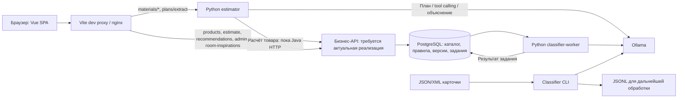

# RepairCalc: контекст проекта без учёта Java-реализации

Срез: **30 октября 2026**, ветка `main`, HEAD `27586a4` (`hotfix(ci): main branch`).

Документ подготовлен по исходникам frontend, Python-компонентов, контрактам и отслеживаемым конфигурациям. **По условию текущего этапа любую бизнес-функцию, исполнителем которой остаётся Java, считаем заглушкой, требующей актуальной реализации.** Это не утверждение об отсутствии Java-кода в репозитории. Его бизнес-реализация не исследовалась; прочитаны только конфигурации, манифест и границы интеграции.

«Реализовано» ниже означает наличие исполняемой логики в изученном коде, а не подтверждённую работоспособность текущего стенда. Модели, приложения, Docker-стек и тестовые наборы при этом исследовании не запускались. Локальные `.env`, `secret.env`, локальный Compose override и секреты не читались. Исторические отчёты не использовались как доказательство актуальной работоспособности.

## 1. Назначение и основное состояние

RepairCalc должен превращать параметры объекта, комнаты и выбранных работ в подбор товаров, количество материалов, целые упаковки, стоимость материалов и ориентировочную стоимость работ. Обязательные сценарии: общий расчёт проекта, подбор по условиям комнаты, калькулятор отдельного товара. Дополнительно разработаны интерфейсы распознавания плана, подбора по интерьеру и администрирования каталога.

При исключении Java проект состоит из:

- достаточно развитого Vue-интерфейса с ручными API-клиентами и проверкой контрактов;
- отдельного Python-классификатора товаров через локальную LLM, включая CLI и PostgreSQL worker;
- Python estimator: распознавание планов, ограниченный tool-calling для объяснения сметы и обучение коэффициентов расхода;
- демонстрационных каталогов, расчётов и изображений;
- инфраструктуры, которая **пока спроектирована вокруг обязательного Java backend**.

Полноценного независимого от Java серверного приложения для каталога, расчётов, рекомендаций и административных операций в изученной части нет. Python estimator не является заменой такого backend.

## 2. Технологии: фактические и предложенные ранее

Версии здесь взяты из файлов репозитория, а не из проверки установленных пакетов или реестров.

| Слой | Фактическая технология | Назначение |
| --- | --- | --- |
| Интерфейс | Vue `3.5.44`, Vue Router `4.5.0`, TypeScript `5.7.3`, Sass `1.83.4` | SPA, формы, навигация, адаптивная вёрстка |
| Контракты и числа в браузере | Zod `3.24.2`, decimal.js `10.6.0` | Проверка ответов/ввода; геометрия и демонстрационные расчёты |
| Отображение | markdown-it `15.0.3`, `@lucide/vue` `1.61.0` | Ограниченный Markdown объяснений, иконки |
| Сборка | Vite `8.3.5`, npm, GNU Make | Dev proxy, сборка SPA, команды проекта |
| Node | `.nvmrc`: `22`; engines: `^22.12.0 || ^24.0.0 || >=26.0.0` | Frontend и локальный загрузчик настроек |
| Проверки frontend | Vitest `5.0.5`, Vue Test Utils, jsdom, Playwright `1.64.1`, swagger-parser, Prettier | Unit/component/contract и браузерные проверки |
| Классификация | Python, LangChain Core `1.7.0`, langchain-ollama `1.1.0`, Pydantic `2.14.1` | Structured output, закрытая таксономия, проверка цитат |
| Очередь классификации | psycopg `3.2.13`, PostgreSQL | Задания с арендой, heartbeat и ограниченными повторами |
| Estimator | Python stdlib: `ThreadingHTTPServer`, `urllib`, `Decimal` | HTTP/CLI, вызов расчётного API, tool loop, регрессия |
| Распознавание плана | Pillow `12.1.1`, jsonschema `>=4.19.2,<5` | Проверка изображения и структурированного черновика |
| Inference | Ollama; шаблон модели `gemma4:12b`, образ `0.40.13` | Локальная модель для текста, tool calling и изображения плана |
| Хранение | PostgreSQL `17.11`, Docker volumes | Каталог/версии/правила/очередь предполагаются серверными данными |
| Развёртывание | Docker Compose v2.20+, nginx `1.28-alpine`, GitHub Actions, GHCR, Ansible Core `2.19.4` | Локальный стек и деплой готовых образов |
| Исключённый исполнитель | Java 21, Spring Boot `4.1.2`, JPA, Flyway, Maven | Существующая граница API и инициализации БД; функции не засчитываются |

Python-образы используют `python:3.11-slim`, CI — Python 3.12. Frontend-образ собирается в `node:22-alpine`. `frontend/package-lock.json` имеет формат v3 и 265 записей packages; установки через `npm ci` используют lock-файл. Python requirements не являются полным транзитивным lock-файлом.

В `PLAN.md` ранее предлагались **Python/FastAPI**, PostgreSQL/JSONB, опциональный поиск по эмбеддингам. В текущих Python-сервисах FastAPI нет. MongoDB относится к раннему варианту схемы, а не к текущему Compose. RAG, векторная БД, индекс эмбеддингов, Redis/Celery, Kubernetes и самостоятельный сервис ранжирования в изученной реализации не обнаружены. Выбор нового backend-фреймворка после исключения Java ещё не закреплён рабочим кодом.

## 3. Frontend: что уже можно сохранить

Точки входа: `frontend/src/main.ts`, `App.vue`; состояние — `composables/useWorkspace.ts`; публичный API — `services/api.ts`; административный — `services/admin.ts`.

| Экран/механизм | Реальная логика интерфейса | Серверная зависимость |
| --- | --- | --- |
| `/`, `/calculator` | Три шага, до 20 комнат, выбор работ, альтернативы и пересчёт, защита от устаревших ответов | `/products`, `/estimate` |
| `/room` | Влажность/нагрузка/отопление, подбор, добавление комнаты в проект | `/recommendations` |
| `/product?id=…` | Выбор товара, параметры расхода, переключатель пояснения ИИ, вывод формул/остатка | `/products`, `/product/{id}/calc` или `/materials/estimate` |
| `RoomEditor` | Ручные размеры, проёмы, тип комнаты и начальные условия, валидация | Не требует сервера для ручного ввода |
| `RoomPlanImport` | Файл/drag-and-drop/Ctrl+V, preview, bbox, проверка размеров, явное применение | `/plans/extract`, реализован в Python |
| `RoomInspirationGallery` | Пагинация, просмотр, обработка ошибок, согласованное применение товаров к комнате | Лента, анализ изображения, каталог и общий расчёт |
| `/saved` | Сохранение и удаление последних 30 смет в этом браузере | Нет серверного хранения |
| `/cart` | Локальный состав корзины, очистка, JSON-экспорт | Нет интеграции заказа с магазином |
| `/admin`, `/admin/products/new`, `/admin/products/:id` | Вход, список/фильтры, карточка, история, конфликт версий, классификация, проверка, публикация | Все административные операции уходят в исключённый backend |

Состояние `project`, `saved`, `cart` сохраняется в `localStorage` под ключом `repaircalc-workspace-v1`; схемы проверяются до восстановления/записи. Это работающая локальная функция, а не имитация серверного сохранения. Передача результата интерьера между маршрутами — одноразовая память `useInspirationImport`, без файлов и модельных ответов в URL.

В `services/api.ts` production принудительно выбирает `api`. `demo` разрешён только в development; ошибки API не переключают приложение на фикстуры. Распознавание плана всегда обращается к Python, даже при `VITE_DATA_MODE=demo`. Админка также не имеет демонстрационного адаптера.

`geometry()` считает площадь/периметр/площадь стен для интерфейса. `compatible()` применяет ограниченные флаги влажности/нагрузки/отопления; неподтверждённые значения не принимаются за разрешение. Это полезные локальные проверки, но будущий backend обязан повторить проверки на своей стороне.

`MarkdownText.vue` запрещает исходный HTML и загрузку изображений из ответа модели, ограничивает протоколы ссылок. Числа сметы выводятся из структурированного ответа, а не извлекаются из Markdown.

## 4. Реестр заглушек и недостающих функций

Обозначения: **J** — заглушка текущего этапа из-за Java-зависимости; **D** — демонстрационная подмена; **N** — необходимой серверной реализации нет в изученном контуре; **L** — рабочая локальная функция с ограниченной областью.

| Код | Функция и точка в коде | Статус | Что должно появиться |
| --- | --- | --- | --- |
| G01 | `service.catalog()`; `demoCatalog()`; `data/catalog.ts` | J + D | Актуальный нормализованный каталог через `GET /api/v1/products`, стабильные ID, подтверждённые цены/фасовки/свойства |
| G02 | `service.product()`; `productDemo()`, `calculateLine()` | J + D | Детерминированный серверный расчёт товара: расход, упаковки, остаток, стоимость, формула и версии |
| G03 | `service.estimate()`; `estimateDemo()`; `EstimateView` | N + D | `POST /estimate`: несколько комнат, состав материалов, сопутствующие товары, selections, отдельные материалы и работы |
| G04 | Тарифы внутри `estimateDemo()` | D | Подтверждённые источники тарифов и полнота состава работ. Сейчас ставки 650/450/400/900/100 зашиты в демо; объект/класс ремонта не создают отдельной расчётной политики |
| G05 | `service.recommendations()`; `recommendDemo()` | N + D | `POST /recommendations`: серверные ограничения совместимости, подбор/ранжирование и проверяемые причины выбора |
| G06 | `roomInspirations()`; `inspirationFeedMock` | N + D | Реестр реальных изображений, происхождение/права, хранение/выдача same-origin, cursor-пагинация |
| G07 | `analyzeRoomInspiration()`; `analyzeInspirationMock()` | N + D | Реальное выделение материалов по изображению и сопоставление с доступными SKU; сейчас выбор зависит от ID иллюстрации и условий комнаты |
| G08 | `Estimator.calculate()` → `/product/{id}/calc` | J | Новый исполнитель расчётного контракта; Python сейчас не рассчитывает baseline самостоятельно |
| G09 | `Estimator.estimate()` → tool → `calculate()` | J, при рабочем LLM-цикле | Подключить актуальный расчётный исполнитель, сохранить проверку единственного инструмента и неизменяемость входа |
| G10 | `admin.session/login/logout` | J | Серверная сессия, парольная проверка, CSRF, ограничения доступа и корректная cookie-политика |
| G11 | `admin.list/get/create/update/history` | J | Хранение черновиков, версии, история, фильтры/пагинация, `ETag`/`If-Match`, конфликт 412 |
| G12 | `admin.classify/classifications` | J для API и подготовки БД | Создание заданий из конкретной версии карточки, выдача статусов/результатов. Сам Python worker уже реализован |
| G13 | `admin.reviewOptions/reviews/review/readiness/publish` | J | Хранение решений человека, сопоставление таксономий, проверка готовности, атомарная публикация совместимых каталога и правил |
| G14 | `init-data`, конфигурация Flyway, `backend/data/*` | J + учебные данные | Независимая инициализация/миграции БД, публикация данных, актуальный механизм импорта и правил |
| G15 | Адаптеры `classification/catalogs.py` | Реальны, но неполны для бизнес-каталога | Объединение источников, разрешение дублей/конфликтов, идентичности, цены, единицы, нормы и запись в каталог. Адаптеры лишь готовят текст для классификации |
| G16 | `training.train()`, `corrected_input()` | Алгоритм реален; данные учебные, применение J | Реальные заказы/факт расхода, независимая оценка качества, процесс публикации артефакта и расчётный исполнитель |
| G17 | `useWorkspace`, `SavedView` | L | Только если требуется межустройственное хранение: API проектов/смет, пользовательская идентичность и политика обновления цен |
| G18 | `setCart()`, `CartView.exportCart()` | L; интеграция магазина отсутствует | Сопоставление со SKU магазина, проверка цены/наличия, передача состава в корзину магазина. JSON-файл не является оформленным заказом |
| G19 | `ProductSwatch.vue`, `RoomPlan.vue`, SVG интерьеров | Условные визуализации | Для реальных карточек — фотографии/URL и параметры оформления. Схематичный план не в масштабе может остаться декоративным; это не CAD и не результат распознавания |
| G20 | Compose/Ansible/CI | Реализованы для прежней архитектуры | Убрать обязательность Java из старта и проверок после выбора актуального backend; включить в жизненный цикл нужные LLM-сервисы |

У `estimateDemo()` есть специальные связи по ID, например добавление клея именно для `demo-tile`, выбор первого подходящего товара и учебные предупреждения. Их нельзя переносить в рабочую систему как универсальные правила комплектации.

Демокаталог frontend содержит 12 карточек `demo-*`, включая намеренно неполную. Bootstrap-каталог `backend/data/catalog-v1.json` тоже содержит 12 товаров, но использует отдельные серверные идентичности; версия `synthetic-catalog-v1`, `dataClass=test`. `rules-v1.json`: 8 профилей, 12 назначений, 5 тарифов; версия `synthetic-rules-v1`, также `test`. `work-mappings-v1.json`: 12 сопоставлений. Эти наборы не являются коммерческим каталогом.

Не следует заменять тестовые моки рабочими сетевыми вызовами: `frontend/tests/mocks/*`, `*.test.ts`, перехваты Playwright, подменённые транспорты Python и синтетические `examples/*` нужны для воспроизводимых проверок. Не являются заглушками также явные `unknown`/`null`, блокировка расчёта неполной карточки, ручное подтверждение распознанных размеров и начальные значения формы.

## 5. LLM-компоненты подробно

### 5.1. Классификатор товаров

Основные файлы: `backend/classification/repaircalc_classifier/{classifier,schema,catalogs,monitor,worker,__main__}.py`, `prompt.txt`, `taxonomy.json`.

Поток: карточка → нормализация `Product` → LangChain `ChatPromptTemplate` → `ChatOllama.with_structured_output(..., method='json_schema')` → Pydantic → проверка дословных цитат и допустимых путей полей → envelope результата.

- Таксономия `repair-product-taxonomy-v2`: **23 вида работ, 8 мест применения, 17 оснований, 7 свойств**. Промпт `repair-classifier-prompt-v2`.
- Свойства: `moisture_resistant`, `washable`, `wet_room_suitable`, `interior_suitable`, `exterior_suitable`, `frost_resistant`, `high_load_suitable`.
- Состояния свойств: `yes/no/unknown/conflict`; область: `in_scope/out_of_scope/uncertain`; есть `needs_review` и причины.
- Утверждения требуют `evidence`; цитата должна реально встречаться в указанном поле. Конфликт требует разных свидетельств. Наличие цитаты не доказывает логическую правильность вывода модели.
- Envelope хранит source/source_id/cod_good, версии и хеши входа/промпта/таксономии, имя модели, адрес и метаданные ответа. Это не обучение модели и не автоматическое получение расчётных норм.
- CLI: одна карточка или исходный JSON/XML; по умолчанию `--limit 1`, `--timeout 600`, `--num-ctx 16384`, `--num-predict 4096`; `--status` проверяет Ollama без inference. Итог — JSONL, прогресс/черновой поток — stderr; существующий output не перезаписывается.
- XML читается потоково; JSON-адаптер использует `json.load()` всего `products`, поэтому **JSON-импорт не потоковый**. Цена, остатки и изображения не входят в модель `Product` классификатора.
- `audit.py` помогает исследовать данные/кандидатов; `live_test.py` выполняет диагностические примеры. Ни они, ни unit-тесты не заменяют независимую размеченную выборку и метрики качества.

Worker уже является настоящим потребителем PostgreSQL-очереди `repaircalc.admin_classification_job`: `FOR UPDATE SKIP LOCKED`, lease 90 секунд, heartbeat 20 секунд, запись по действующему token, максимум 3 попытки, задержки 15/30 секунд. Вызов модели находится вне транзакции. Он не имеет HTTP-сервера и не создаёт таблицы/задания. Нужны существующая схема БД, вход задания и API управления; в рассматриваемом этапе эти зависимости относятся к G12–G14.

В текущем административном контракте предусмотрена проверка `accept/reject/correct`, профиль расчёта и отдельная публикация. Frontend поддерживает только четыре вида работ `floor/paint/wallpaper/electrical`; автоматически приравнивать к ним 23 метки классификатора нельзя. Аналогично `moisture_resistant` не равен разрешению для влажной комнаты, а `frost_resistant` не равен `unheated`. Нужен явный адаптер утверждённых данных; прежний Java-адаптер для этого этапа не считается реализацией.

### 5.2. Расход и объяснение сметы

Основные файлы: `backend/estimation/repaircalc_estimator/service.py`, `__main__.py`, `training.py`.

`POST /api/v1/materials/estimate` делает два обращения к Ollama: сначала требует вызов **ровно одного** `calculate_material_cost` с пустыми аргументами, затем объясняет возвращённую смету. Товар, площадь, запас и другие числа берутся из валидированного запроса; модель не может изменять аргументы расчёта. Сам tool вызывает прежний backend по HTTP.

`POST /api/v1/materials/calculate` вызывает расчётный backend без LLM. Оба маршрута без нового исполнителя остаются Java-зависимыми. `GET /health` сообщает `dependenciesChecked=false`: это liveness Python, не готовность модели или бизнес-API.

Если не удалось только финальное объяснение, готовая смета сохраняется с `explanationStatus=unavailable`. Успешный текст имеет статус `unverified_model_text`. Ошибка первого LLM-вызова или расчёта не подменяется демонстрационной сметой. UI по умолчанию включает пояснение ИИ в карточке товара, поэтому неподготовленная Ollama мешает этому сценарию даже при доступном расчётном API.

Регрессия реализована отдельно: для каждого SKU `factor = Σ(x*y)/Σ(x²)`, где x — baselineNeed, y — actualConsumed. Минимум по умолчанию 5 заказов, контроль дублей, factor `0.5..1.5`, совместимость SKU/единицы/версий. Поправка переводится в `effectiveReserve = (100 + reserve) * factor - 100` и снова отправляется в расчётный backend; допустимый эффективный запас `0..30`. Поддержаны paint/primer/covering/adhesive/cable, исключены wallpaper/socket. В браузере всегда `useCorrection:false`; штатные Make/Compose-команды не подключают `--correction`. Реальных обучающих заказов и подтверждённой оценки на новых данных в исследованном контуре нет.

### 5.3. План комнаты: самостоятельная рабочая реализация

`POST /api/v1/plans/extract` находится в `backend/estimation/repaircalc_estimator/plans/__init__.py` и **не вызывает Java**. Использует один запрос с изображением и JSON Schema в Ollama.

Сервис принимает base64 без data URL: PNG/JPEG/WebP, до 8 MiB, 12 млн пикселей и 12 MiB JSON. Проверяет фактический формат/анимацию, применяет EXIF-ориентацию, убирает метаданные, заменяет прозрачность белым фоном и передаёт PNG. Проверяет схему, bbox, совпадение числа с подписью, единицы mm/cm/m и диапазоны. Версии: `room-plan-draft-v1` и `room-plan-extraction-v1`; ответ содержит хеши и время запроса.

Результат — черновик `found/unknown/conflict`, а не подтверждённая геометрия. Размеры не восстанавливаются по пропорциям фотографии или площади. Для нескольких/непрямоугольных комнат прямое применение блокируется. Высоту и площадь проёмов пользователь подтверждает отдельно; пустые проёмы не означают 0. Обрезка комнаты до отправки ручная. UI защищает применение от изменения комнаты во время запроса.

### 5.4. Подбор по интерьеру: реализация отсутствует

Это **другой поток**, не `/plans/extract`. Контракт получает ID изображения из ленты и проект ровно с одной комнатой. Результат может изменить `works` и `selections`, но не геометрию, условия, ID и остальные параметры. Затем frontend проверяет товары по каталогу и запрашивает обычную смету. Для проекта с несколькими комнатами сохраняет остальные комнаты и пересчитывает весь проект.

Сейчас существуют три SVG-иллюстрации и `analyzeInspirationMock()` с условным выбором заранее известных товаров. Нет Python-обработчика фотографии интерьера, хранилища ленты и реального сопоставления визуальных признаков с SKU.

## 6. Контракты и схема взаимодействия

Основной контракт — `docs/openapi.yaml` (OpenAPI 3.0.3), административные схемы — `docs/admin-catalog-api.json`, план — `docs/room-plan-api.json`. В браузере им соответствуют `domain/types.ts`, `admin.ts`, `materials.ts`, `plans.ts`, `inspirations.ts`. Клиенты написаны вручную.

Схема отражает границы существующих компонентов и место недостающего бизнес-API. Направление `materials → бизнес-API` уже существует, но адресовано Java. Для реализации анализа интерьеров бизнес-API потребуется дополнительный модельный обработчик; сейчас такого соединения в коде нет.

Предполагаемый жизненный цикл данных: исходные карточки → нормализация/идентичность → классификация → проверка спорных утверждений и норм → согласованные версии каталога/правил → серверный подбор → детерминированный расчёт → необязательное объяснение → сохранение/экспорт/интеграция корзины.

Договорённости, которые нужно сохранить при смене исполнителя:

- Деньги — десятичные строки RUB, вычисления в десятичной арифметике; цена относится к единице продажи. `quantity` — целое количество упаковок, `need/purchased/remainder` — в расчётной единице.
- LLM классифицирует/извлекает/объясняет. Формулы, совместимость, округление упаковок и итоговая стоимость исполняются проверяемым кодом. Исключение Java не делает LLM источником арифметики.
- Смета содержит `versions.catalog/rules/model`, формулы, источники и предупреждения. Нужны согласованные снимки данных на весь расчёт.
- `selections` имеет формат `roomId:productKind → productId`. Неподходящий или устаревший выбор нельзя молча заменять другим SKU.
- В публичном `Product` ID — строка, но material-estimator требует UUID. `demo-*`, JSON source id, XML offer id и `cod_good` не взаимозаменяемы. Нужен явный слой идентичности.
- Комната прямоугольная; максимум 20 комнат, 4 вида работ, 7 видов товара. Для стен paint и wallpaper взаимоисключающие. Свойство `washable` есть в LLM-таксономии, но отсутствует как отдельный фильтр текущего публичного Product/Room.
- Неполные характеристики должны давать уточнение/блокировку, не вымышленные нормы. Производственный каталог нельзя получить только переименованием `synthetic-*`.

## 7. Конфигурации и способы запуска

### 7.1. Реестр конфигураций

| Файлы | Что задают |
| --- | --- |
| `env/.env.example`, `env/secret.env.example` | Общие defaults и отдельные имена секретов; рабочие локальные файлы исключены из Git |
| `Makefile`, `scripts/config.mjs`, `scripts/local.mjs` | Установка, проверка, сборка, копирование настроек без перезаписи, запуск процессов |
| `frontend/package.json`, `package-lock.json`, `.nvmrc` | Команды, зависимости и версия Node; lock изучен программно, без полного вывода |
| `frontend/{vite,vitest,playwright,playwright.inspirations}.config.ts`, `tsconfig.json`, `.prettierrc.json`, `.prettierignore` | Proxy, тестовые режимы, строгий TypeScript, форматирование |
| `frontend/Dockerfile`, `nginx/nginx.conf`, `nginx/default.conf.template` | Сборка SPA, nginx, CSP, API routing, лимиты тела/таймауты |
| `backend/{estimation,classification}/{Dockerfile,requirements.txt}` | Python runtime, зависимости, точки входа и непривилегированный пользователь |
| `docker/docker-compose.yml`, `.release.yml`, `.gpu.yml`, `.override.yml.example` | Основной стек, образы релиза, NVIDIA GPU и локальные loopback-порты |
| `.github/workflows/{ci,deploy}.yml`, `scripts/{release,github_actions}.py`, корневой `release.py` | CI, публикация образов, проверка SHA и запуск Ansible |
| `ansible/ansible.cfg`, `deploy.yml`, `requirements.txt`, `roles/repaircalc/{defaults,tasks}/main.yml` | SSH, параметры окружения, блокировка деплоя, pull/up, healthchecks |
| `backend/pom.xml`, `.mvn/wrapper/maven-wrapper.properties`, `Dockerfile`, `docker/init-data.sh` | Конфигурация исключённого исполнителя и зависимость bootstrap от Java |
| `backend/src/main/resources/application{,-local,-deploy}.yml`, `src/test/resources/application{,-postgres}-test.yml` | DB/profile/порты, admin-cookie, health; тестовые режимы. Java-код не изучался |
| `docs/openapi.yaml`, `docs/{admin-catalog-api,room-plan-api}.json` | Контракты HTTP и схемы; JSON изучен выборочно/программно |
| `classification/repaircalc_classifier/{taxonomy.json,output.schema.json,prompt.txt}`, `estimation/repaircalc_estimator/plans/{schema.json,prompt.txt}` | Словарь классификации, структурированные ответы и модельные инструкции; runtime-схема классификатора строится из Pydantic |
| Корневые и компонентные `.gitignore`, `.dockerignore`, `.ignore`, `.idea/.gitignore` | Исключения секретов, зависимостей, отчётов, сборок и крупных ресурсов; это не контроль доступа |

Для Docker Java и Python применены allowlist-контексты; frontend исключает артефакты и тестовую директорию. Веса моделей, исходные большие каталоги и локальный Ollama runtime в штатные образы не входят.

### 7.2. Приоритет настроек

- **Vite:** `envDir=../env`; читает dotenv этого каталога и mode-файлы. `VITE_*` доступны браузеру, секреты туда передавать нельзя. `secret.env` Vite не загружает.
- **Локальные процессы через Make:** `.env.example` → `env/.env` → `env/secret.env` → env процесса. Node-loader запрещает секреты в общем файле, проверяет допустимые ключи секретного файла, не исполняет shell-подстановки. У estimator удаляет `DB_PASSWORD` и `ADMIN_PASSWORD_HASH` из child env.
- **Compose:** `--env-file env/.env --env-file env/secret.env`, затем приоритет env процесса. Внутренние адреса БД/backend/estimator заданы именами сервисов; host-адреса внутрь контейнеров не переносятся.
- **Прямые Python CLI:** dotenv самостоятельно не читают; параметры задаются CLI, а worker — env/libpq.
- **Релиз:** отдельные GitHub Environment Variables/Secrets → два временных dotenv → Ansible → `env/` конкретного релиза. Build-time Vite-настройки и внутренние upstream фиксированы.

### 7.3. Основные адреса и параметры

| Назначение | Значение шаблона/кода |
| --- | --- |
| Vite | `127.0.0.1:5173`, `DEV_HOST`, `DEV_PORT` |
| Бизнес-API с хоста | `API_UPSTREAM=http://127.0.0.1:8000`; прежний сервер `SERVER_ADDRESS/PORT` |
| Estimator с хоста | `ESTIMATION_UPSTREAM=http://127.0.0.1:8010`, `ESTIMATOR_ADDRESS/PORT` |
| nginx | `FRONTEND_HOST=127.0.0.1`, `FRONTEND_PORT=8080`; внутри 8080 |
| PostgreSQL | `DB_NAME/USER=repaircalc`, host 55432, контейнер 5432; `DB_PASSWORD` — только секрет |
| Ollama | host `LOCAL_OLLAMA_URL=http://127.0.0.1:11434`; контейнер `OLLAMA_URL=http://ollama:11434` |
| Модель/ресурсы | `OLLAMA_MODEL=gemma4:12b`, 8 CPU, 12g RAM, 8 потоков; теги модели/образа параметризованы |
| Admin | `ADMIN_USERNAME`, `ADMIN_PASSWORD_HASH`, `ADMIN_COOKIE_SECURE=true`, `ADMIN_SESSION_SECONDS=1800`; пустые реквизиты предполагают отключённый admin API |
| Worker | `PGHOST/PGPORT/PGDATABASE/PGUSER/PGPASSWORD`, необязательный `CLASSIFIER_DB_DSN`, `OLLAMA_*` |

Прокси и клиентские сроки ожидания:

| Маршрут | Upstream | Браузер | Proxy |
| --- | --- | --- | --- |
| Обычные `/api/*`, включая admin | `API_UPSTREAM` | 15 с | nginx 15 с |
| Анализ `/api/v1/room-inspirations/{id}/analyze` | `API_UPSTREAM` | 120 с | 125 с |
| `/api/v1/plans/extract` | `ESTIMATION_UPSTREAM` | 660 с | 650 с; nginx тело 12 MiB |
| `/api/v1/materials/*` | `ESTIMATION_UPSTREAM` | estimate 1260 с | 1250 с |

У inference socket timeout по умолчанию 600 с; у расчётного HTTP-вызова 30 с. Это не единый дедлайн всего сценария. nginx для прочих тел задаёт 2 MiB. Estimator внутри допускает до 64 KiB для материалов. CSP разрешает изображения только same-origin/data; произвольные внешние фото из будущего API без изменения доставки не заработают.

Административный клиент жёстко использует `/api/v1/admin`, не `VITE_API_BASE_URL`. Vite/nginx также маршрутизируют стандартный `/api/v1`. Смена публичного префикса требует согласованной правки, а не только одной env-переменной.

### 7.4. Локально, контейнеры, релиз

1. **Frontend локально:** `make init` создаёт отсутствующие настройки и выполняет `npm ci`; `make dev` запускает Vite. Demo включается только для development. Для реального плана нужен estimator и Ollama независимо от режима каталога.
2. **Python локально:** `make estimator` передаёт настройки через Node-loader; `python -m repaircalc_estimator` поддерживает `serve`, `estimate`, `calculate`, `train`. Classifier запускается отдельным CLI или `python -m repaircalc_classifier.worker`. Зависимости устанавливаются отдельно; сами команды не запускают Ollama.
3. **Полный Compose:** `make up` собирает и ждёт сервисы. Цепочка: PostgreSQL → Java `init-data` → backend → estimator → frontend. Поэтому готового режима Compose без Java сейчас нет, хотя план можно обрабатывать отдельно запущенным Python.
4. **Профили:** `llm` добавляет Ollama и classifier-worker, `batch` — разовый CLI classifier. Запуск конкретно сервиса `ollama` не означает запуск всего профиля. Веса готовят отдельно; GPU подключается дополнительным `.gpu.yml` и требует подготовленного хоста.
5. **Хранение:** named volumes `pgdata` и `ollama-data`; имя зависит от Compose project. Релизы используют стабильный project для окружения. Замена пароля/имени БД в dotenv не мигрирует существующий volume.
6. **CI:** push в `master` или `main` → проверки frontend/Java/Python/deploy → сборка и push четырёх образов linux/amd64 в GHCR под `sha-<SHA>`. Триггера `pull_request` сейчас нет. `make release` — локальная проверка/сборка, не публикация или деплой.
7. **Деплой:** workflow_dispatch с environment/SHA → проверка успешного CI → Ansible по SSH. На стенд копируются Compose и два dotenv, исходники не собираются. Есть deployment lock, временный registry login, pull образов, повтор bootstrap, `up --no-build --wait`, проверки `/healthz` и `/api/v1/products`, затем ссылка `current`.
8. **Состав релиза:** профиль llm/batch отключён, classifier-worker не запускается. Для ИИ требуется отдельно подготовленная Ollama; значение по умолчанию `http://ollama:11434` само по себе не создаёт её. Автоматического отката приложения/БД при неудаче нет; `current` обновляется лишь после успеха, но это не откат уже изменённых контейнеров.

## 8. Выявленные несогласованности и ограничения интеграции

1. **`main` не проходит штатный release gate.** CI разрешает main/master, но `.github/workflows/deploy.yml` имеет `if: refs/heads/master`, checkout master, а `scripts/github_actions.py::check_release()` ищет успешный push CI только в master. Текущая ветка — main. Настройки GitHub/наличие удалённых веток не проверялись.
2. **Описания отстают от кода.** README ещё утверждает, что LLM не подключена к расчётам; `API_CONTRACT.md` называет admin API отсутствующим; README классификатора отрицает интеграцию с БД. При этом estimator tool loop, admin-клиент и worker уже есть. Более новые OpenAPI и `docs/admin-workflow.md` отражают расширенный поток. При разногласиях этот контекст опирается на код, сохраняя исключение Java.
3. **Документация запуска неполна для новых маршрутов.** В `deploy.md` обзор proxy упоминает материалы, но фактические nginx/Vite также направляют планы в estimator. В README estimator остались старые `DOCKER_*_UPSTREAM`, которых нет в актуальном общем шаблоне.
4. **Нет общей координации inference.** `threading.Lock` защищает только один процесс estimator и общий поток plans/materials. Worker и CLI этот lock не используют. `OLLAMA_NUM_PARALLEL=1` не создаёт общего прикладного планировщика: фоновые задания могут задерживать пользовательские запросы. Classifier по умолчанию запрашивает 16384 контекста, estimator — 8192; worker наследует classifier-default, несмотря на 8192 в общих настройках Ollama.
5. **Readiness не равен готовности LLM.** `/health` проверяет процесс Python, `ollama list` — доступность daemon, nginx `/healthz` — nginx. Релиз не выполняет inference и не проверяет worker/анализ интерьера. Это нельзя трактовать как успешную проверку всех сценариев.
6. **Ресурсы нужно оценивать для реального входа.** Estimator ограничен 256 MiB, хотя обрабатывает изображения до 12 млн пикселей с несколькими представлениями в памяти. Достаточность этого лимита на максимальном размере в рамках исследования не измерялась. Таблица суммы ресурсов в старом deploy.md также не учитывает добавленный worker.
7. **HTTP и admin-cookie требуют согласования.** Secure-cookie включена по умолчанию; nginx здесь не терминирует TLS. Нужен выбранный способ HTTPS или явная конфигурация закрытого HTTP-стенда. TLS/reverse proxy хоста не развёртываются данной Ansible-ролью.
8. **UI-интерьер зависит сразу от нескольких отсутствующих функций.** Одного endpoint анализа недостаточно: далее обязательны реальный каталог и `/estimate`. Распознавание плана само по себе также не делает доступным расчёт сметы.
9. **Полнота модели предметной области ограничена.** Учебные правила не покрывают весь технологический состав ремонта; нет самостоятельного рабочего редактора правил/тарифов, массового бизнес-импорта и интеграции цен/остатков. Админ-формы и LLM-метки не устраняют отсутствие подтверждённых норм.

## 9. Проверки и границы доказательств

В репозитории предусмотрены `make check` для frontend/config, `make e2e` для двух Playwright-конфигураций, unittest для estimator/classifier, tests/release и Ansible syntax-check. Браузерные `*.api.spec.ts` используют **перехват HTTP**, а не реальный backend; основной Playwright запускается в demo. Python unit-тесты подменяют модель/расчётный транспорт. Queue-тесты требуют явного `CLASSIFIER_QUEUE_TESTS=1` и одноразовой подготовленной PostgreSQL; штатный CI их пропускает.

Эти проверки важны, но не доказывают качество классификации, точность OCR/vision, наличие коммерческих данных или успешный сквозной сценарий с моделью. Для этого нужны отдельные реальные прогоны и эталоны. В текущем исследовании выполнены статическое чтение, адресные поиски, программная сводка схем/данных/lock-файла и проверка оформления нового документа. Сборка, тесты, сеть к модели и деплой не выполнялись.

## 10. Контекст для следующей разработки

1. Зафиксировать актуальный исполнитель бизнес-API и владельца схемы БД. Сохранить совместимость frontend-контрактов либо явно версионировать изменения; не считать существующую Java завершённой работой этого этапа.
2. Сначала закрыть каталог + идентичности + проверяемый калькулятор товара. Затем подключить существующий Python tool к нему: это разблокирует карточку товара и объяснение.
3. Реализовать общий расчёт и рекомендации с подтверждёнными нормами, тарифами и составом комплекта. Не переносить `demo.ts` как коммерческий источник истины.
4. Перенести административные контракты и жизненный цикл версий/заданий/проверок/публикаций; сохранить Python worker. Отдельно определить отображение широкой таксономии в ограниченные виды работ интерфейса.
5. Реализовать ленту и модельный анализ интерьеров, затем связать их с каталогом/общим расчётом. Сохранить отдельность потока плана и запрет получать размеры по фото интерьера.
6. Согласовать Compose, readiness, релиз из нужной ветки, подготовку Ollama и worker. Обеспечить управление конкуренцией модели между интерактивными и фоновыми задачами.
7. Подключать реальные цены/остатки/корзину и обучение коэффициентов только после появления источников данных и независимых эталонов.

Краткая формулировка для передачи задачи: **сохранить работающие Vue UI/валидацию, Python-классификацию, worker, обработку планов и ограниченный tool loop; реализовать актуальный бизнес-API вместо всех Java-зависимостей и демо-расчётов; отдельно построить подбор по интерьеру и коммерческую интеграцию. LLM не определяет итоговые суммы, неизвестные свойства не становятся подтверждёнными. Инфраструктура и документация требуют согласования с этим решением.**
