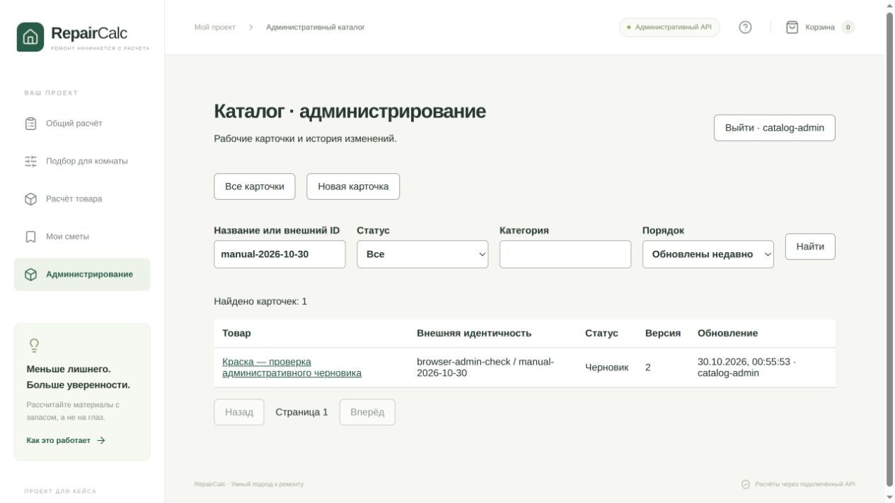

# Административный каталог: CRUD и доступ

Дата: 30.10.2026, Europe/Moscow. Логи Java/Docker содержат UTC за 29.10.2026. Рабочая копия `/home/artparve/projects/spb_tech_run_2026`, ветка `main`, базовый commit `70341e5f3dd91bbfb0f67c7e20c20ba9b2dd3874`, origin `git@github.com:artparve/HotProd_SPB_TECH_RUN.git`. Изменения находятся в рабочей копии. Контрольные суммы относящихся к реализации файлов: [source-manifest.json](source-manifest.json).

## Результат

Реализованы V5, серверная сессия одного именованного администратора, CSRF, ограничение входа, строгий контракт неполной карточки, создание/чтение/изменение, поиск/фильтры/пагинация, история и транзакционный аудит. Административный frontend использует реальный API в любом режиме витрины. Подробности и настройка: [документ реализации](../../../docs/admin-catalog-implementation.md), [OpenAPI](../../../docs/admin-catalog-api.json).

| Проверка | Результат | Свидетельство |
| --- | --- | --- |
| Полный Maven verify | PASS: 84 unit/API + 66 PostgreSQL IT, 0 failures/errors/skipped; exit 0 | [Окончательный лог](backend-final-verify.log) |
| Frontend unit/контракт/компоненты | PASS: 46 тестов, exit 0 | [Лог](frontend-verify.log) |
| TypeScript и production build | PASS, exit 0 | [Тот же лог](frontend-verify.log) |
| Вход, создание, изменение, конфликт, история, поиск, выход в настоящем браузере | PASS на изолированной БД и реальном Java API | Скриншоты и состояния ниже |
| Перезапуск Java и повторный вход | PASS: версия 2, цена, unknown и обе версии остались | [Состояние после перезапуска](browser-restart-state.txt) |
| Публичный UUID и изоляция черновика | PASS в CatalogImportIT; CLI не перепривязывает зарезервированную идентичность | Окончательный Maven-лог |
| Классификация, публикация, рекомендации, импорт | Не реализованы; приёмка всей спецификации не завершена | [Оставшийся объём](../../../docs/admin-catalog-implementation.md) |

Хост не предоставил JDK 21/рабочий JAVA_HOME, поэтому проверки выполнены в имеющихся локальных тестовых Docker-образах. Для каждого PostgreSQL IT Testcontainers создавал отдельную PostgreSQL 17.11. Новые тесты проверяют неизменяемость истории и уникальность, CSRF и сессии, положительные значения/единицы/типы, 400/401/403/409/412/413/422/428/429/503, конкурентные изменения (200 + 412), rollback новой версии при ошибке аудита, поиск/размер страниц. Frontend тесты отдельно проверяют сохранение несохранённых полей при 412 и явное перечитывание. Все старые тесты каталога и расчётов также прошли.

## Браузерный сценарий

Использованы временная сеть `repaircalc-admin-check`, PostgreSQL `repaircalc-admin-check-db`, Java на loopback `18080` и Vite/API-mode на `15173`. Постоянные Compose-сервисы не перезапускались. Использованы заведомо тестовые учётные данные из интеграционных тестов; реальные секреты не читались. Модели не запускались.

1. Вход через `/admin` создал серверную сессию.
2. Через форму создан товар `browser-admin-check / manual-2026-10-30`, UUID `a5cc205d-44b5-48d7-a741-e6c1cc25bc68`. Для `wet` выбрано «Явно неизвестно», цена оставлена незаполненной.
3. Во второй версии подтверждена цена `1234.50` с источником «Тестовая этикетка от 30.10.2026»; автор назначен сервером: `catalog-admin`.
4. Вторая вкладка сохранила устаревшую версию с изменённым именем. Сервер вернул 412; форма показала конфликт и сохранила введённое имя. [Скриншот конфликта](browser-conflict.png).
5. Явное перечитывание загрузило версию 2. История показала версии 1 и 2; неизвестность `wet` сохранилась. [Состояние карточки](browser-card-state.txt).
6. Поиск по внешнему ID вернул одну карточку с версией 2. [Скриншот](browser-list.png), [состояние списка](browser-list-state.txt). При заключительной проверке консоль браузера не содержала ошибок.
7. Выход вернул форму входа. После замены JAR на окончательный прошедший verify артефакт и перезапуска Java прежняя сессия пропала. Новый вход показал тот же UUID, версию 2, цену `1234.50`, `wet=unknown` и историю обеих версий.

Прямой снимок временной БД: [browser-db-evidence.json](browser-db-evidence.json). В нём две неизменяемые версии, две записи аудита и `publicRevisionCount=0`: создание административного черновика не выпустило публичный каталог. Готовность к публикации/расчёту этим сценарием не проверялась.



## Команды проверки

Из корня репозитория, пути и socket соответствуют этому хосту:

```bash
docker run --name repaircalc-admin-final-verification --cpus=2 --memory=1536m \
  -e JAVA_TOOL_OPTIONS='-XX:ActiveProcessorCount=2 -Xmx512m' \
  -e DOCKER_HOST=unix:///var/run/docker.sock \
  -e TESTCONTAINERS_HOST_OVERRIDE=host.docker.internal \
  -v /home/artparve/.docker/desktop/docker.sock:/var/run/docker.sock \
  -v "$PWD/backend/src:/build/src:ro" \
  -v "$PWD/backend/data:/build/data:ro" \
  --add-host host.docker.internal:host-gateway \
  repaircalc-backend-tests:local mvn -B verify \
  > reports/admin-catalog/2026-10-30/backend-final-verify.log 2>&1

docker run --rm --cpus=2 --memory=1024m \
  -v "$PWD/frontend/src:/app/src:ro" -v "$PWD/docs:/docs:ro" \
  repaircalc-frontend-tests:local sh -c 'npm test && npm run build' \
  > reports/admin-catalog/2026-10-30/frontend-verify.log 2>&1

git diff --check
```

Для браузерной проверки JAR извлечён из тестового контейнера и запущен с отдельной временной БД. Окончательная проверка восстановления использовала JAR из `repaircalc-admin-final-verification`; данные остались в том же контейнере PostgreSQL при перезапуске Java. Это проверка восстановления черновиков, а не будущих очередей/импорта. Сценарий выполнен вручную инструментами браузера; повторяемость API-части обеспечивают HTTP IT, UI-конфликта — компонентный тест.

Временные runtime-сервисы и сеть после проверки удалены; Vite остановлен. Изменения других параллельных задач в README/ignore-файлах/AGENTS сохранены.
