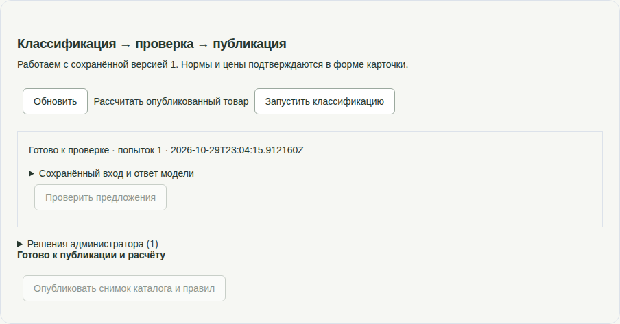

# Повторная проверка админки на сервере

30 октября 2026, Europe/Moscow. Проверено с пользовательского компьютера через **http://194.67.95.67**, без подмены API и ответов модели. Основная проверка — **http://194.67.95.67/admin**.

## Итог

Рабочая серверная версия обновлена до `4a2b0844bedb060dff8c3c6850011b356b583897`. Проверены форма карточки и панель классификации, решений и публикации. Путь **новая карточка → настоящее Ollama → проверка администратором → публикация → Java-расчёт** завершён в браузере. После перезапуска Java/worker выполнен новый вход и повторно проверены опубликованная панель и расчёт на desktop/mobile.

Результат: **5,28 л → 3 банки → 7,5 л куплено → остаток 2,22 л → 3 703,50 RUB**. Расчёт выполнен Java, `model=not-used`. Независимая арифметика Decimal совпала. Все **12 исходных товаров**, их поля и расчёты сохранены; публичный каталог содержит **13 товаров**. В административном хранилище оставлены три учебных черновика и одна опубликованная карточка этой приёмки.

Функциональных ошибок в пройденных административных сценариях не обнаружено. Небольшое замечание к интерфейсу: опубликованная карточка продолжает показывать «Готово к публикации и расчёту», а завершённое задание — «Готово к проверке», хотя проверка уже сохранена. Состояние карточки — «Опубликован», кнопки повторной проверки и публикации правильно отключены. Это неоднозначность текста, а не повторная публикация или потеря состояния. Производственные исходники в ходе проверки не менялись.

## Браузерные проверки сервера

Все тесты запущены локальным Playwright Chromium против публичного HTTP-адреса. Успешные прогоны: **12 сценариев**, из них шесть непосредственно относятся к админке, шесть — к публичному UI.

| Сценарии | Результат | Свидетельство |
| --- | --- | --- |
| Desktop/mobile: вход, создание полной карточки, сохранение версии, два редактора, HTTP 412 с сохранением введённых полей, явное перечитывание, история, поиск, блокировка публикации, выход | 2 PASS | [Лог CRUD](remote-admin-crud.log), [тест](remote-admin.spec.ts) |
| Свежая карточка: постановка задания, отключение повторного запуска, автоматическое появление результата без reload, решения с основаниями, выбор профиля, готовность, публикация и расчёт | 1 PASS | [Окончательный полный прогон](remote-workflow-final.log), [серверное состояние](runtime-summary.json) |
| Desktop/mobile: после рестарта сохранены результат, одна проверка и публикация; повторные проверка/публикация отключены; ссылка ведёт на нужный UUID; повторный расчёт совпадает | 2 PASS | [Окончательный лог](remote-final-ui.log), [тест](remote-persistence.spec.ts) |
| Сохранение новой версии с неизвестной нормой делает прежний реальный результат устаревшим; использовать его нельзя, публикация отключена | 1 PASS | [Лог](remote-negative.log), [тест](remote-negative.spec.ts), [снимок](stale-and-no-norm.png) |
| Desktop/mobile: Java-расчёт исходной краски без LLM, отказ товара без нормы, неизвестный ID, геометрическая валидация и ширина страницы | 6 PASS | [Окончательный лог](remote-final-ui.log), [тест](remote-public.spec.ts) |

В отрицательном UI-сценарии readiness сначала сообщает об отсутствии проверки текущей версии; отдельный блокер нормы появляется после наличия подходящей проверки. Отказ публикации уже проверенного товара без нормы дополнительно покрыт `AdminWorkflowIT`. Ошибка модели, восстановление аренды и конкурентная публикация повторно проверялись автоматическими Java/Python-тестами; намеренный отказ Ollama в рабочем серверном стеке не создавался.



[Мобильная панель](published-panel-mobile.png), [мобильная заблокированная публикация](admin-panel-mobile.png), [готовность перед публикацией](remote-admin-ready.png), [результат калькулятора](remote-calculation.png).

## Проверки компонентов

| Проверка | Результат | Лог |
| --- | --- | --- |
| Полный Maven verify в локальном тестовом контейнере: все unit/API и все PostgreSQL IT | **86 + 68**, failures/errors/skipped = 0, exit 0 | [java-verify.log](java-verify.log) |
| Frontend: формат, TypeScript, unit/компонентные/контрактные тесты и production build | **48 PASS**, exit 0 | [frontend-check.log](frontend-check.log) |
| Classifier и очередь на отдельной мигрированной БД, без inference | **28 PASS**, exit 0 | [services.log](services.log) |
| Штатный Playwright деморежима, desktop/mobile | **14 PASS**, exit 0 | [ui-e2e.log](ui-e2e.log) |
| Сравнение всех исходных серверных товаров и расчётов до/после обновления и публикации | **12 сохранены**, итог 13 | [до](calculations-before.json), [после обновления](calculations-after-deploy.json), [после публикации](calculations-after-publication.json) |
| Независимый Decimal-пересчёт фактического Java-ответа | PASS | [скрипт](independent-check.py), [результат](independent-result.json), [Java-ответ](remote-calculation.json) |

## Идентификаторы окончательного серверного прогона

- Товар: `51903e1c-a3c0-4a8a-8689-5cc564ba8076`, состояние `published`.
- Job: `d27c9e0c-c102-4363-bd95-ae35af545674`, `succeeded`, одна попытка, `gemma4:12b`; от создания до завершения **14,247 с** по БД. Серверная Ollama использовала GPU. Полный браузерный сценарий занял 22 с.
- Проверка: `1968698d-797c-4a33-9cea-e4c569e4a247`, профиль `paint-012-v1`.
- Catalog release: `cdc1ab71-fa87-4a41-896c-96c6aadfe7e9`.
- Rule set: `09cac74b-6797-454d-a369-b719d9dadb71`.

Модельные предложения и решения администратора сохранены раздельно в [runtime-summary.json](runtime-summary.json). Свойства, не подтверждённые учебным описанием, исправлены на `unknown`; внутреннее применение подтверждено. Это приёмка маршрута обработки, а не измерение качества классификации на корпусе и не подтверждение производственной нормы.

## Обновление сервера и воспроизведение

До обновления `/opt/repaircalc` не содержал `.git`, база имела только V1–V4, classifier-worker отсутствовал. Коммиты `240dd9a` и `4a2b084` отправлены в `origin/main`. Сервер не имел доступа к приватному GitHub; использован полный Git bundle, созданный из `main`, проверенный локально и клонированный на сервере. Origin новой копии настроен на `git@github.com:artparve/HotProd_SPB_TECH_RUN.git`; последующий прямой fetch потребует серверной GitHub-авторизации.

Прежняя поставка, конфигурация и дамп PostgreSQL сохранены на сервере в `/opt/repaircalc-backups/2026-10-30-recheck/`. Данные PostgreSQL/Ollama не удалялись, модели не скачивались. Backend и classifier собраны на сервере. Серверный npm registry не отвечал; frontend собран локально из того же коммита с `VITE_DATA_MODE=api`, образ `repaircalc-frontend:recheck` передан и помечен `repaircalc-frontend:local`. [Локальная сборка frontend-образа](frontend-image.log).

Применены V5–V7, запущен classifier-worker; backend/frontend/estimator/PostgreSQL/Ollama проверены по health. Создан `catalog-admin` со случайным паролем. В Git и отчёты пароль не включён; данные входа выданы отдельно. Хеш и `ADMIN_COOKIE_SECURE=false` для запрошенного HTTP-адреса сохранены в существующем игнорируемом `docker/docker-compose.override.yml` на сервере; обычная Compose-команда из проекта продолжит использовать их. Compose config прошёл, серверная Git-копия чистая.

Для повторения UI-тестов с компьютера нужны установленный Chromium и временный `/tmp/repaircalc-admin-recheck.json` с `username`/`password`. Запуск из корня checkout:

```bash
frontend/node_modules/.bin/playwright test \
  --config reports/admin-workflow/2026-10-30-recheck/remote.config.ts \
  remote-admin.spec.ts remote-persistence.spec.ts remote-public.spec.ts
python3 reports/admin-workflow/2026-10-30-recheck/independent-check.py
```

Полный workflow-тест создаёт и публикует **новый учебный товар** при каждом запуске. `remote-negative.spec.ts` использует конкретную неопубликованную учебную карточку этого прогона. Трассировка административных тестов отключена для защиты пароля. Первоначальные `setup.py`/`start-services.py` относятся только к одноразовой локальной подготовке; этот стенд и Vite после серверной приёмки остановлены и удалены.

## Промежуточные сбои

Начальный запуск штатных UI-тестов не нашёл Chromium; после его установки прошли все 14. Первый серверный CRUD-тест совпал с перезапуском frontend и получил 502; после окончания обновления desktop/mobile CRUD прошли. В первых workflow-тестах использовался неподходящий `getByLabel` для вложенного select; он заменён на `getByRole('combobox', ...)`, затем свежий полный сценарий прошёл без ручного refresh. Эти промежуточные логи оставлены: [первый прогон](remote-admin-ui.log), [продолжение](remote-workflow.log).

Во время первого прогона после рестарта временно пропало внешнее HTTP/SSH-соединение (`ECONNREFUSED`, `Connection reset by peer`). Причина внешнего обрыва не установлена. После восстановления HTTP 200, повторного входа и нового прогона все восемь финальных UI-сценариев прошли; сравнение 12 товаров также прошло. [Неудавшийся сетевой прогон](remote-final-ui-connection-error.log) сохранён. Это ограничивает вывод: подтверждено восстановленное состояние, но причина сетевого сбоя не диагностирована.
