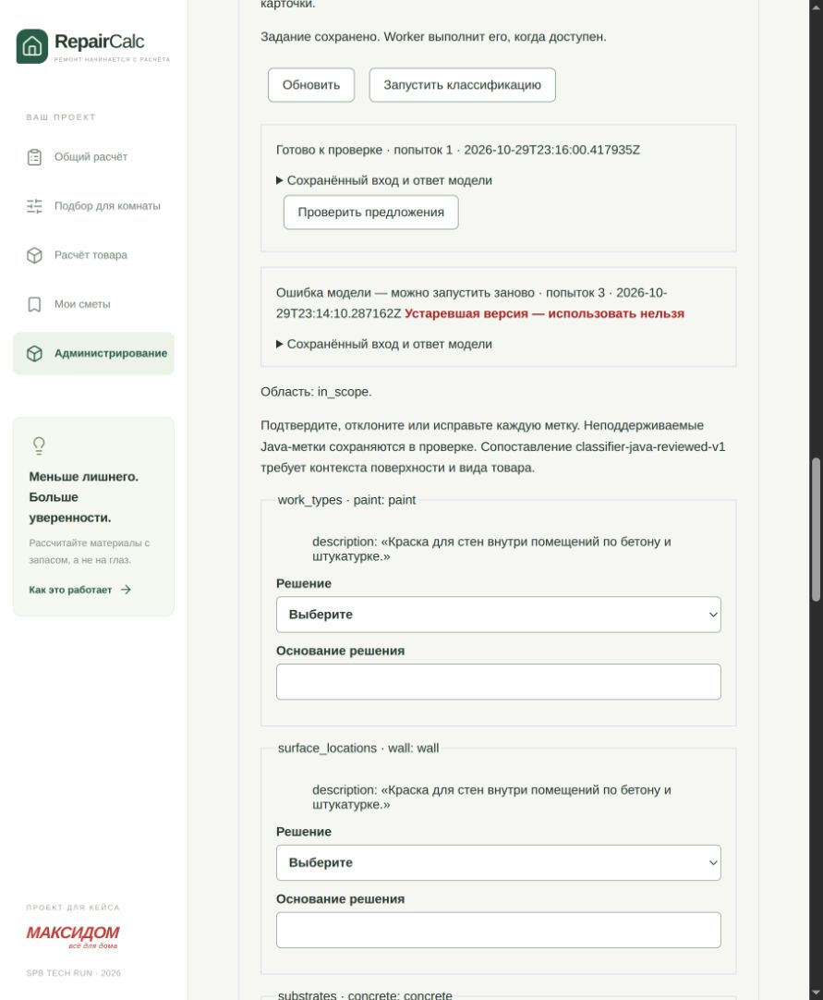

# Живая демонстрация в браузере приложения

30.10.2026, после автоматической приёмки. Через видимый in-app browser выполнены вход, создание карточки, ввод описания и запуск настоящего классификатора.

Карточка: http://194.67.95.67/admin/products/c4cc7fcc-d06f-4d86-8634-bec27dd4c6b9 — «Демонстрация — интерьерная краска для стен», namespace `live-demo`.

Версия 1 содержала расширенное описание матовой акриловой краски для внутренних сухих помещений, бетона и цементной штукатурки. Категория не была заполнена. Все три попытки задания от `2026-10-29T23:14:10.287162Z` завершились `classification_failed`. UI показал ошибку, сохранил вход и позволил повторный запуск. Точная причина отказа этим показом не диагностирована.

Для версии 2 одновременно сокращено описание до «Краска для стен внутри помещений по бетону и штукатурке. Расход 0.12 л/м² на слой. Банка 2.5 л. Влагостойкость не заявлена.» и подтверждена демонстрационная категория «Краски». Новое задание от `2026-10-29T23:16:00.417935Z` завершилось с первой попытки: `gemma4:12b`, `in_scope`, `paint`, `wall`, `concrete`, `plaster`, цитаты из description. UI автоматически показал «Готово к проверке». По этой демонстрации нельзя установить, какое из двух изменений повлияло на успех.

Есть содержательная ошибка модели: фраза «Влагостойкость не заявлена» дала `moisture_resistant=no`, хотя корректная административная оценка — `unknown`. `needs_review=false` у модели не устраняет необходимость ручной проверки. Решения не сохранялись, публикация не выполнялась. В приложении оставлена открытая форма проверки предложений; исходная неудачная версия сохранена в истории.

