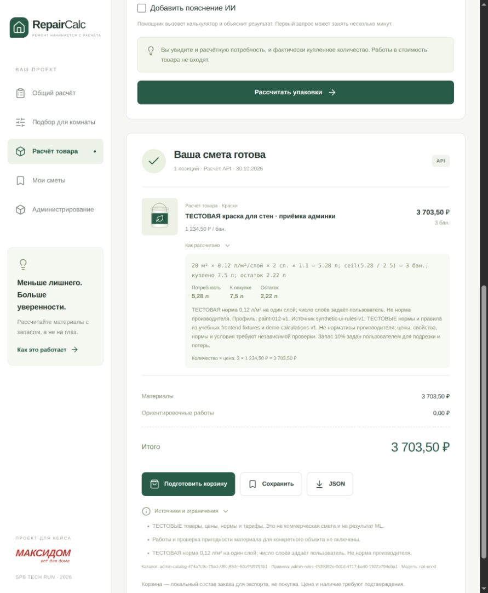

# Приёмка ручной вертикали административного каталога

30.10.2026, Europe/Moscow. Checkout `/home/artparve/projects/spb_tech_run_2026`, ветка `main`, origin `git@github.com:artparve/HotProd_SPB_TECH_RUN.git`. Первоначальная поставка CRUD сохранена отдельным коммитом `240dd9a`, включая обновление корневого README. Этот отчёт относится к последующему изменению; [manifest](source-manifest.json) содержит SHA-256 конкретных исходников. Внутренние timestamps Java/PostgreSQL/Ollama — UTC за 29.10.2026; браузер показывает локальную дату 30 октября.

## Результат и границы

Пройден путь **новая карточка → настоящее Ollama → решения человека → публикация новой пары catalog/rules → Java-расчёт в реальном браузере**. Существующий Compose-стек не обновлялся. Использованы отдельные PostgreSQL/API/worker и Vite на loopback; inference направлен в уже имеющийся `repaircalc-ollama-1` с установленной `gemma4:12b`. Модели не скачивались. Никакие реальные `.env`/секреты не читались; стенд использовал только открытые тестовые учётные данные из API IT.

Публикация ограничена текущей учебной `dataClass=test` и существующими проверенными профилями. Отдельные произвольные производственные нормы не создавались. Сопоставление Python/Java закрывает четыре описанных в [документации](../../../docs/admin-workflow.md) случая, а не весь словарь Python. Архив, очередь внимания, пакетный импорт и серверные рекомендации не реализованы этим изменением.

| Проверка | Результат | Свидетельство |
| --- | --- | --- |
| Java unit/API + целевые PostgreSQL IT | PASS: 86 + 28, 0 failures/errors/skipped; exit 0 | [Окончательный прогон](java-acceptance-verify.log) |
| Две конкурирующие публикации | PASS: 2 unit + 1 workflow IT; итог 15 товаров, оба новых и все исходные сохранены; exit 0 | [Целевой прогон](java-concurrency-verify.log) |
| Frontend формат, TypeScript, unit/контракт/компоненты, production build | PASS: 48 тестов; exit 0 | [Окончательный make check](frontend-acceptance-check.log) |
| Python classifier + PostgreSQL queue | PASS: 28 тестов, exit 0; LLM не вызывается | [Окончательный лог](classifier-final-tests.log) |
| Настоящий inference | PASS: `gemma4:12b`, CPU, 16384 context, 8 threads, одна попытка | [Ответ, input, metadata и job в БД](runtime-evidence.json) |
| Ошибка Ollama и явный повтор | PASS: реальный отказ TCP на порту 9, 3 попытки, карточка сохранена; новый запуск создаёт другой job | [Результат](model-error-result.json), [лог](model-error.log), [скрипт](queue-model-error.py) |
| Нет нормы | PASS: проверенная классификация не снимает блокировку, публикация 422 и старый release сохранён | `AdminWorkflowIT`, [лог](java-acceptance-verify.log) |
| Устаревший результат | PASS: после сохранения версии 2 результат версии 1 не принимается; 409; HTTP If-Match 428/412 проверены отдельно | Тот же IT и `AdminProductApiIT` |
| Потеря worker/аренды | PASS: просроченная аренда переиздана; старый token не записывает результат; потеря последней попытки даёт failed; два потребителя не дублируют claim | `tests/test_worker.py`, [лог](classifier-final-tests.log) |
| Rollback при ошибке финального аудита | PASS: откат нового каталога/правил/активации, исходный release и единственный catalog сохранены | `AdminWorkflowIT` |
| Сохранение исходного каталога и расчётов | PASS: поля всех 12 старых товаров, 11 успешных расчётов и прежний 422 совпали; каталог вырос до 13 | [До](calculations-before.json), [после](calculations-after.json), [скрипт](calc-regression.py) |
| Независимая арифметика | PASS: Decimal без использования Java/Python estimator formulas | [Скрипт](independent-check.py), [результат](independent-result.json) |
| Перезапуск Java и worker | PASS: новая сессия, тот же successful job, review, публикация и повторный расчёт | [Состояние после рестарта](browser-restart-state.txt), [снимок БД после рестарта](runtime-evidence.json) |
| OpenAPI/Zod | PASS: маршруты и ссылки валидируются frontend contract test | Frontend-лог |
| Compose из примера, diff whitespace | PASS, exit 0 | [Compose](compose-check.log), `git diff --check` |

Первый повторный Java-прогон завершился с ошибкой тестового порядка: новый HTTP-тест попал после теста исчерпания login rate limit и получил 429. Rate-limit тест перенесён последним; следующий полный целевой прогон прошёл. Runtime JAR взят из успешной сборки этого промежуточного прогона; после него производственные Java-исходники не менялись, менялись порядок HTTP-тестов и тест конкурентных публикаций. SHA-256 JAR записан в manifest. Лог не скрыт: [промежуточная ошибка](java-final-verify.log). Полный набор всех PostgreSQL IT не запускался: выбраны административный CRUD/persistence/workflow, CLI-каталог и правила. Unit/API-тесты Maven выполнены полностью.

## Настоящий браузерный сценарий

Тестовый frontend `http://127.0.0.1:15174` обращался к настоящему Java API `127.0.0.1:18081`. Тестовая PostgreSQL `repaircalc-workflow-db` и worker из нового образа использовали отдельную сеть `repaircalc-workflow-check`; только worker дополнительно подключён к существующей сети Ollama.

1. В браузере выполнен вход `catalog-admin`. Через форму создан товар `browser-workflow / paint-2026-10-30`, UUID **`d423fa38-ae71-41d5-b895-fc937bab1761`**. Цена **1234.50 RUB**, фасовка **2.5 л**, учебная норма **0.12 л/м²/слой**, подтверждённый источник и дата 30.10.2026. Условия среды оставлены `unset`.
2. В UI запущено задание **`5a273fa7-0494-4ed8-914c-88ee2b871211`** для версии **`4bbbe8a2-ae69-435e-b8d1-fee4f3aa96f6`**. Оно сохранено в 01:23:39 и завершилось в 01:26:47 по Москве. Ollama сообщил total_duration **186.421 s**, 3608 prompt tokens, 569 generated tokens, done_reason=stop. В БД сохранены нормализованный input, hashes prompt/taxonomy/input, модель, metadata и валидированный классификационный ответ. Это один реальный прогон, не оценка качества классификатора на корпусе.
3. Модель предложила `paint`, `wall`, `concrete`, `plaster`; каждое предложение имеет дословную цитату. Подтверждены метки и применение внутри помещения. `exterior_suitable=no` исправлено на `unknown`: внутреннее применение не доказывает непригодность снаружи. `wet_room_suitable=no` также исправлено на `unknown`: «не заявлена» не означает «не подходит». `frost_resistant` отклонено как неподтверждённое; остальные неизвестности сохранены явно. Все **11** решений получили основания. Выбран существующий учебный профиль `paint-012-v1`.
4. Проверка **`d702c99f-d8cc-473d-b832-e7d259352787`** сохранена отдельно от ответа модели. В снимке БД исходные модельные `no` остались `no`, а утверждённые значения — `unknown`. Булевы свойства публичного товара остались null, а не false. [Состояние UI](browser-review-state.txt), [готовность](browser-ready.png).
5. Нажата публикация. Получены catalog release **`474a7c9c-79ad-48fc-864e-53a9fd9793b1`** и rule set **`4539d82e-0d1d-4717-ba40-1922a794eba1`**. Новый каталог содержит 13 товаров; все старые товары и назначения правил сохранены.
6. По ссылке «Рассчитать опубликованный товар» открыт калькулятор именно этого UUID. Пояснение ИИ отключено, чтобы приёмка отдельно проверила Java. Параметры: 20 м², 2 слоя, 10% запас. В реально отрисованном результате: **5.28 л**, **3 банки**, куплено **7.5 л**, остаток **2.22 л**, **3703.50 RUB**, работы **0.00**, `model=not-used`. Формула и версии раскрыты в UI; ошибок console на этом этапе нет. [Текст UI](browser-calculation-state.txt).
7. Перезапущены только тестовые Java/worker. После нового входа UI сохранил результат, проверку, публикацию и возможность расчёта. Повторный браузерный расчёт снова дал 3 банки и 3703.50 RUB.



Независимый расчёт: `20 × 0.12 × 2 × 1.10 = 5.28`; `ceil(5.28 / 2.5) = 3`; `3 × 2.5 = 7.5`; `7.5 − 5.28 = 2.22`; `3 × 1234.50 = 3703.50`. Он проверен Python Decimal-скриптом по фактическому Java-ответу.

## Повторение проверок

Из корня checkout на этом хосте. Java запускается в локальном тестовом образе, потому что JDK 21 на хосте отсутствует:

```bash
docker run --name repaircalc-workflow-recheck --cpus=2 --memory=1536m \
  -e JAVA_TOOL_OPTIONS='-XX:ActiveProcessorCount=2 -Xmx512m' \
  -e DOCKER_HOST=unix:///var/run/docker.sock \
  -e TESTCONTAINERS_HOST_OVERRIDE=host.docker.internal \
  -v /home/artparve/.docker/desktop/docker.sock:/var/run/docker.sock \
  -v "$PWD/backend/src:/build/src:ro" -v "$PWD/backend/data:/build/data:ro" \
  --add-host host.docker.internal:host-gateway repaircalc-backend-tests:local \
  mvn -B -Dit.test=AdminWorkflowIT,AdminProductApiIT,AdminProductPersistenceIT,CatalogImportIT,RuleSetImportIT verify \
  > /tmp/repaircalc-workflow-java.log 2>&1
# Сохраните exit code и проверьте итог, не только grep PASS.
make check
cmp backend/src/main/resources/classification-taxonomy.json backend/classification/repaircalc_classifier/taxonomy.json
DB_PASSWORD=workflow-config-only docker compose --env-file env/.env.example -f docker/docker-compose.yml --profile llm config --quiet
python3 reports/admin-workflow/2026-10-30/independent-check.py
```

Очередные Python IT требуют **отдельной одноразовой БД с применёнными V1–V7**, `CLASSIFIER_QUEUE_TESTS=1` и стандартных `PG*` параметров; они создают тестовые версии и не удаляют неизменяемую историю. В этой приёмке выполнены через `repaircalc-classifier-workflow:local` с bind mount каталога tests, команда `python -m unittest discover -s tests`. [Лог сборки образа](classifier-build.log). Для намеренно сломанного Ollama основной worker был остановлен, а test script сокращал только задержку между попытками посредством `available_at=now()`; сам отказ соединения и сохранение состояния проходили через настоящий Python-модуль и PostgreSQL.

Скрипты в этом каталоге содержат только открытые тестовые параметры и зависят от названий временного стенда. Они не предназначены для запуска против рабочей БД. После сохранения evidence временные runtime-контейнеры/сеть удалены, Vite остановлен; исходный Compose-стек и его данные сохранены.
